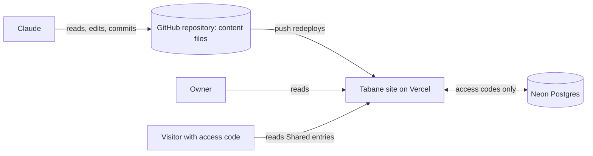

# Project Tabane

2026-10-25 · Kyle Q. Zoleta

## Overview

Project Tabane is Moeko Works' private website and repository for ultra-fast rapid prototyping. It gathers proven UI/UX and backend pieces from existing projects, plus researched and hand-picked ones, into one personal library that new projects can start from. It works as a personal notebook and guide, written by and for Moeko Works.

## Purpose

Tabane exists so that no new project starts from a blank page. Every interface, flow or backend that has already worked once should be easy to find, understand and reuse. The same goes for good ideas found elsewhere that could be adopted later.

The goal is speed: go from an idea to a working prototype by combining what is already built, instead of rebuilding it.

## Core principles

- **Reusability first.** Old UI/UX and backend are kept in a form that can be lifted into a new project with little rework.
- **Speed.** Prototyping should take as few steps as possible, from picking a pattern to running it.
- **Forward-looking.** New researched UI/UX and backend that may be implemented in the future are stored alongside what is already proven.
- **Personal and private.** Tabane is a notebook for Moeko Works, not a public product, so it is organized around how I work.

## What goes inside

Each source maps onto the Origin and Status tags in Organizing entries.

| Source | What it holds | Origin | Starting status |
|---|---|---|---|
| Existing projects | UI/UX components, layouts and backend logic already built and working | Own project | Proven |
| Selected websites | Sites chosen for design or functionality worth borrowing | Researched | Candidate |
| Created pieces | Patterns and snippets built specifically to be reused | Created for Tabane | Proven once used in a project, Candidate until then |
| Future ideas | New UI/UX and backend approaches that could be implemented later | Researched or Created for Tabane | Candidate |

## How it is used

Claude is the only one who updates Tabane. I read it on the site and think with it; Claude writes to it.

| Step | Who | What happens |
|---|---|---|
| 1. Fill | Claude | Adds many concepts as entries: pieces from my projects, researched sites and ideas, all in the fixed Entry model |
| 2. Deliberate | Me and Claude | When I have a new idea or project, I talk the plan through with Claude, who reads Tabane's existing entries and playbooks to suggest what to reuse and what is missing |
| 3. Build | Me and Claude | The new project pulls in the reusable parts, and only what it needs is adjusted, to get a prototype running |
| 4. Update | Claude, when I ask | When I think of something, or a project produces something worth keeping, I ask Claude to update the site: new entries, changed statuses, new playbooks |

So Tabane has one writer (Claude) and two readers (me on the site, Claude while deliberating). Everything is shaped around that: entries must be easy for Claude to write the same way every time and easy for me to browse.

## Platform and stack

Tabane is a single site built from files in its own repository. Entries and playbooks are files, so Claude reads and writes them directly and the site turns them into pages.

- **Content:** entries, playbooks, diagrams and images are files in the repository's content folder (see Data and storage). The repository is the single source of truth.
- **Front end:** where I, and visitors with an access code, browse and read entries. It is read-only: there is no page for adding or editing entries.
- **Back end:** Next.js server code that reads the content files, decides what each viewer may see, and handles login and access codes.
- **Stack:** Next.js with React and TypeScript, matching the Moeko Works Portfolio.
- **Repository:** [PastelSalt/project-tabane](https://github.com/PastelSalt/project-tabane), private, since it holds private notes and links. The local copy is `C:\Users\Myaako\Documents\MoekoWorks\project-tabane`.
- **Hosting:** deployed on Vercel. Every push to GitHub redeploys the site. Claude commits locally, and pushes only when I say so. The site uses its free `*.vercel.app` address, with no custom domain.
- **Database:** Neon Postgres, used only for access codes.

## System at a glance



Claude is the only writer: it edits the content files in a local copy of the repository and commits; when I say to push, Vercel redeploys the site. The owner and visitors only read, through the site. Neon holds nothing but access codes.

## Entry format

Entries from my own projects are copied into Tabane together with a link to the live site and a link to its repository. Researched sites are recorded through my own wireframes and notes plus a link to the live site, never copies of their code, images or text. What each entry holds depends on its layer.

| Layer | What the entry contains |
|---|---|
| UI/UX | A wireframe, plus where the concept came from: the live site, whether it is my own project or something I researched |
| Backend | Technical details of how it operates, plus diagrams in levels: the whole system first, then a second level, then a third and lower level, so each diagram stays clean and readable |

A piece that has both an interface and a backend becomes two entries, one per layer, linked to each other through Related entries.

## Organizing entries

Tags, so any entry can be found from several angles and Claude can filter them reliably. Every tag takes its values from a fixed list kept in `content/tags.yml`, so the same thing is never spelled two ways. New values are added to the list first, then used.

| Tag | Values |
|---|---|
| Layer | UI/UX, Backend |
| Origin | Own project, Researched, Created for Tabane |
| Stack | Starting list below |
| Feature | Starting list below |
| Status | Proven (live and working), Candidate (researched or created, not yet used in a project) or Outdated (the source changed or is gone) |
| Target | Website, Mobile Application, Desktop Application |

Full stack is not a Target value: it is shown by a UI/UX entry and a Backend entry linked through Related entries.

### Starting values

Taken from the five first projects and the features named so far.

| Tag | Starting values |
|---|---|
| Stack | HTML, CSS, JavaScript, TypeScript, React, Next.js, Preact, Astro, Material UI, GSAP, Node.js, C, SDL 3, FreeType, Neon Postgres |
| Feature | Auth, Admin panel, Dashboard, Cards, Gallery, Forms, Search, Timeline, Countdown, Statistics, Layout, Editor, Export pipeline |

## Entry model

Every entry uses the same fields, so people and Claude can read any entry the same way. The tags come from Organizing entries; the other fields come from the Entry format section. In the entry file, Technical details is the Markdown body and every other field sits in the front matter at the top.

| Field | Applies to | Holds |
|---|---|---|
| Title | All | Short name of the pattern or piece |
| Layer | All | UI/UX or Backend |
| Origin | All | Own project, Researched, or Created for Tabane |
| Stack | All | Language, framework and database used, from the Stack list |
| Feature | All | What it does, from the Feature list |
| Status | All | Proven, Candidate or Outdated |
| Target | All | Website, Mobile Application or Desktop Application |
| Reuse note | All | One or two lines on when to reuse it, so Claude can pick the right entry quickly |
| Live site link | When one exists | The live site the concept came from, whether my own project or researched. Future ideas, created pieces and many backend entries have none |
| Embeddable | With a live site link | Whether the live site can be shown in a frame on the entry page. Many sites refuse, and a browser cannot reliably tell, so Claude records it when creating the entry; when false, the screenshot is shown instead |
| Repository link | Own projects | The project's repository |
| Code location | Own projects | The repository path and commit or tag where the reusable code lives, so it can be lifted without searching |
| Key code | Own projects, optional | A short excerpt of the code that makes the piece work (a few dozen lines at most), in a "Key code" part of the body. The full code stays in the project's repository |
| Source and license | Researched | Where the idea came from and any license or usage terms, so Shared entries don't pass on someone else's work |
| Wireframe | UI/UX | A wireframe of the interface, an SVG or PNG file in the entry's folder |
| Screenshot | UI/UX with a live site, and every Mobile or Desktop Application entry | PNGs in the entry's folder, saved when the entry is created. Shown if the live site cannot be embedded or is offline, and always for apps, which cannot be embedded |
| Clip | Mobile or Desktop Application, optional | A short silent clip of the piece in use, shown only on the entry page and never on cards |
| Technical details | All | How it operates: the techniques and stack for UI/UX, the backend logic for backend |
| Diagrams | Backend | Mermaid files in the entry's folder, so Claude can read them. The front matter lists each diagram with its ID, level (1 for the whole system, then 2, 3 and lower), parent diagram ID and file name, so the levels link to each other |
| Related entries | All | The folder names (slugs) of other entries this one pairs with, such as the Backend entry behind a UI/UX entry |
| Shared | All | Off by default; only Shared entries are visible to someone using an access code |
| Used in | All | The projects that have reused this entry, added after a project built with Tabane |
| Last checked | When a live site exists | The date the link check last found the live site working |
| Created and updated | All | Dates, used for the default newest-first order |

**Status rule:** an entry starts as Candidate unless it comes from my own live project. It becomes Proven when its first project is added to Used in, and Outdated when the link check finds its live site gone or changed and the entry no longer matches.

## Data and storage

Entries and playbooks are files in the repository; Neon holds only access codes.

### Content folder

```text
content/
  tags.yml                         the fixed list for every tag
  entries/
    kotoha-stream-countdown/       one folder per entry, named by its slug
      entry.md                     front matter fields + technical details
      wireframe.svg                UI/UX entries
      screenshot.png               UI/UX entries with a live site
    portfolio-cookieless-stats/
      entry.md
      level-1-system.mmd           backend diagrams, one file per diagram
      level-2-collector.mmd
  playbooks/
    replicate-kotoha-fan-site.md   one file per playbook, front matter + steps
```

- **Entries:** one folder per entry. `entry.md` holds every field of the Entry model, with images and diagrams as files next to it.
- **Naming:** folder and file names are lowercase words joined by hyphens. Entries from a project start with the project's short name (`kotoha-`, `hanon-`, `portfolio-`, `himawari-`, `aqua-iro-`), then the piece (`kotoha-stream-countdown`). Researched entries start with the site's name. Playbooks start with what they do (`replicate-`, `idea-`, `workflow-`). Diagrams are `level-<n>-<name>.mmd`.
- **Playbooks:** one Markdown file per playbook, with the Playbook fields in the front matter and the steps in the body. Based on lists entry slugs.
- **Checked on every build:** a schema check validates every entry and playbook against the Entry model, the Playbook fields and `tags.yml`. A missing field, an unknown tag value or a broken link to another entry fails the build, so a bad update never reaches the site.
- **Images:** stored in the repository and served through the site, so the same gate, login and Shared rules protect them as the entries.
- **Neon:** one `access_codes` table with hashed codes, created, redeemed and revoked times. The site is the only thing that connects to it.
- **Who sees what:** pages are rendered on the server for each request, so entries that are not Shared are never sent to a visitor's browser.
- **Search:** a search index built from the content files over title, feature and reuse note, plus the tag filters, newest first by default. Search runs on the server against the viewer's allowed entries, so a visitor's results, and anything sent to their browser, only ever contain Shared entries.
- **Other people's work in images:** screenshots that show someone else's art or content, such as fan art on the Kotoha and Hanon sites, have that part blurred before saving. If the piece cannot be shown without it, the entry is not Shared.
- **History:** every change is a Git commit, so any entry can be traced or rolled back.

## How Claude works on Tabane

Tabane will be worked on by me and Claude over a long time, and Claude is the only one who writes to it. Its content must be easy for Claude to read and understand without extra explanation, and every update must come out the same way, which is why every entry uses the fixed fields in the Entry model.

- **Instructions in the repository:** a CLAUDE.md file in the Tabane repository explains the content folder, the Entry model, `tags.yml`, the naming rules, the image rules and the exact steps for adding or updating an entry or playbook, so every Claude session works on Tabane the same way. It is the first file written when the repository is created.
- **Access to my project code:** all my project repositories are cloned under `C:\Users\Myaako\Documents\MoekoWorks\`, next to Tabane. Claude reads them there to write entries, Key code excerpts and replication guides, and to lift code into a new project. Claude pulls the latest commit before reading, and never commits to those repositories while working on Tabane.
- **Templates:** a template `entry.md` and playbook file in the repository, so every new file starts with the right fields.
- **Reading while deliberating:** Claude reads the content files straight from a local copy of the repository, filtering by the tags in the front matter. No database or site access is needed.
- **Writing when asked:** Claude only updates Tabane when I ask. Each update edits or adds files, runs the schema check and commits with a message saying what changed. Claude does not push, or ask to push, after every update: commits wait locally until I say to push, and the push redeploys the site.
- **LOG.md:** a log at the root of the repository records both my actions (decisions, answers, requests) and Claude's actions (what was changed and why), newest first, one line each, so either of us can see what happened and when.
- **New tag values:** Claude adds a value to `tags.yml` first and tells me, rather than inventing spellings inside an entry.
- **After a project:** when a project we planned with Tabane is built, Claude adds it to Used in on every entry it reused (which moves Candidates to Proven) and adds any new pieces it produced as entries.

### How entries are made

| Part | How Claude makes it |
|---|---|
| Wireframe | Hand-written SVG: grey boxes, labels and lines only, no colors or real content, at 1440 px wide for desktop layouts or 390 px for phone layouts |
| Screenshot | Taken by a Playwright script in the repository at fixed sizes: 1440 × 900 for desktop and 390 × 844 for phone, saved as PNG |
| App screenshots and clips | Taken from the running app on my machine, since apps have no live site |
| Diagrams | Written as Mermaid, level 1 first, then a level-2 diagram for each part of level 1 that needs more detail |
| Researched entries | Added only when I ask, either for a site I name or for one Claude suggested while we were deliberating and I agreed to |

### Keeping entries current

A link-check script in the repository visits every live site link and records the result. Claude runs it when I ask, updates Last checked, and for any site that is gone or has changed, marks the entry Outdated or updates it, and tells me which.

A pipeline built for Claude's convenience can be added later, such as a single command for "add entry" or "update status".

## Site map

The front end is where I browse and read entries. It has no pages for adding or editing entries, because Claude makes every change.

| Area | Purpose | Who sees it |
|---|---|---|
| Sign in | Owner login, or entering a one-time access code | Everyone |
| Library | Home page: a grid of design concept cards, filterable by the tags in Organizing entries | Owner and visitors |
| Entry page | Opened from a card: the wireframe, the already deployed site (or screenshots and clip for apps), the technical details, the source and repository links, related entries, the projects it was used in, and for backend entries the clickable diagram with its levels | Owner and visitors |
| Access codes | Generate, list and revoke one-time codes inside the website | Owner only |
| Playbook | Personal, repeatable guides for replicating projects and ideas, each on its own page | Owner only |

## Access system in detail

| Way in | How it works |
|---|---|
| Owner login | Sign in with GitHub, allowed for my GitHub account (PastelSalt) only, checked by its account ID. Full access: every entry, the Playbook and managing codes. There is no separate password to protect, and GitHub's two-factor sign-in covers it |
| One-time access code | I generate and set it inside the website. It expires and also works only once. I can hand it to anyone, such as a potential client or an employer, so that someone other than me can get in |

How a code works:

- A code can be redeemed once, within 48 hours of being created.
- Redeeming it starts the visitor's session, which ends when those 48 hours are up. Using the code again after that is refused.
- I can revoke a code at any time, which also ends any session it started.
- Codes are stored hashed in Neon, and code entry is rate limited so codes cannot be guessed.
- The GitHub sign-in keys and my allowed GitHub account ID are kept in Vercel environment variables, not in Neon or the repository.

Visitors using a code are read-only and never reach the owner-only areas (the access codes page and the Playbook). A code shows only entries marked Shared, and links to private repositories stay hidden unless shared.

The login and access codes are built last, as the final update after everything else, so they don't get in the way in the middle of coding.

### Before login exists

The deployed site is kept out of public view from the first deploy with a simple password gate: Next.js middleware checks a single password held in a Vercel environment variable and sets a cookie. Every page is also marked noindex so search engines skip it. The gate is removed when the real login and access codes arrive.

## Playbook

The Playbook is the personal, repeatable side of Tabane. Entries record what a piece is; the Playbook records how I rebuild or apply it. Claude writes each playbook from what I tell it and from what we worked out while deliberating; it is for me and only I need to fully understand it, and Claude reads it and follows it too.

### What it holds

| Kind | What it is | Example |
|---|---|---|
| Replication guide | Steps to rebuild one of my own projects or pieces | How to replicate the Kotoha fan site |
| Reverse-engineered idea | My own notes on how something I saw on another site works, and how I would build it | A new idea I took apart the other day |
| Personal workflow | A repeatable way I set something up or do something | Anything else I do the same way each time |

### Principles

- **Written for me first.** Shorthand and private wording are fine; nothing has to be explained for outsiders.
- **Repeatable.** Each playbook is ordered so I, or Claude, can follow it from start to finish and get the same result.
- **Its own page, linked to entries.** Each playbook is its own page that points to the library entries it uses, so one playbook can draw on many entries and the pieces and instructions stay connected.
- **Owner only.** The Playbook is never shown to someone using an access code.
- **First guide:** how to replicate the Kotoha fan site, since the Hanon fan site shares its structure and can follow straight after.

### Playbook fields

Stored as files in `content/playbooks/`, with these fields in the front matter, so Claude reads every playbook the same way.

| Field | Holds |
|---|---|
| Title | What the playbook produces or does |
| Kind | Replication guide, Reverse-engineered idea, or Personal workflow |
| Goal | The end result in one or two lines |
| Based on | The library entries and live sites it draws from |
| Before you start | What must already exist or be installed |
| Steps | The ordered instructions |
| Gotchas | Things that went wrong before and my own quirks |
| Finished looks like | How I know it worked |
| Last verified | When I last followed it successfully |
| Status | Draft, Verified or Outdated |
| Target | Website, Mobile Application or Desktop Application, same values as entries |

## First entries

The first entries come from everything in the Moeko Works sites projects.

The five projects currently listed on the [Moeko Works site](https://moekoworks.vercel.app/), oldest first. Dates, stacks and statuses are as shown there. Every project is cloned locally under `C:\Users\Myaako\Documents\MoekoWorks\`, next to the Tabane repository, which is where Claude reads their code.

| Project | Date | Main stack | Status | Local folder | Repository |
|---|---|---|---|---|---|
| Moeko Works Portfolio | 2026.01.20 | Next.js, React, TypeScript, Material UI | Live | `moekoworks_official` | [PastelSalt/moekoworks_official](https://github.com/PastelSalt/moekoworks_official) |
| Kotoha Fan Site | 2026.10.04 | HTML, CSS, JavaScript, GSAP | Live | `kotoha-fansite` | [PastelSalt/kotoha-fansite](https://github.com/PastelSalt/kotoha-fansite) |
| Hanon Fan Site | 2026.10.11 | HTML, CSS, JavaScript, GSAP | Live | `hanon-fansite` | [PastelSalt/hanon-fansite](https://github.com/PastelSalt/hanon-fansite) |
| Himawari Visual Novel Studio and Engine | 2026.10.23 | C, SDL 3, FreeType, TypeScript, Node.js | Beta | `himawari-c`, `himawari-website` | [PastelSalt/himawari-c](https://github.com/PastelSalt/himawari-c), [PastelSalt/himawari-website](https://github.com/PastelSalt/himawari-website) |
| Aqua Iro Archive | 2026.10.24 | Astro, Preact, TypeScript, GSAP | Live | `aqua-iro-archive` | [PastelSalt/aqua-iro-archive](https://github.com/PastelSalt/aqua-iro-archive) |

Himawari is split across two repositories: `himawari-c` (the C engine) and `himawari-website`. Which repository each Himawari entry comes from is recorded in its Code location.

### How each project is split

Every existing project is divided three ways:

- **UI/UX entries:** its interface pieces, each with a wireframe.
- **Backend entries:** how it works behind the interface, each with leveled diagrams, linked to the UI/UX entries it serves through Related entries.
- **How it was created:** a Replication guide in the Playbook that walks through building the whole project, pointing to its UI/UX and Backend entries.

First pass at the split, to be refined while writing the entries:

| Project | UI/UX entries | Backend entries | Playbook |
|---|---|---|---|
| Moeko Works Portfolio | Project cards, story-style project pages | Cookieless statistics | Replicate the portfolio |
| Kotoha Fan Site | Clover-scrapbook layout, stream countdown, discography, fan-art gallery | Admin panel and how the site's content is managed | Replicate the Kotoha fan site (written first) |
| Hanon Fan Site | Ripple-scrapbook layout | Links to the Kotoha backend entries it shares | Replicate the Hanon fan site, building on the Kotoha guide |
| Himawari Visual Novel Studio and Engine | Live-preview editor | Engine (C, SDL 3, FreeType), export pipeline | Replicate the studio and engine |
| Aqua Iro Archive | Timeline travel, search, note-leaving, visual-novel structure | How notes are stored, how search works | Replicate the archive |

## Suggested build phases

The order, so the site is useful early and grows as concepts are added:

1. **Working UI.** The full site running locally with sample entries only: design system, motifs, every page, search, filters, diagram levels, motion, phone layout. Planned in detail in `PHASE-1.md`.
2. **Content system and first entries.** The content folder, `tags.yml`, the Markdown loader, the templates, the schema check and the full CLAUDE.md, then the first entries from the Moeko Works projects written as files, replacing the samples.
3. **Claude's upkeep tools.** The screenshot script and the link-check script.
4. **Deploy.** Vercel deployment behind the password gate, with noindex.
5. **Login and access codes, last.** Neon connected for the first time, GitHub sign-in, and one-time codes that expire and work once, replacing the password gate.

## Site design

Tabane is a private working catalog of design concepts, not a shop. It should feel alive and playful, like a genius's storybook lab, while staying easy to read and use. The approved direction is in `.drafts/mockup.html`, kept hidden and out of Git until the design is settled.

### Layout: my wireframe

The layout follows my own wireframe for now:

| Area | What it holds |
|---|---|
| Header bar (full width) | The rabbit-ear logo and "Tabane" on the left, the page links (01 Library, 02 Playbook, 03 Access codes) in the middle, "Signed in with GitHub" on the right |
| Left sidebar | The tag filters, one group per tag. The same sidebar is reused on pages 01, 02 and 03. The Moeko Works logo sits at its bottom |
| Main area | The numbered section heading (a "01" badge and the page name) with the search bar and button beside it, then the card grid, three across on desktop |

On a phone the sidebar moves above the cards.

### Cards and entry pages

- **Home:** a grid of cards, one per design concept. Each card shows a preview.
- **UI/UX entries:** clicking a card opens a new page that shows the wireframe, the already deployed site, and the technical details. This applies even when the entry is only front end. If the live site cannot be embedded or goes offline, the saved screenshot is shown with a link to open the live site. Many researched sites block embedding, so for them the screenshot is the usual view.
- **Backend entries:** the card shows a preview of the diagram. Clicking it opens the diagram so I can read it in full, level by level.

### Colors: Alice in Wonderland

The palette is Alice in Wonderland as eastern media draws her: a blue dress, golden-yellow hair, a white apron and black outlines, with violet (Tabane's hair) as the secondary color. This reverses the first palette, where purple led; now blue and yellow lead.

| Color | Hex | Role |
|---|---|---|
| Blue | #7D98EC | Main color: header, main buttons, selected filters, card shadows. Kept from Tabane's dress swatch |
| Yellow | #FFD45C | Main color: the current page, highlights, number badges, the grid's major lines |
| White | #FFFFFF | Cards, sidebar and the page under the grid |
| Black | #0B0B0B | Text and outlines |
| Violet | #9F5CA6 | Secondary: Proven labels, accents, the sidebar shadow, motif details. Kept from Tabane's hair swatch |

Light tints of blue, yellow and violet are used only as surfaces, such as card preview backgrounds.

Contrast rules, from the measured ratios:

| Pair | Ratio | Use |
|---|---|---|
| Black on white | about 20:1 | All text |
| Black on yellow | about 14:1 | Text on yellow badges and buttons |
| Black on blue | about 7:1 | Text on blue buttons and the header |
| White on violet, violet on white | about 4.6:1 | Labels and accents; fine for text |
| Blue on white | about 2.8:1 | Never for text; fills, borders and lines only |

Light mode is the default. Dark mode is added after the design pass.

### Look and feel

- **Rounded:** cards, sidebar and panels have rounded corners (about 20 px); buttons, filters, tags and labels are pill shaped.
- **Graph-paper background:** a white page with a grid of thin blue lines and a yellow line every fourth square.
- **Sticker style:** thick black outlines with solid offset shadows in blue, yellow or violet, so cards look like cut-out stickers on the grid.
- **Scrapbook touches:** a strip of yellow or blue washi tape on each card, borrowed from the Kotoha and Hanon fan sites.
- **Chessboard strip:** a black-and-white checkered band under the header, Wonderland's floor.

### Motifs

All original static SVGs drawn for Tabane (by me, with Claude's help), not traced from official art.

| Motif | Where it appears |
|---|---|
| Rabbit ears | The logo: white ears with violet inner lines, in a white rounded tile |
| Flowers | Beside section headings and as small decorations |
| Card suits (♥ ♠ ♦ ♣) | A badge in each card's corner, and the sidebar heading |
| Pocket watch | A sticker near the page's end; later the icon for dates |
| Teacup | A sticker in the corner of the main area |
| Carrot pod | A sticker on the edge of the grid; later the empty-state icon |
| Stamp | A small tilted "Genius approved" stamp, after Tabane's "Tabane the Genius" |

### My own references

From the [Moeko Works site](https://moekoworks.vercel.app/), to borrow layout and interaction ideas only; the colors stay the Tabane palette. The Moeko Works logo comes from `moekoworks_official/public/brand/moekoworks-logo.svg`.

- Project cards with a screenshot, status label, date, description and tech tags. No video previews.
- Numbered sections.
- Flower graphics and scrapbook styles, as in the Hanon and Kotoha fan sites.
- [Aqua Iro Archive](https://aqua-iro-archive.vercel.app/), one of my own sites, kept as a reference.

### Design rules

- **Lively but usable:** colorful, rounded and full of motifs, but text, filters and cards always stay easy to read and use.
- **Not a shop:** the card layout is only a way to browse concepts. There is no cart, no prices and no checkout.
- **Single language:** English across the whole site, with no language switch.
- **No dialogue boxes:** no character speaking in a text box and no chat-style lines. There are also no popups or modals: everything opens as its own page, and confirmations such as revoking a code happen inline on the page.
- **Light motion only:** the site itself has two small motions. Cards lift and tilt slightly on hover (about 0.2 seconds), and the pocket watch ticks: its second hand jumps once a second and its minute hand creeps round. Nothing else on the site moves. Fuller motion still appears only inside each UI/UX concept on its entry page. Anyone whose device asks for reduced motion gets a fully still site.
- **Phones:** the site stays readable on a phone, with diagrams that can be scrolled or zoomed.

## Design inspiration: Tabane Shinonono

The main inspiration for Project Tabane is 篠ノ之 束 (Tabane Shinonono), the creator of the IS in *IS: Infinite Stratos*. This section records her visual details and the design direction drawn from them. It is a design note only; nothing is being built yet.

| Detail | What the sources say |
|---|---|
| Eyes | Purple ([MyAnimeList](https://myanimelist.net/character/40976/Tabane_Shinonono)) |
| Hair | Long, reaching her hips, in purple ([Anime Characters Database](https://www.animecharactersdatabase.com/char_profiles.php?x=2400)) or a purple-pink mix ([MyWaifuList](https://mywaifulist.moe/waifu/tabane-shinonono)); a braid appears in fan model tags ([Tensor.Art](https://tensor.art/models/894389195487897472)) |
| Signature accessory | Robotic rabbit ears |
| Outfits | A lab coat, and often a frilly, maid-like blue and white dress |
| Personality | Energetic and playful, running around like a happy kid, and cocky, calling herself "Tabane the Genius" ([Anime Characters Database](https://www.animecharactersdatabase.com/profiles.php?id=13207)) |

Sources disagree slightly on her hair, so the swatches were checked against the anime itself.

### Which look the design follows

All sources (anime, light novel illustrations and the wikis) are used together so details stay consistent, but **the anime look leads**. When the anime and the light novel differ, the anime wins.

### Checked against the anime

Colors sampled from a 1920×1080 anime frame of her (the main image on the [Infinite Stratos wiki](https://infinite-stratos.fandom.com/wiki/Tabane_Shinonono)), using the median of a small patch at each point:

| Part | Sampled in the anime | Site swatch | Result |
|---|---|---|---|
| Hair, lit | #9D5AA1 | Purple #9F5CA6 | Matches |
| Hair, shadow | #824B7F | none | A darker purple, available as a shadow tone if ever needed |
| Dress | #7B96EA | Blue #7D98EC | Matches |
| Rabbit ears | #DA7AC8 pink, with white | none | Pink accent on white; not part of the palette |
| Eyes | Red-purple (magenta) to the eye | none | Too small in this frame to sample reliably |

The purple and blue swatches are her anime hair and dress colors, so the palette is confirmed. Lavender white and black are the site's light and dark surfaces rather than colors on her. Lighting changes from scene to scene, so these are close matches, not exact model-sheet values.

### Direction for the design

- **Color:** the Alice in Wonderland palette in Site design (blue, yellow, white, black), with her violet hair as the secondary color. Her blue dress swatch is the main blue.
- **Motif:** rabbits, flowers and Wonderland objects throughout, with the rabbit ears as her signature logo.
- **Feel:** a genius inventor's storybook lab: clever and lively, colorful and playful, but always readable.

### The Alice in Wonderland influence

Her look is built on children's tales, as the [Infinite Stratos wiki](https://infinite-stratos.fandom.com/wiki/Tabane_Shinonono) describes it. Her beach costume is derived from Alice and the White Rabbit from *Alice in Wonderland*, and an earlier outfit mixed clothing from every character in *Hansel and Gretel*. The [Protagonists wiki](https://protagonists.fandom.com/wiki/Tabane_Shinonono) lists Gretel, Alice and the White Rabbit as the origin of her usual outfit.

| Alice in Wonderland element | Where it shows up in Tabane |
|---|---|
| Alice's blue dress and white apron | The frilly, maid-like blue and white dress |
| Alice's Mary Jane shoes | Her Mary Jane shoes, noted as similar to those in the story |
| The White Rabbit | Metal rabbit ears, and the carrot-shaped pod she arrives in |
| Falling into Wonderland | Dramatic entrances from the sky, where she drops in, runs down cliffs or pops out of the ceiling |
| A genius "mad scientist" in a storybook world | A childish, playful personality paired with the world's top intellect |

#### Wonderland motifs for the site

Design choices inspired by the series, all static to keep the site still:

- The White Rabbit's pocket watch, as the icon for timestamps and the "last verified" date.
- Playing-card corners and heart shapes on entry cards and tags.
- The carrot pod as a small icon for empty states, such as a filter with no results.
- Tea-party details such as teacups, used sparingly as decoration.

### Detailed appearance

| Feature | Details |
|---|---|
| Age and role | 24 in the wiki's profile; scientist and IS core engineer, called the ultimate human ("Renürion") ([Infinite Stratos wiki](https://infinite-stratos.fandom.com/wiki/Tabane_Shinonono)) |
| Eyes | Purple; one wiki describes them as red-purple ([Protagonists wiki](https://protagonists.fandom.com/wiki/Tabane_Shinonono)) |
| Hair | Long purple-pink hair reaching her hips, with loose bangs covering her forehead; one wiki describes it as a darker purplish pink reaching her waist |
| Expression | Sleepy but cheerful, in contrast to her younger sister Houki's serious face |
| Figure | Slim and curvaceous |
| Headwear | Robotic rabbit ears |
| Clothing | A frilly, maid-like blue and white dress, a lab coat worn over it, ribboned tights, and Mary Jane shoes |
| Beach costume | An Alice and White Rabbit design |
| Arrival | A carrot-shaped pod that drops from the sky |

#### Personality and voice, for tone

- Energetic and affectionate, hugging the few people she loves as often as she likes.
- Cocky, calling herself "Tabane the Genius", and greets people playfully with lines like "Hi hi, hi-de-ho~".
- Eccentric and self-centered, treating most people as interchangeable and caring about only a handful.
- Unmatched intellect: she created 467 IS cores that no one else can replicate, and can configure a new machine in minutes.

Tone for the site: the confidence of "Tabane the Genius" can show in small labels and empty states, but the main text stays plain and professional.

## Decisions

| Topic | Decision |
|---|---|
| Framework | Next.js with React and TypeScript |
| Content storage | Entries, playbooks, diagrams and images are files in the private GitHub repository, checked by a schema check on every build |
| Database | Neon Postgres, only for access codes |
| Image storage | In each entry's folder in the repository, served through the site |
| Before login | Password gate in Next.js middleware, plus noindex |
| Who updates Tabane | Only Claude, when I ask; I read on the site and deliberate with Claude |
| Claude's access | A local copy of the repository; Claude edits files and commits, and pushes only when I say so |
| Pushing | Only when I say; Claude does not ask after every change |
| LOG.md | One log of my actions and Claude's actions, newest first |
| Edit page | None; the site is read-only and every change is a commit from Claude |
| Claude's instructions | A CLAUDE.md file in the repository with the Entry model and update steps |
| Target | Website, Mobile Application, Desktop Application; full stack is a linked UI/UX and Backend pair |
| Stack and Feature | Fixed lists, starting with the values in Organizing entries |
| Access codes | Redeemed once within 48 hours; the session ends when the 48 hours are up; revocable; hashed; rate limited |
| Researched sites | My own wireframes and notes plus a link, never copied assets |
| Playbook | Owner only, each playbook on its own page linked to entries; Kotoha fan site first |
| Rabbit and flower art | Original static line-art SVGs drawn for Tabane |
| Popups and modals | None; everything is its own page and confirmations are inline |
| Palette | Alice in Wonderland: blue, yellow, white, black, with violet as secondary |
| Look | Rounded, sticker style, blue-and-yellow graph-paper background, many static motifs |
| Layout | My wireframe: header, left filter sidebar reused on every page, card grid |
| Light and dark mode | Light by default; dark mode after the design pass |
| Motion | Cards lift on hover and the pocket watch ticks; nothing else moves; still for reduced motion |
| First entries | Each existing project is split into UI/UX entries, Backend entries and a Replication guide for how it was created |
| Palette check | Purple and blue confirmed against her anime hair and dress |
| Reference look | All sources for consistency, with the anime look leading |
| Code in entries | A pointer to the repository plus an optional short Key code excerpt |
| Used in and Status | Used in records reuse; an entry becomes Proven when its first project is added |
| Wireframes | Hand-written grey SVGs at 1440 px or 390 px wide |
| Screenshots | Playwright script at 1440 × 900 and 390 × 844 |
| App entries | Screenshots and an optional clip on the entry page; never video on cards |
| Researched entries | Added only when I ask or agree to Claude's suggestion |
| Upkeep | Link-check script run on request; updates Last checked and Outdated |
| Search and Shared | Search runs on the server, so visitors only ever get Shared entries |
| Other people's work | Blurred in screenshots, or the entry is not Shared |
| Naming | Lowercase hyphenated slugs, project name first |
| CLAUDE.md | The first file written in the repository |
| Project code | All project repositories cloned under `C:\Users\Myaako\Documents\MoekoWorks\`; links in First entries |
| Domain | The free `*.vercel.app` address |
| Owner login | Sign in with GitHub, for my account (PastelSalt) only |

## Open questions

None right now. New questions are added here as they come up.
