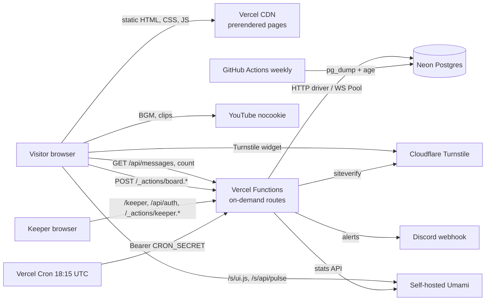
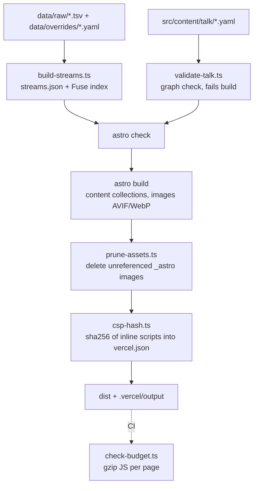
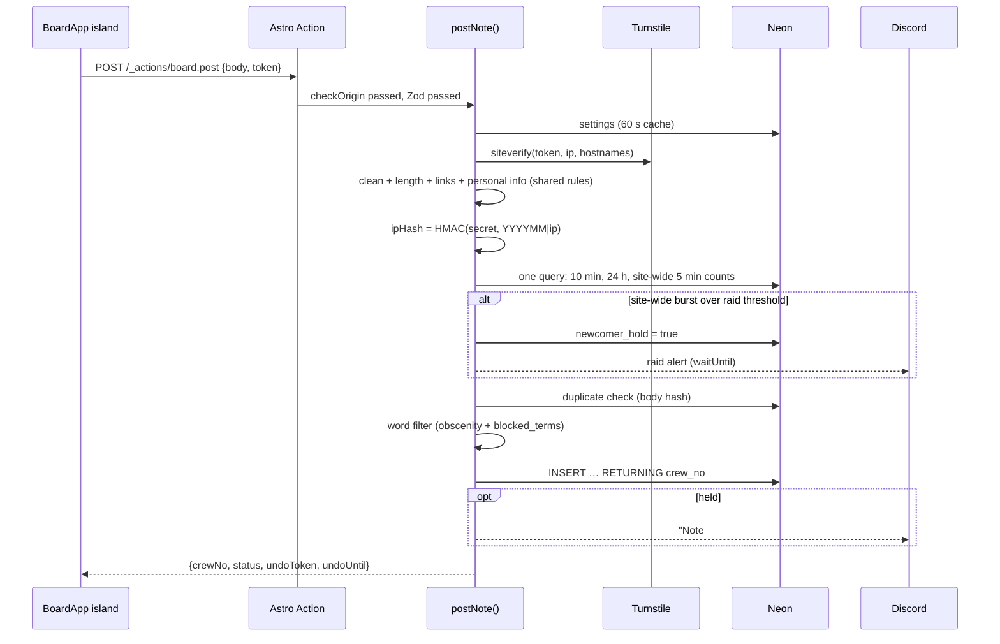
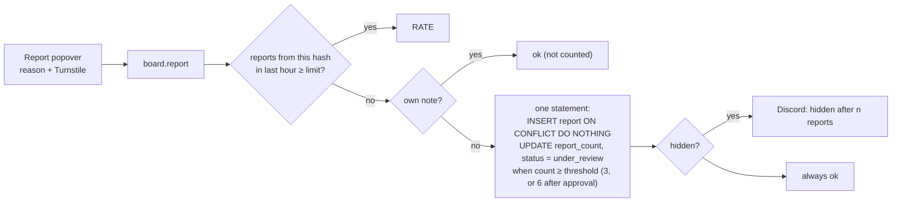
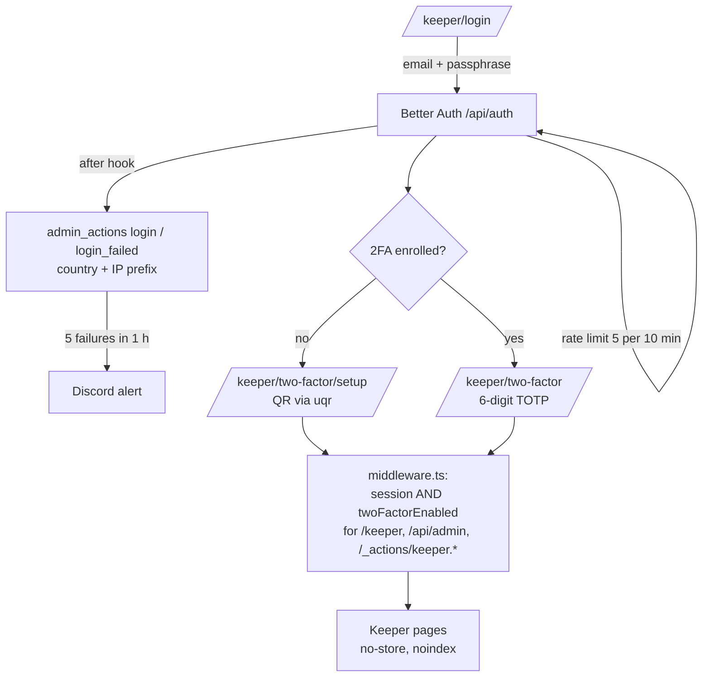
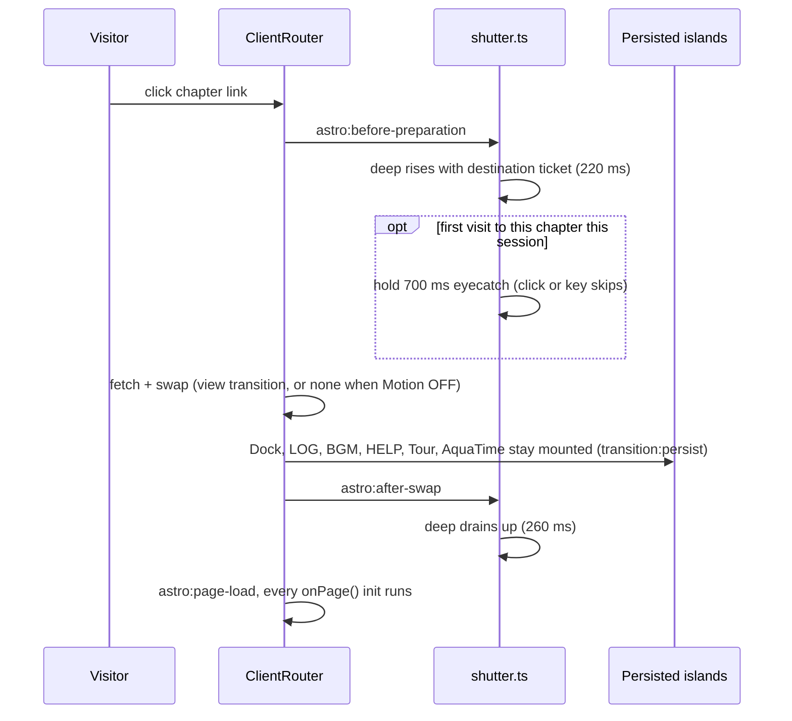
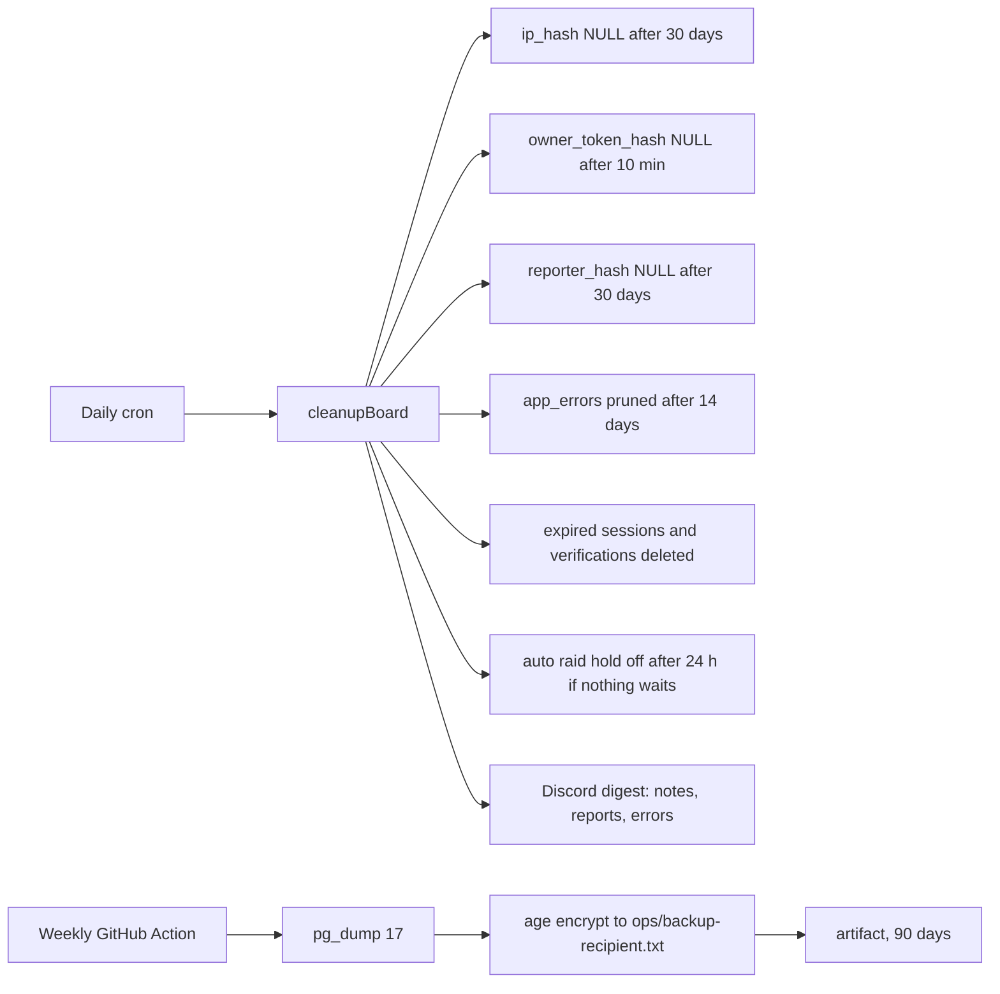

# Aqua Iro Archive · project file

Full architectural analysis (visual, operation, process, code) of Aqua Iro Archive, written for Tabane so its reusable parts can become entries. It is a different codebase from Kotoha and Hanon (Astro + Preact + TypeScript rather than plain HTML and ES modules), so this is a full file, not a differences-only one. Where an idea matches a Kotoha piece, the entry links to it. Every fact below comes from the repository or the live site; the Sources section lists where. Nothing here has been applied to Tabane yet.

| | |
|---|---|
| Name | Aqua Iro Archive (あくあ色アーカイブ): an unofficial, non-profit, bilingual (日本語 / English) fan archive of Minato Aqua's six years (2018-08-08 → 2024-08-28). "Project 44.5 by Moeko Works" |
| Kind | Own project (Moeko Works) |
| Live site | https://aqua-iro-archive.vercel.app/ |
| Repository | [PastelSalt/aqua-iro-archive](https://github.com/PastelSalt/aqua-iro-archive) (private) |
| Local folder | `C:\Users\Myaako\Documents\MoekoWorks\aqua-iro-archive` |
| Read at | commit `616052f` (`main`, 2026-10-24), 57 commits, read 2026-10-25 |
| Target | Website (public archive + private admin area called the keeper, `/keeper`) |
| Status on the site | Live. Full visual update (Parts A and B) shipped 2026-10-24. Message board open (live count: 1 note) |
| Embeddable | **No.** The site sends `Content-Security-Policy: … frame-ancestors 'none'`, so Tabane must show screenshots, not a live frame |
| Size | ≈ 27,000 lines of code (TypeScript, Astro, TSX, CSS, SQL, tests), ≈ 4,500 lines of YAML content, ≈ 1,500 lines of docs; 498 tracked files |

## Contents

1. [Overview](#1-overview)
2. [Stack](#2-stack)
3. [Architecture](#3-architecture)
4. [Repository structure](#4-repository-structure)
5. [Visual design](#5-visual-design)
6. [How the front end operates](#6-how-the-front-end-operates)
7. [How the back end operates](#7-how-the-back-end-operates)
8. [Data model](#8-data-model)
9. [How it was built (process)](#9-how-it-was-built-process)
10. [Reusable pieces catalogue](#10-reusable-pieces-catalogue)
11. [Gotchas and quirks](#11-gotchas-and-quirks)
12. [Proposed entries](#12-proposed-entries)
13. [Proposed replication guide](#13-proposed-replication-guide)
14. [Proposed new tag values](#14-proposed-new-tag-values)
15. [Open questions](#15-open-questions)
16. [Sources](#16-sources)

---

## 1. Overview

- **What it is:** a static, multi-page archive in eight numbered "chapters", like an anime official site. It covers her profile, clips, discography, 639 archived streams, events, 190 pieces of official art, and a fan message board.
- **Chapters:** NO.00 Home · NO.01 About · NO.02 Clips · NO.03 Discography · NO.04 Streaming · NO.05 Events · NO.06 Arts · NO.07 Message Board (寄せ書き). Extra pages: Credits, Privacy, 404. Admin: `/keeper/*`. API: `/api/*` (`src/lib/chapters.ts`).
- **Signature features:**
  - **Talk with Aqua:** a visual-novel dialogue box on Home with branching, YAML-authored, fan-written conversations.
  - **Aqua Time (あくあ時間):** a VHS tape deck that "travels" the whole archive to any day between debut and graduation.
  - **Message board:** anonymous notes with Turnstile, rate limits, a word filter, reports that auto-hide, raid detection, a moderation queue and Discord alerts.
  - **Anime-site chrome:** a loading screen with a title screen, a "tide shutter" page transition with an eyecatch, an onboarding tour, a bottom dock, a LOG drawer, a BGM capsule.
- **Design idea:** "The site is a harbour, and Aqua's colours are the sea" (`docs/FULL-UPDATE-PLAN.md`). Every element belongs to the wash (ground), paper (what you read) or the deep (the navy sea band, which is also the page-switch and loading animation).
- **What it is for (Tabane's view):** the most complete example of Kyle's anime-site design language with a real static-site generator, plus a hardened anonymous-posting back end, all on free tiers.
- **Sister sites:** links to the Kotoha and Hanon fan sites in the footer (`SISTER_SITES` in `src/lib/site.ts`); credits Moeko Works (https://moekoworks.vercel.app).

## 2. Stack

| Layer | What | Tabane tag |
|---|---|---|
| Language | TypeScript 6 (strict), TSX, Astro components, plain CSS | `typescript`, `css` |
| Framework | Astro 7.3 with `output: 'static'` and on-demand routes (`prerender = false`), ClientRouter (view transitions) | `astro` |
| Islands | Preact 10 + `@preact/signals` | `preact` |
| Hosting | Vercel Hobby, region `sin1`, `@astrojs/vercel` adapter (`maxDuration` 30), one cron job | `vercel` *(proposed by Kotoha)* |
| Database | Neon Postgres: HTTP driver for public routes, WebSocket Pool for transactions | `neon-postgres` |
| ORM / migrations | Drizzle ORM 0.45 + drizzle-kit (`db/migrations/0000_init.sql`) | `drizzle` *(new)* |
| Auth | Better Auth 1.7.7 (email + password, sign-up disabled, `twoFactor` plugin, database rate limits) | `better-auth` *(new)* |
| Bot check | Cloudflare Turnstile (managed mode) | `turnstile` *(new)* |
| Analytics | Self-hosted Umami, proxied through the site (`/s/ui.js`, `/s/api/pulse`), plus Core Web Vitals | `umami` *(new)* |
| Alerts | Discord webhook | — |
| Libraries | GSAP 3.15 (Events rope only), Fuse.js 7.5 (search), uPlot 1.6 (keeper charts), uqr (TOTP QR code), obscenity (word filter), `@justinribeiro/lite-youtube`, `@phosphor-icons/core` (dock icons), web-vitals 6, sharp (image prep), BudouX (listed, not imported, see G13) | `gsap`, `fuse-js` *(new)*, `uplot` *(new)* |
| Fonts | Fredoka (via Astro `<Font>`), Zen Maru Gothic 500/700, Shippori Mincho 700 (served from `/fonts/jp.css`) | — |
| Tests | Vitest 5 (unit, data, integration on PGlite), Playwright 1.64 (Chromium, WebKit, mobile, visual), axe-core | `playwright` *(new)*, `vitest` *(new)*, `pglite` *(proposed by Hanon)* |
| CI | GitHub Actions: `ci.yml` (lint, contrast, tests, Neon branch migrations, build, JS budget, e2e), `backup.yml` (weekly encrypted `pg_dump`) | — |
| Runtime | Node ≥ 22.12 | `node-js` |

## 3. Architecture

### 3.1 Level 1 · System



### 3.2 Level 2 · Build pipeline



### 3.3 Level 2 · Posting a note (`board.post`)



### 3.4 Level 2 · Reporting a note



### 3.5 Level 2 · Keeper sign-in and guard



### 3.6 Level 2 · Page change (ClientRouter)



### 3.7 Level 2 · Upkeep



## 4. Repository structure

```text
astro.config.ts          static output, Vercel adapter, Preact, sitemap, fonts, env schema, checkOrigin
vercel.json              cron, Umami rewrites, security headers + CSP (hashes written by csp-hash.ts), caching
drizzle.config.ts        migrations into db/migrations
playwright.config.ts     chromium, webkit (reduced motion), mobile, visual-laptop, visual-phone
db/migrations/           0000_init.sql (153 lines) + meta
db/seed/                 blocked-terms.sql
data/raw/                streams/videos/shorts TSV, wiki file lists (inputs to build-streams)
data/overrides/          games.yaml, stream-categories.yaml, stream-highlights.yaml
docs/                    AUDIT-2026-10-13, BOARD-SETUP, DOCK-PLAN, FULL-UPDATE-PLAN, IMPROVEMENT-PLAN, VISUAL-REFINEMENT-PLAN
ops/                     backup-recipient.txt (age public key)
scripts/                 build-streams, validate-talk, csp-hash, prune-assets, check-budget, contrast-check,
                         import-rawdata, prepare-images, make-og, create-admin, reset-2fa, seed
scripts/dev/             look, shot, shot-at, visual-diff, perf, paint, fill, dock-look, serve-dist, print-auth-tables
src/layouts/             Base.astro (html, prefs, chrome), Page.astro (NO.0X skeleton), Extra.astro, Keeper.astro
src/pages/               8 chapters + credits, privacy, 404; talk.json.ts, aqua-time.json.ts, fonts/jp.css.ts;
                         api/{messages, admin/stats, auth/[...all], cron/cleanup}; keeper/*
src/actions/             index.ts (board.post/report/undo), keeper.ts (moderation, settings, terms)
src/middleware.ts        keeper guard
src/components/chrome/   Dock, DockButton, LogDrawer, BgmCapsule, HelpDrawer, Tour, AquaTime (islands);
                         Splash, Shutter, Sprite, Motifs, SideRails, CreditRails, Marquee, LogoTab, Footer
src/components/talk/     DialogueBox.tsx (419)
src/components/board/    BoardApp.tsx (795), turnstile.ts
src/components/ui/       AquaWait, Icon, MoekoFlower, Odometer, Postcard, Seam, SectionTitle, Stamp, Sticker, T, VoyageLine
src/lib/                 chapters, chapter-art, prefs, storage, i18n, useLang, lifecycle, aquatime, analytics, format, site;
                         talk/{schema, picker, context, store, types}; streams/{filter, tags}; text/{normalize, kana}
src/scripts/             global (imports the rest), shutter, reveal, topbar, lightbox, bubbles, chrome-scroll,
                         offscreen, odometer, tilt, sparkle, keeper-client
src/server/              auth, settings, alerts, log, umami; board/{post, report, undo, list, moderation, filter, cleanup};
                         db/{schema, auth-schema, http, pool}; security/{iphash, turnstile}
src/content/             about, arts (190), clips, events, songs, streams, talk (YAML), i18n (ja.json, en.json)
src/styles/              tokens, base, layout, components (2,168), dock, sections (3,290), motion, fill (2,173), aquatime, keeper
tests/                   unit (normalize, streams), data (content), integration (board, moderation on PGlite), e2e (9 specs + 37 screenshots)
```

## 5. Visual design

### 5.1 Identity: the harbour

From `docs/FULL-UPDATE-PLAN.md` ("The one idea everything follows"):

| Layer | What | Rules |
|---|---|---|
| The wash | pastel seigaiha (wave) ground with drifting motifs | the shore; the only place for patterns, motifs and ghost numbers |
| Paper | white cards, tickets, notes, drawers, pinned or taped | no pattern, motifs or ghost numbers on paper; only tape and pins |
| The deep | navy water with a pink-to-cyan glow on its crest, wave edges top and bottom | **exactly one band per chapter page**, on its headline block; it *is* the page-switch and loading animation |

- **Colour roles:** Ink = `--navy`. The Aqua palette (pink → cyan) is the signature: crest, progress, active states, splash. A chapter tint only marks which chapter it is (dock pill, banner card tint bar, ticket tape) and is never a big background.
- **Tilt rule:** paper you read is straight; small grouped cards may tilt −2° to +2°; stickers, stamps and the eyecatch ticket up to ±12°; nothing else tilts.
- **Card family (two shapes):** the banner card (icon + title + small line + tint bar; used for the maker card, sister sites, Prev/Next, the shutter ticket) and the content card (paper block with optional tape or pin).
- **"Aqua talks" (one component):** the Home dialogue box is the template wherever she speaks; loading, empty and error states use a compact version with a small pose (`AquaWait.astro`, `--pose-wait`).

### 5.2 Tokens (`src/styles/tokens.css`)

- **Brand:** `--aqua-pink #f2a7cf`, `--aqua-pink-deep #c47fb6`, `--aqua-blue #8ec9ee`, `--aqua-cyan #7fd9f2`, `--aqua-mint #c9f0ee`, `--navy #3b4583`, `--lavender #cdb8ea`, `--paper #fffbfe`, `--ink-soft #5e668f`.
- **Text-safe (AA on paper):** `--pink-ink #9a4f8c`, `--link-blue #2a6f9a`, `--placeholder #6e6a90`. `scripts/contrast-check.ts` asserts the pairs in CI.
- **Note papers (board):** pink, mint, cream, lavender, sky.
- **Chapter tints:** one per chapter (`--tint-home` … `--tint-messages`), plus `--icon-*` fills for the Phosphor duotone layer. `--tint` is set per page by `[data-chapter]`.
- **Gradients:** `--iro` (pink → violet → cyan, 100°), `--wash` (two radial blooms over a linear pastel).
- **Deep:** `--deep: var(--navy)`, `--deep-low #2c3468`.
- **Type:** `--font-display` (Fredoka then Zen Maru), `--font-jp-round`, `--font-jp-serif` (Shippori Mincho), with system fallbacks until `/fonts/jp.css` arrives. Fluid scale `--step--2 … --step-4` (360 → 1600 px); h1 ≈ 76 px at 1600.
- **Space:** 4 px base, `--s-1 … --s-9`, `--gutter: clamp(16px, 4vw, 64px)`.
- **Radius:** chip 999 px, 10, 16, 22, 30, and `--r-note: 6px 6px 16px 6px` (a dog-eared note).
- **Seasons:** Aqua Time sets `html[data-season]`; `aquatime.css` swaps `--wash` per season. "Art is never tinted: only the colour tokens shift."

### 5.3 Fillers: the "no empty area" rule (`fill.css`, `docs/IMPROVEMENT-PLAN.md` §1.2–1.3)

- **Made measurable:** split a screenshot into 120×120 px cells; a cell is empty when its pixel standard deviation is below about 6. Target: at most 8% empty cells per screen at 1366×649, 1920×953 and 390×664. (`scripts/dev/fill.mjs` measures it.)
- **One set of fillers, placed per page:**

| Part | Component | Where | Motion |
|---|---|---|---|
| Side rails | `SideRails.astro` (≥ 1440 px) | chapter pages | filmstrip of official art drifts up; right rail shows the vertical title and a running percentage |
| Credit rails | `CreditRails.astro` | Credits, Privacy | slow vertical credits roll |
| Ghost numbers | `.page-head__ghost`, `SectionTitle` `ghost` | every section | huge outlined numbers at low opacity |
| Section seams | `Seam.astro`: wave, ticker, rope | between sections | transform-only, rotate kinds so pages don't repeat |
| Motif field | `Motifs.astro` | whole site | anchors, bubbles, stars, hearts, ribbons, each a compositor-only CSS loop at fixed positions |
| Sticker kit | `Sticker`, `Stamp` (circular text ring) | card corners | slight sway |
| Masonry tails | `Postcard.astro` | ends of masonry lists | a quote, fact or doodle; fan-written lines labelled |
| Ambient key visual | `Page.astro` `.page-head__kv` | title cards | chapter key visual washed behind the sharp art |

### 5.4 Page skeleton (`src/layouts/Page.astro`)

Key visual → label `NO.0X — EN` → bilingual h1 + JP subtitle + intro → optional vertical JP column → `Seam` wave → page body → `Marquee` (hashtags) → related → Prev/Next banner cards (wrapping around the eight chapters). Chapter art comes from `CHAPTER_ART` (`src/lib/chapter-art.ts`): which key visual, which art section feeds the filmstrip, and the rail title. Art is "cropped / framed / moved, never edited", framed on her face (`1215eaf`).

### 5.5 Chrome pieces

- **Logo tab:** fixed top-left; shrinks after 120 px of scroll; swings gently with scroll speed (`chrome-scroll.ts`).
- **Dock:** bottom, one size, never changes while scrolling (section 6.5).
- **Footer:** chapter list, sister-site banner cards, Moeko Works credit, her signature (except on Home, which ends on its own farewell).
- **Marquee:** hashtags in a two-group track, `aria-hidden`.

### 5.6 Breakpoints and layering

- **Breakpoints:** sm 600 · md 900 · lg 1180 · xl 1440 (`layout.css`). The dock switches layout at 1024; side rails appear at 1440.
- **Phone:** no sideways scroll at 390 px is an e2e check (`AUDIT-2026-10-13` #8).

### 5.7 Icons

- **One inline SVG sprite** (`Sprite.astro`, 355 lines): motifs (anchor, cat, onion, bow, note, spark, heart, wave, headdress, flag, pin …), UI icons, and six emote stickers used as Talk fallbacks. `<Icon name>` renders `<svg><use href="#i-…">`, coloured by `currentColor`.
- **Dock icons:** Phosphor duotone, copied in at build time as `#ph-<name>`; the soft fill layer takes `--ph-fill` / `--ph-op` from the using `<svg>`.
- **Moeko Works flower:** `MoekoFlower.astro`, a small vector redraw of the logo's two flowers for stamp and bubble sizes; the wordmark itself stays the PNG.

### 5.8 Imagery

- **190 official art pieces** curated in `arts.yaml` with credit and source. Left out: press images, duplicates, animated GIFs and pin-up pieces, to keep the archive all-ages (README deviations).
- **Pipeline:** `prepare-images.ts` copies only referenced files from the asset folder, long edge 2000 px, strips metadata, near-lossless WebP for transparent images, JPEG otherwise, and fails above a size budget. Astro re-encodes to AVIF/WebP at build. One 1600 px lightbox variant. Deploy kept under 80 MB (75.6 MB).
- **Share images:** `make-og.ts`, 1200×630 per chapter (official art + title + credit line).

### 5.9 Keeper look

`keeper.css`: "the calm working-tool variant: same tokens, no decorations". Background `#faf8fd`, no motifs, no motion.

## 6. How the front end operates

### 6.1 Pre-paint (`Base.astro`)

- One inline script, byte-identical so its hash stays valid in the CSP. Reads `aia:prefs` from localStorage (inside try/catch) and sets `html[data-motion]` (stored, else `prefers-reduced-motion`), `html[data-lang]` and `<html lang>` (stored, else `navigator.language`).
- Sets `html[data-splash=seen]` when the splash has shown this browser session and no tour replay is pending, so the splash is hidden before paint.
- Re-runs on `astro:after-swap`, because ClientRouter copies `<html>` attributes from the incoming document and would drop them (also handled in `prefs.ts`).
- `<meta name="google" content="notranslate">` and `translate="no"`: the site ships both languages, and browser auto-translate "garbles names and breaks islands".

### 6.2 Islands and the ClientRouter lifecycle

- **Persisted chrome:** Dock (`client:load`), LogDrawer, BgmCapsule, HelpDrawer, AquaTime (`client:idle`), Tour (`client:idle` with 1500 ms timeout), each with `transition:persist`, so state and music survive page changes.
- **Page scripts:** module scripts run once, so every page module registers with `onPage(init)` (`src/lib/lifecycle.ts`). `init` runs on every `astro:page-load`, must bail out when its root element is not on the page, and returns a cleanup that runs on `astro:before-swap`. `onMotion(fn)` re-runs on the `aia:motion` event.
- **Shared state between islands:** module singletons (`@preact/signals` in `prefs.ts`, `aquatime.ts`, `talk/store.ts`), plus window events (`aia:log`, `aia:help`, `aia:time`, `aia:motion`, `aia:splash-seen`).

### 6.3 Language

- **Both languages ship in the HTML.** `<T>` renders `<span data-l="ja" lang="ja">` and `<span data-l="en" lang="en">`; CSS hides the one not matching `html[data-lang]`. Strings live in `src/content/i18n/{ja,en}.json`; `t(key, vars)` returns a `{ja, en}` pair; `pick()` falls back to the other language.
- **Hydration trick (`useLang.ts`):** islands are server-rendered in Japanese, so the first client render uses `'ja'` to match, then switches to the visitor's language on the next render, which makes Preact patch every attribute that differs (aria-labels, titles).
- **Only write when changed:** rewriting `lang` re-matches every `:lang()` rule, so `prefs.ts` compares before writing.

### 6.4 Preferences and storage

- `prefs.ts`: signals for motion, lang, BGM (never autoplays), shortcuts; `setMotion`, `toggleLang`, `markSplashSeen`, `motionOn()` for non-Preact scripts.
- `storage.ts`: every read and write in try/catch (private windows, blocked storage, prerender), a 64 KB cap per value, and one `KEYS` table (`aia:prefs`, `aia:talk.album`, `aia:board.draft`, `aia:board.mine`, `aia:tour.done`, `aia:title` …).

### 6.5 Dock (`Dock.tsx`, `DockButton.tsx`, `dock.css`, `docs/DOCK-PLAN.md`)

- **One dock, one size:** it never changes while you scroll or hover (the result of the 13 Oct audit, which found three dock behaviours plus a fourth on phones).
- **Wide (≥ 1024 px):** 8 chapters + 6 system buttons (MOTION, JP/EN, BGM, LOG, HELP, TIME). **Narrow:** 5 chapters (`home, clips, discography, streaming, messages`) + MORE, which opens one sheet with everything. Which buttons show is decided by CSS only.
- **Only motion:** the current-chapter pill slides to the new chapter after a page change.
- **Buttons:** a Phosphor icon with one short label in the visitor's language; chapters are links, system buttons are buttons; same size and states.
- **Keyboard shortcuts** (Alt+M motion, Alt+L language, Esc log; can be turned off), skipped while typing or inside a dialog (`isTyping`). The system toolbar has roving focus with the arrow keys.

### 6.6 Splash and title screen (`Splash.astro`)

Three beats ("出航準備" → title screen):

1. **Studio card:** 「制作 Moeko Works」 with flowers blooming in (~600 ms, first-ever visit only).
2. **Harbour:** her under-the-sea key visual, blurred; logo and NOW LOADING bobbing like buoys; a tide gauge with the flower riding the waterline and a percentage; TIPS in the Talk box in her voice.
3. **Title screen** (first-ever visit, or a tour replay): the art comes into focus; PRESS START, a version line and a copyright line. "No menu: a website needs no 'continue' or 'config'."

Later sessions get beat 2 only (1.6–3.2 s). Skip (▸▸, Esc) always works. Motion OFF: still frames, no studio beat, no tide.

### 6.7 Tide shutter (`Shutter.astro`, `src/scripts/shutter.ts`)

- On `astro:before-preparation` the deep rises over the screen with a paper ticket showing the destination's number and name, its tape in the chapter tint (220 ms). On the first visit to a chapter this session it holds ~700 ms as an anime eyecatch with bubbles and a production credit; a click or any key skips the hold. On `astro:after-swap` it drains up (260 ms).
- Seen chapters are kept in sessionStorage (`aia:eyecatch`); a once-per-session flower bubble (`aia:flower`).
- **Motion OFF:** no shutter, and `document.startViewTransition` is wrapped so the swap runs *without* a native view transition, because its snapshot "takes seconds on GPU-less WebKit".

### 6.8 Onboarding tour and HELP

- **Tour (`Tour.tsx`):** a ~30 s spotlight tour of the logo, Talk, outfit dots, Three Moments, dock, BGM, MOTION, JP/EN, LOG and HELP; Home-only steps drop out elsewhere. Starts after the splash; Esc or Skip ends it; stores `aia:tour.done`.
- **HELP drawer (`HelpDrawer.tsx`):** what each control does, plus "Replay the tour" with a confirm step. Replaying sets `aia:replay` in sessionStorage and reloads, so the splash and tour run again; settings, the album and drafts are kept.

### 6.9 Talk with Aqua (`DialogueBox.tsx`, `src/lib/talk/*`, `src/content/talk/*`)

- **States:** hidden ⇄ idle → speaking(i) → choosing → responding(i) → (choosing | ended) → idle.
- **No-JS first:** server-rendered with the first line; hydrates `client:idle`; fetches the prerendered `/talk.json` (34 KB live), where expressions are already resolved to optimized official-pose URLs.
- **Authoring (YAML):** 21 conversations in five categories (ask, tease, cheer, explore, special), plus `idle.yaml` (lines that type in by themselves every 20–30 s, Motion ON only) and `expressions.yaml` (expression → pose or emote sticker). Each conversation: `id`, bilingual `title`, `category`, `weight`, `rare` (~5% pool), `when` (any, morning, day, evening, night, birthday, anniversary, graduation, first-visit, returning), `lines`, `choices` (4–6 candidates, 3 shown, at most one `goto`, at least one non-goto), optional `nodes`.
- **Validation:** one Zod schema plus a graph validator (`talk/schema.ts`) used by the build gate (`validate-talk.ts`), the endpoint and unit tests.
- **Picking:** `crypto.getRandomValues` (injectable for tests); context triggers from the visitor's local clock (`talk/context.ts`).
- **`goto`** offers "Take me there →" after the reply and never navigates on its own.
- **LOG integration:** session backlog and a Memory album (`talk/store.ts`), shared with the LOG drawer.
- **Honesty:** the box and the LOG drawer say the lines are fan-written, not her actual words.

### 6.10 Aqua Time (`AquaTime.tsx`, `src/lib/aquatime.ts`, `aquatime.css`, `/aqua-time.json`)

- **What it does:** a VHS-style tape deck opened from the dock's TIME button. Drag the scrubber or step by day, week or month across 2,212 days; or jump to "On this day". The whole archive then shows that day: the Home outfit, the Talk greeting, the stream log, the discography and the counters. A badge under the logo tab shows where you are and returns to the present. Once per session an "On this day" toast lists what happened on today's date in past years.
- **How it works:** `timeDate` signal (null = present), stored per browser; changes dispatch `aia:time` and set `html[data-time]` and `html[data-season]`, so CSS can react. Helpers: `upTo(rows, d)`, `between`, `greeting`, `onThisDay`.
- **Data:** `/aqua-time.json` (134 KB live) is built at compile time from existing content (streams, timeline events, songs, art, outfits), re-indexed by day, and fetched only when the deck opens or on the once-a-session check.

### 6.11 LOG drawer and BGM capsule

- **LOG (`LogDrawer.tsx`):** tabs Backlog · Memory album · Credits & sources · Shortcuts. Opened by the dock, Esc, or the dialogue box (`aia:log`).
- **BGM (`BgmCapsule.tsx`):** the YouTube IFrame API loads only after the first ♪ press; hidden 1 px player on youtube-nocookie, volume 40%, never autoplays, persisted across page changes so music keeps playing; official uploads only.

### 6.12 Lightbox (`src/scripts/lightbox.ts`)

- One `<dialog>` opened with `showModal()`, blurred mint backdrop, a credit bar at the bottom, focus returned to the trigger on close.
- Delegated triggers that survive page swaps: `data-lb="video"` (lazy-loads `lite-youtube`) or `data-lb="image"` with `data-group`, `data-srcset`, `data-credit`, `data-source`.
- Without JS the anchors simply open YouTube or the image file.

### 6.13 Filter bars and search

- **One shared filter-bar pattern (`topbar.ts`):** on Discography, Streaming and Arts, once its slot scrolls under the top edge (and while its section is on screen), the bar becomes one fixed row beside the logo tab (under it on phones). The primary control scrolls sideways with faded edges; secondary controls open from a Filters button. It slides back when the section has passed.
- **Streaming:** 639 rows are prerendered; the filter toggles `hidden` and must run under 16 ms (`streams/filter.ts`). Search uses a prebuilt Fuse index (`public/data/stream-search.json`) loaded on first search focus. Stream tags come from rules (`streams/tags.ts`) plus `data/overrides/stream-categories.yaml`. A per-year heatmap is one SVG per year, drawing only days with streams.
- **Discography:** Fuse.js loaded on demand.

### 6.14 Motion system and budget

- **Gate:** every animation is behind `html[data-motion='on']` (`motion.css`).
- **Four kinds** (`IMPROVEMENT-PLAN` §1.4):

| Kind | Examples | Rules |
|---|---|---|
| Ambient loops | marquee, motifs, bubbles, seams | transform/opacity only; ≤ 12 on screen; paused off screen (`offscreen.ts` sets `[data-offscreen]`) |
| Entrances | title card intro, section reveals | ≤ 700 ms, stagger ≤ 240 ms; `reveal.ts` animates section-level blocks only (not single tiles) and skips anything already on screen |
| Scroll-driven | parallax, ghost numbers, Events rope, filmstrip speed | CSS scroll-driven animations where supported; GSAP ScrollTrigger otherwise (Events rope); one scroll listener for chrome (`chrome-scroll.ts`) |
| Interaction | hover tilt (`tilt.ts`, ±8° with glare, mouse/pen only), click sparkles (`sparkle.ts`), press squash | < 300 ms |

- **Budget (Ryzen 3, 1366×649):** scrolling ≥ 55 fps; idle main thread < 15%; ≤ 40 KB JS added per page; bubble canvas ≤ 30 fps and ≤ 40 sprites (`bubbles.ts` also reacts to the cursor and pauses when hidden).
- **JS budget enforced in CI:** `check-budget.ts` sums gzip JS per page (scripts, modulepreloads, island component and renderer URLs) and fails above 110% of the budget (Home 120 KB, Streaming 80 KB, others 70 KB).
- **Odometer:** digits roll as strips of 0–9 moved with transform only, so masonry never re-lays out; screen readers get plain text.

### 6.15 Analytics (`src/lib/analytics.ts`, `src/scripts/global.ts`)

- Umami script with `data-do-not-track` and `data-exclude-search`, persisted across swaps, loaded through the site's own `/s/ui.js` rewrite.
- `track()` is a typed no-op when `window.umami` is missing; never sends personal data or note text.
- Outbound-link events and Core Web Vitals (LCP, INP, CLS, FCP, TTFB via lazy `web-vitals`).

## 7. How the back end operates

### 7.1 Static with a few on-demand routes

Everything is prerendered except: `/api/messages`, `/api/messages/count`, `/api/admin/stats`, `/api/auth/*`, `/api/cron/cleanup`, `/_actions/*` and `/keeper/*`. `/talk.json`, `/aqua-time.json` and `/fonts/jp.css` are prerendered endpoints.

### 7.2 Database access (`src/server/db/*`)

- **Two drivers by job:** public endpoints use Neon's HTTP driver (single statements and CTEs, `http.ts`); auth and admin use the WebSocket Pool for interactive transactions (`pool.ts`), because "neon-http has no interactive transactions".
- **One DB type** covers neon-http, the Pool and PGlite, so the same board code runs in production and in integration tests (`types.ts`).

### 7.3 Posting pipeline (`server/board/post.ts`)

"Cheap checks first; every check runs before the insert" (see 3.3):

1. Shape (body ≤ 2000 chars raw, token ≤ 2048).
2. Paused setting.
3. Turnstile server check.
4. to 6. Shared text rules: clean, length, links, personal info.
7. IP hash: HMAC-SHA256(secret, `YYYYMM|ip`), first 32 hex chars; the month makes this month's hashes unlinkable to last month's; raw IPs are never stored.
8. Rate limit and raid detection in **one query** (10-minute and 24-hour counts for this hash, 5-minute count site-wide). A burst over `raid_posts_5m` switches `newcomer_hold` on automatically and alerts.
9. Duplicates: same compare-form hash in the last 24 h from anyone, or ever from this hash.
10. Word filter: `obscenity` English matcher + database `blocked_terms` (substring, word or regex; action reject or hold), cached 60 s.
11. Hold (filter, newcomer or raid).
12. Insert, returning `crew_no` (a sequence number shown as "crew #n").
13. Discord alert for held notes (crew number and reason only, never the text).
14. Response with a 10-minute undo token (only its hash is stored).

Error codes are stable strings (`BAD_REQUEST, PAUSED, BOT, EMPTY, LENGTH, EMOJI, LINK, PERSONAL, RATE, DUPLICATE, FILTER, INTERNAL`); the UI maps them to friendly text.

### 7.4 Reports (`server/board/report.ts`)

- Always answers `{ ok: true }` (except bad request, bot, rate), so reporters learn nothing.
- Reporting your own note succeeds quietly and isn't counted.
- **Insert and auto-hide in one statement:** a CTE inserts the report (`ON CONFLICT (message_id, reporter_hash) DO NOTHING`) and bumps `report_count`, setting `under_review` when it reaches the threshold: 3 for never-approved notes, 6 after the keeper approved it (so approved notes are harder to brigade).
- Discord alert with the reason counts.

### 7.5 Undo (`server/board/undo.ts`)

The poster removes their own note within 10 minutes using the token from the response (kept in `aia:board.mine`). The cron nulls `owner_token_hash` after 10 minutes.

### 7.6 Shared text rules (`src/lib/text/normalize.ts`)

- **One implementation for client and server**, "so client and server never disagree": the composer gives instant feedback, the server enforces.
- Limits: 300 graphemes, 6 lines, 20 emoji. Anti-zalgo (at most 2 combining marks per grapheme). Control characters removed. Compare form for duplicates (with katakana → hiragana, `kana.ts`).
- Link detection includes spelled-out forms ("h t t p"), `t.me/`, and `www.` only when a domain follows, because bare "www" is laughter in Japanese. Personal-info detection: emails, `@handles` and phone-like runs of 10+ digits (after NFKC and removing spaces, dashes and the long-vowel mark).

### 7.7 Moderation and audit (`server/board/moderation.ts`, `src/actions/keeper.ts`)

- Approve, remove (with reason), restore, purge, queue (reported / held), notes list, audit list, board stats.
- **Every mutation writes an `admin_actions` row in the same transaction.** Rows are never hard-deleted except by Purge, which needs the crew number typed in to confirm.
- Keeper actions are guarded by middleware *and* checked again in every handler (defence in depth).

### 7.8 Keeper auth (`src/server/auth.ts`)

- Better Auth with Drizzle adapter; one admin; **sign-up disabled** (the admin is created once by `scripts/create-admin.ts`, passphrase typed in, never stored).
- Passphrase 14–256 chars; sessions 7 days, refreshed daily; secure cookies with prefix `aia-keeper`.
- Database-backed rate limits: sign-in 5 per 10 minutes, two-factor 10 per 10 minutes.
- **Mandatory TOTP:** the `twoFactor` plugin; enrollment is forced on first sign-in; enforcement lives in middleware. QR code drawn with `uqr`. `scripts/reset-2fa.ts` is the runbook for lost backup codes (writes an audit row).
- **Sign-in hook:** logs `login` / `login_failed` with country and the first two IP octets; Discord alert on success, and when failures reach 5 in an hour.

### 7.9 Middleware guard (`src/middleware.ts`)

`/keeper` (except login and two-factor pages), `/api/admin` and `/_actions/keeper.*` require a session **and** `twoFactorEnabled`. Keeper responses get `Cache-Control: no-store` and `X-Robots-Tag: noindex, nofollow` (confirmed live: `/keeper` → 302 to `/keeper/login`).

### 7.10 Settings (`src/server/settings.ts`)

Key/value JSON rows with a 60 s in-memory cache per function instance and clamped ranges. Defaults: report threshold 3, re-report 6, posting paused off, newcomer hold off, 3 posts per 10 min, 10 per day, 20 reports per hour, raid 40 posts in 5 min, 300 chars, 6 lines, board cache 10 s.

### 7.11 Alerts and error log

- `alertLater()` sends the Discord webhook with `waitUntil`, so the visitor never waits; messages carry numbers and reasons only.
- `logError()` writes to `app_errors`, because Vercel Hobby keeps runtime logs for only one hour; the keeper has an Errors page.

### 7.12 Public read endpoints

- `GET /api/messages`: edge-cached (`s-maxage=10, stale-while-revalidate=60`); never reads cookies; never returns hashes, report counts, held or removed notes.
- `GET /api/messages/count`: visible total, next crew number and paused flag (`s-maxage=60, stale-while-revalidate=300`). Live: `{"total":1,"nextCrewNo":2,"paused":false}`, 2.7 s cold.

### 7.13 Cron and backups

- `/api/cron/cleanup` daily at 18:15 UTC with `Authorization: Bearer $CRON_SECRET`; the clean-up list is in 3.7; sends a digest.
- Weekly GitHub Action (Sunday 03:00 Manila): `pg_dump` 17 custom format, encrypted with `age` to a public key in `ops/`, uploaded as a 90-day artifact.

### 7.14 Umami for the keeper (`src/server/umami.ts`, `/api/admin/stats`)

Token cached 12 h, responses cached 5 min per range; endpoint shapes isolated in one file so an Umami version change touches one file (v3 uses metric type `path`, v2 `url`). Stats are `private, max-age=300`. Charts drawn with uPlot.

### 7.15 Security and delivery (`vercel.json`, `astro.config.ts`)

- **Headers (live):** CSP with `script-src 'self'` + 4 sha256 hashes + Turnstile and YouTube hosts, `frame-ancestors 'none'`, `object-src 'none'`, `form-action 'self'`, `upgrade-insecure-requests`; HSTS with preload; `nosniff`; `strict-origin-when-cross-origin`; a Permissions-Policy turning off camera, mic, geolocation, payment, USB and FLoC.
- **CSP hashing at build (`csp-hash.ts`):** collects every executable inline `<script>` in the built HTML (the pre-paint script plus Astro's island-hydration runtime), hashes them, and rewrites `script-src` in `vercel.json`. JSON and ld+json are skipped.
- **CSRF:** Astro `security.checkOrigin` on Actions.
- **Caching:** `_astro/*` immutable; `/fonts/jp.css` cached; `/keeper` no-store.
- **Env schema:** typed in `astro.config.ts` (`astro:env/server`, `astro:env/client`).

## 8. Data model

### 8.1 Database (`src/server/db/schema.ts`, `auth-schema.ts`, `db/migrations/0000_init.sql`)

| Table | Holds | Notes |
|---|---|---|
| `messages` | id (uuid), `crew_no` (from `crew_no_seq`), body (NFC, cleaned), `body_hash`, status (`visible`, `held`, `under_review`, `removed`), `held_reason`, `report_count`, `approved_at`, `removed_at`, `removed_reason`, `created_at`, `ip_hash`, `owner_token_hash` | indexes on (status, crew_no desc), (ip_hash, created_at), (body_hash, created_at); `CHECK char_length 1–1200` with the 300-grapheme limit in the app; `ip_hash` nulled after 30 days, `owner_token_hash` after 10 min |
| `reports` | message, reason enum (spam, hate, sexual, personal_info, impersonation, other), note ≤ 200, `reporter_hash`, `resolved_at`, outcome | unique (message_id, reporter_hash); `reporter_hash` nulled after 30 days |
| `admin_actions` | bigserial id, actor, action enum, message (set null on delete), detail jsonb | audit log |
| `blocked_terms` | term, kind (substring, word or regex), action (hold or reject), note | seeded by `db/seed/blocked-terms.sql` |
| `settings` | key, value jsonb | board settings |
| `app_errors` | route, message, stack, meta | pruned after 14 days |
| Better Auth | `user`, `session`, `account`, `verification`, `two_factor`, `rate_limit` | JS keys match Better Auth's field names, SQL names snake_case |

### 8.2 Content collections (`src/content.config.ts`)

Astro `file()` loaders with Zod schemas over YAML: `profile`, `lore`, `relationships`, `links` (About); `clips` (tags: animated, gaming, collab, funny, emotional, music); songs (`originals`, `units`, `covers-solo`, `covers-collab`, `releases`); `milestones`, `records`, `subscribers`, `yearTotals`; events (`timeline`, `brands`) with typed event kinds; `arts` (190, with sections, credit, source, image). Shared schema parts: `I18n` (both languages required), `I18nPartial`, `YtId` (11 chars), `DateStr` (`YYYY`, `YYYY-MM` or `YYYY-MM-DD`).

### 8.3 Data pipeline

- **One-time import:** `import-rawdata.ts` turned the planning doc's tables into YAML; "after this runs once, the YAML files are the source of truth".
- **Streams:** `data/raw/streams.full.tsv` + overrides → `streams.json` + the Fuse index; the build fails if any assertion does not hold. 639 public archives ≈ 2,013 hours (as of 2026-10-11); 2018–2019 are undercounted because most were privated or deleted, and the page says so.

## 9. How it was built (process)

### 9.1 Timeline (57 commits, 2026-10-12 → 2026-10-24)

| Date | What |
|---|---|
| 10-12 | v0.1: phases 0–7 of the execution plan in one commit; first Vercel deploy; rolldown stub fix; WebKit e2e fixes; 1366×649 laptop fixes; tour and HELP |
| 10-13 | Home fits 1366×768; performance pass; dock behaviour work; **site audit** (16 issues) and its fixes |
| 10-14 | Improvement plan (Part 1 approved, Part 2 A only): fillers, shutter, measuring tool; pages restyled; **Aqua Time**; phone, Motion OFF and performance pass; odometer fix; **Dock v2** with Phosphor icons |
| 10-21 | Rebrand Moesoft → Moeko Works; removal requests via the contact form |
| 10-24 | Art framed on faces; Talk script rewritten in her voice; mini update; guard rails (nothing-covers-content e2e, screenshot record); **Full update A** (the deep, card family, Aqua talks, decoration rule) and **B** (tide shutter, loading screen with a VN title screen, Moeko Works flower), worked on a `full-update` branch and merged; npm audit fixes |

### 9.2 Working method seen in the repo

- **Plan, decide, build, audit:** each big change has a plan doc with a "Decisions" or "Decided" section dated by Kyle, then commits named after the plan's parts.
- **Audits with evidence:** `AUDIT-2026-10-13.md` lists issues by severity, each with evidence and a fix, and ends with "Not issues" and a fix order. It calls out its own regression (`7aeefcc`).
- **Measured design rules:** "no empty area" as a pixel test, motion as a budget, contrast as a script, JS weight as a CI gate.
- **Guard rails before big changes:** the nothing-covers-content e2e and a committed screenshot record (37 visual baselines) came before the full update.
- **Deviation log:** the README lists every deviation from the execution plan, with the reason.
- **Honesty rules:** fan-written lines labelled; undercounts stated; the official talent page linked rather than claiming it was removed (`b4a3843`).
- **Dev tools kept:** `scripts/dev/` (screenshots at any size, visual diff, perf, paint, fill measurement).

### 9.3 Operations

- **Opening the board (`docs/BOARD-SETUP.md`):** create Turnstile keys, put them in Vercel and redeploy, create the keeper account, set alerts and contact, open the board.
- **Admin scripts** load and check `.env.production.local` (`scripts/lib/standalone-auth.ts`).
- **CI:** Turnstile testing keys; Astro font and image cache (Google Fonts downloads are flaky); lint, contrast, tests; migrations and seed on a temporary Neon branch when `NEON_API_KEY` exists; build retried once; JS budget; Playwright on Chromium and WebKit; report uploaded on failure; Neon branch deleted.

## 10. Reusable pieces catalogue

Reusability: **High** = lift with little change · **Medium** = needs rebranding or untangling · **Low** = specific to Aqua.

### 10.1 UI/UX pieces

| # | Piece | Files | What it gives a new project | Reuse | What to change when lifting |
|---|---|---|---|---|---|
| A-U1 | Harbour design system (wash / paper / deep) | `tokens.css`, `components.css`, `docs/FULL-UPDATE-PLAN.md` A1 | a three-layer rule set (where patterns, paper and the one deep band go), colour roles, tilt rule, two-shape card family | High | palette, the "sea" metaphor |
| A-U2 | Filler kit and the measurable "no empty area" rule | `fill.css`, `SideRails`, `CreditRails`, `Seam`, `Motifs`, `Postcard`, `Sticker`, `Stamp`, `scripts/dev/fill.mjs` | one set of fillers for margins, gaps and masonry ends, plus a pixel test with a target | High | motifs, art |
| A-U3 | Chapter page skeleton | `Page.astro`, `chapters.ts`, `chapter-art.ts`, `SectionTitle`, `Marquee` | NO.0X numbered chapters with key visual, bilingual title, vertical JP column, seams, marquee and wrap-around Prev/Next | High | chapter list, art map |
| A-U4 | Bottom dock (one size) | `Dock.tsx`, `DockButton.tsx`, `dock.css`, `docs/DOCK-PLAN.md` | an app-like dock that never resizes; 8 + 6 wide, 5 + MORE sheet narrow; CSS-only visibility; sliding current pill; shortcuts | High | chapters, system buttons, icons |
| A-U5 | Splash with title screen | `Splash.astro`, prefs pre-paint | studio card → loading harbour with tide gauge and tips → PRESS START title screen; once per session; skippable; Motion OFF still frames | Medium | art, copy, beats |
| A-U6 | Tide shutter page transition with eyecatch | `Shutter.astro`, `shutter.ts` | a ClientRouter page change that covers, shows a destination ticket, holds once per chapter as an eyecatch, and skips the native view transition when motion is off | High | colours, ticket text |
| A-U7 | Onboarding tour + HELP replay | `Tour.tsx`, `HelpDrawer.tsx` | spotlight tour that adapts per page, and a replay that reloads into splash + tour while keeping settings | High | steps |
| A-U8 | Visual-novel dialogue box with YAML scripts | `DialogueBox.tsx`, `lib/talk/*`, `content/talk/*`, `talk.json.ts`, `validate-talk.ts` | branching character chat with time-of-day triggers, rare lines, idle chatter, a memory album, a build-time graph validator, no-JS first line | High | character, poses, lines |
| A-U9 | Time-travel archive (Aqua Time) | `AquaTime.tsx`, `aquatime.ts`, `aquatime.css`, `aqua-time.json.ts` | a scrubber that re-dates the whole site from one prebuilt by-day index; seasons via CSS; "On this day" toast | Medium | date range, which data is indexed |
| A-U10 | LOG drawer | `LogDrawer.tsx`, `talk/store.ts` | one drawer for backlog, collected items, credits and shortcuts | Medium | tabs |
| A-U11 | BGM capsule | `BgmCapsule.tsx` | background music from YouTube that loads on first press, never autoplays and survives page changes | High | playlist |
| A-U12 | Dialog lightbox (image + video) | `lightbox.ts` | one `<dialog>`, delegated triggers, credit bar, lazy lite-youtube, no-JS fallback | High | styles |
| A-U13 | Docking filter bar | `topbar.ts` | a section filter that docks beside the logo while its section is on screen, then slides back | High | controls |
| A-U14 | Prerendered list with instant filter + lazy Fuse search | `streaming.astro`, `streams/filter.ts`, `build-streams.ts` | 600+ rows filtered by toggling `hidden` (< 16 ms), search index prebuilt and loaded on focus, per-year SVG heatmap | High | data |
| A-U15 | Motion system with budget | `motion.css`, `reveal.ts`, `offscreen.ts`, `chrome-scroll.ts`, `tilt.ts`, `sparkle.ts`, `bubbles.ts`, `Odometer` | four kinds of animation with rules, one Motion switch, off-screen pausing, one chrome scroll listener, transform-only odometer | High | motifs |
| A-U16 | Bilingual islands without flicker | `T.astro`, `i18n.ts`, `useLang.ts`, `prefs.ts`, pre-paint script | both languages in the HTML, CSS picks one, islands hydrate in JA then patch, `lang` written only when changed, notranslate | High | languages |
| A-U17 | "Aqua talks" state component | `AquaWait.astro` | one speaking component reused for loading, empty and error states | Medium | character |
| A-U18 | Message board island | `BoardApp.tsx`, `turnstile.ts` | composer with live rule feedback, crew-number preview, optimistic insert, undo, drafts, sort, report popover, Turnstile on demand; notes always rendered as text | High | copy, note papers |
| A-U19 | Keeper (admin) UI | `pages/keeper/*`, `keeper.css`, `keeper-client.ts` | overview with uPlot charts, queue, notes, audit, errors, settings, 2FA setup; calm variant of the same tokens | Medium | sections |
| A-U20 | Icon system | `Sprite.astro`, `Icon.astro`, Phosphor copy-in | one inline sprite plus build-time Phosphor duotone icons tinted by CSS variables | High | symbols |

### 10.2 Backend pieces

| # | Piece | Files | What it gives a new project | Reuse | What to change when lifting |
|---|---|---|---|---|---|
| A-B1 | Anonymous posting pipeline | `server/board/post.ts`, `actions/index.ts` | 14 ordered checks, one-query rate limit + raid detection, duplicate hash, holds, undo token, stable error codes | High | limits, copy |
| A-B2 | Report with auto-hide in one statement | `server/board/report.ts` | brigade-resistant reports (higher threshold after approval), always-ok answers | High | reasons |
| A-B3 | Shared client/server text rules | `lib/text/normalize.ts`, `kana.ts` | grapheme limits, anti-zalgo, link and personal-info detection tuned for Japanese, compare form | High | rules |
| A-B4 | Monthly IP hash | `server/security/iphash.ts` | rate limiting without storing IPs; unlinkable month to month; hashes nulled after 30 days | High | — |
| A-B5 | Turnstile verify | `server/security/turnstile.ts`, `components/board/turnstile.ts` | on-demand widget, single-use tokens, server check with hostnames | High | — |
| A-B6 | Single-admin auth with forced TOTP | `server/auth.ts`, `middleware.ts`, `scripts/create-admin.ts`, `reset-2fa.ts` | Better Auth config with no sign-up, database rate limits, alerts, enforcement in middleware, CLI admin creation and 2FA reset | High | names |
| A-B7 | Moderation with audit in the same transaction | `server/board/moderation.ts`, `actions/keeper.ts` | approve, remove, restore, typed-confirm purge; defence-in-depth checks | High | — |
| A-B8 | Settings table with cache and clamps | `server/settings.ts` | tunable limits without redeploys, 60 s cache | High | keys |
| A-B9 | Alerts and error log for Hobby | `server/alerts.ts`, `server/log.ts` | Discord alerts via `waitUntil` with no user text; errors kept in the database past Vercel's 1-hour logs | High | webhook |
| A-B10 | Privacy cron + encrypted backups | `server/board/cleanup.ts`, `api/cron/cleanup.ts`, `.github/workflows/backup.yml` | daily nulling of hashes and tokens, pruning, digest; weekly `pg_dump` + `age` artifact | High | retention |
| A-B11 | Two database drivers by job, PGlite in tests | `server/db/http.ts`, `pool.ts`, `types.ts`, `tests/integration/*` | HTTP driver for public reads, Pool for transactions, the same code tested on in-process Postgres with real migrations | High | — |
| A-B12 | Build-time CSP hashes for inline scripts | `scripts/csp-hash.ts`, pre-paint script | strict `script-src` that still allows the pre-paint script and Astro's hydration runtime | High | header location (see G2) |
| A-B13 | Build quality gates | `check-budget.ts`, `contrast-check.ts`, `validate-talk.ts`, `prune-assets.ts`, `ci.yml` | per-page gzip JS budget, WCAG pair check, content graph check, unused-image pruning, Neon branch migrations in CI | High | budgets |
| A-B14 | Self-hosted analytics through the site | `vercel.json` rewrites, `lib/analytics.ts`, `server/umami.ts` | Umami on first-party paths, typed no-op tracker, Web Vitals, admin stats with cached token | High | Umami version |
| A-B15 | Data import and build of large lists | `import-rawdata.ts`, `build-streams.ts`, `prepare-images.ts`, `make-og.ts` | one-time import to YAML, TSV + overrides → JSON with assertions, curated image prep under a size budget, OG images | Medium | data shapes |

## 11. Gotchas and quirks

From the README deviations, the audit, the plan docs and commits, plus things noticed while reading:

| # | Gotcha | Detail |
|---|---|---|
| G1 | ClientRouter drops `<html>` attributes | it copies attributes from the incoming page, so `data-motion` and `data-lang` vanish; re-apply on `astro:after-swap` (pre-paint script and `prefs.ts`) |
| G2 | CSP hashes and `vercel.json` | `csp-hash.ts` rewrites `vercel.json` after the build. The live hashes match the committed file, so the committed copy is what is served; after changing the pre-paint script or Astro, build locally and commit `vercel.json` (see question A4) |
| G3 | Pre-paint script must stay byte-identical | any edit changes its hash; the comment in `Base.astro` says so |
| G4 | Inlined Japanese fonts made every page ≈ 250 KB gz | about 120 unicode-range slices per weight; served once from `/fonts/jp.css` instead (`media="print"` swap, noscript fallback) |
| G5 | Astro emits original images nobody uses | `prune-assets.ts` deletes unreferenced `_astro` images in both `dist` and `.vercel/output/static`; only static output counts, because the server bundle lists every original |
| G6 | Build-only rolldown import leaked into the function | stubbed with an alias in `astro.config.ts` (`d8e480d`) |
| G7 | Native view transition is slow on GPU-less WebKit | with Motion OFF the swap runs without one (`16ae862`) |
| G8 | Off-screen pausing froze one-shot entrances | content appeared late or stayed invisible (audit #5); only loops may be paused |
| G9 | Scroll reveal on 190-tile galleries left gaps | reveal only section-level blocks, not single tiles (audit #6) |
| G10 | Several scroll listeners deciding chrome state | dock, filter bars and logo disagreed; one module (`chrome-scroll.ts`) and a one-size dock fixed it (audit code notes) |
| G11 | Islands hydrate in Japanese | first client render must match the server, so `useLang` renders JA once, then the visitor's language |
| G12 | Browser auto-translate breaks islands | `notranslate` meta and `translate="no"` |
| G13 | BudouX is a dependency but not imported | listed in `package.json` and credits, no import in `src` or `scripts` (see question A5) |
| G14 | Bare "www" is laughter in Japanese | link detection needs a domain after `www.` |
| G15 | WebKit e2e needs reduced motion | otherwise the dock isn't clickable there (`8a04840`); axe waits for hydration and running fade-ins, capped at 3 s |
| G16 | Google Fonts downloads are flaky in CI | cache `node_modules/.astro` and retry the build once |
| G17 | Vercel Hobby keeps runtime logs for 1 hour | errors also go to `app_errors` |
| G18 | neon-http has no interactive transactions | use the WebSocket Pool for admin and auth |
| G19 | YAML flow maps split on commas | quote every `ja` / `en` Talk value with double quotes (`content/talk/README.md`) |
| G20 | Umami API changed between versions | v3 uses metric type `path`, v2 `url`; isolated in `umami.ts` |
| G21 | Deploy size | 80 MB budget: 2000 px sources, one 1600 px lightbox size, near-lossless WebP for transparency (75.6 MB) |
| G22 | Storage can throw | every storage call wrapped, 64 KB cap, site works with it blocked |
| G23 | Dock regression | a size change that "balloons then snaps" came from one commit (`7aeefcc`); the audit flagged it Critical and the dock became one size |

## 12. Proposed entries

All own-project entries start as **Proven** (live site), **Shared off**, Target **Website**, `projectFile: aqua-iro-archive`, Used in: Aqua Iro Archive. Live site: https://aqua-iro-archive.vercel.app/ with **Embeddable: false**. Code location ref: `616052f`. Slugs use the `aqua-` prefix.

### 12.1 UI/UX entries

| Slug | Title | Pieces | Stack | Feature | Related |
|---|---|---|---|---|---|
| `aqua-harbour-design-system` | Aqua Iro · Harbour design system | A-U1, A-U20 | css, astro | design-system *(Kotoha)*, layout | `kotoha-scrapbook-design-system`, `aqua-filler-kit` |
| `aqua-filler-kit` | Aqua Iro · Filler kit and "no empty area" test | A-U2 | astro, css | layout, testing *(Hanon)* | `aqua-harbour-design-system` |
| `aqua-chapter-skeleton` | Aqua Iro · Numbered chapter page skeleton | A-U3 | astro | layout, navigation *(Kotoha)* | `aqua-bottom-dock` |
| `aqua-bottom-dock` | Aqua Iro · One-size bottom dock | A-U4 | preact, typescript, css | navigation | `kotoha-nav-pill-circle-menu` |
| `aqua-splash-title-screen` | Aqua Iro · Splash with a title screen | A-U5 | astro, css | loader *(Kotoha)* | `kotoha-clover-loader`, `aqua-tide-shutter` |
| `aqua-tide-shutter` | Aqua Iro · Tide shutter page transition | A-U6 | astro, typescript | page-transition *(new)*, motion *(Kotoha)* | `aqua-splash-title-screen` |
| `aqua-onboarding-tour` | Aqua Iro · Onboarding tour with replay | A-U7 | preact | onboarding *(new)* | `aqua-bottom-dock` |
| `aqua-dialogue-box` | Aqua Iro · Visual-novel dialogue box (Talk) | A-U8, A-U17 | preact, typescript, astro | dialogue *(new)* | `aqua-log-drawer` |
| `aqua-time-travel` | Aqua Iro · Time-travel archive (Aqua Time) | A-U9 | preact, typescript, css | timeline | `aqua-dialogue-box` |
| `aqua-log-drawer` | Aqua Iro · LOG drawer | A-U10 | preact | navigation | `aqua-dialogue-box` |
| `aqua-bgm-capsule` | Aqua Iro · BGM capsule | A-U11 | preact | audio *(new)*, video *(Kotoha)* | — |
| `aqua-dialog-lightbox` | Aqua Iro · Dialog lightbox | A-U12 | typescript | gallery, video | `kotoha-masonry-lightbox` |
| `aqua-docking-filter-bar` | Aqua Iro · Docking filter bar | A-U13 | typescript, css | search, navigation | `aqua-stream-log-search` |
| `aqua-stream-log-search` | Aqua Iro · Prerendered list, instant filter, lazy search | A-U14 | astro, typescript, fuse-js | search, statistics | `aqua-docking-filter-bar` |
| `aqua-motion-budget` | Aqua Iro · Motion system with a budget | A-U15 | css, typescript, gsap | motion | `kotoha-motion-calm-mode`, `kotoha-scroll-reveals` |
| `aqua-bilingual-islands` | Aqua Iro · Bilingual islands without flicker | A-U16 | astro, preact | localization *(Kotoha)* | `kotoha-bilingual-i18n` |
| `aqua-message-board` | Aqua Iro · Message board island | A-U18 | preact, turnstile | forms, moderation *(new)* | `aqua-posting-pipeline` |
| `aqua-keeper-panel` | Aqua Iro · Keeper admin panel | A-U19 | astro, uplot | admin-panel, dashboard | `kotoha-admin-panel`, `aqua-moderation-audit` |

### 12.2 Backend entries

| Slug | Title | Pieces | Stack | Feature | Related |
|---|---|---|---|---|---|
| `aqua-posting-pipeline` | Aqua Iro · Anonymous posting pipeline | A-B1, A-B3, A-B4, A-B5 | typescript, neon-postgres, drizzle, turnstile | moderation, security *(Kotoha)* | `aqua-report-auto-hide`, `aqua-message-board` |
| `aqua-report-auto-hide` | Aqua Iro · Reports with auto-hide in one statement | A-B2 | neon-postgres | moderation | `aqua-posting-pipeline` |
| `aqua-keeper-auth-totp` | Aqua Iro · Single-admin auth with forced TOTP | A-B6 | better-auth, astro | auth | `kotoha-admin-auth` |
| `aqua-moderation-audit` | Aqua Iro · Moderation with audit log | A-B7, A-B8 | drizzle, neon-postgres | moderation, admin-panel | `aqua-keeper-panel` |
| `aqua-hobby-ops` | Aqua Iro · Alerts, error log, privacy cron, backups | A-B9, A-B10 | vercel, neon-postgres | cron *(new)*, database *(Kotoha)* | `aqua-posting-pipeline` |
| `aqua-db-drivers-pglite` | Aqua Iro · Two drivers by job, PGlite tests | A-B11 | neon-postgres, drizzle, pglite, vitest | database, testing | `hanon-pglite-preview`, `kotoha-sleeping-db-cache` |
| `aqua-csp-build-hashes` | Aqua Iro · Build-time CSP hashes | A-B12 | astro, vercel | security | `kotoha-security-headers` |
| `aqua-build-gates` | Aqua Iro · Build quality gates and CI | A-B13 | typescript, playwright | testing, performance *(new)* | `hanon-cdp-test-harness` |
| `aqua-first-party-umami` | Aqua Iro · Self-hosted Umami through the site | A-B14 | umami, vercel | statistics | `kotoha-cookieless-analytics` |
| `aqua-data-build` | Aqua Iro · Data import and list build | A-B15 | typescript, sharp *(Kotoha)* | image-pipeline *(Kotoha)* | `kotoha-image-pipeline` |

**28 entries** in total (18 UI/UX, 10 Backend). Not proposed as entries: Aqua's own content (profile, songs, streams, art, Talk lines), which is fan content, not a reusable pattern; the Moeko Works flower mark (a brand asset).

### 12.3 Key code candidates

| Entry | Excerpt |
|---|---|
| `aqua-posting-pipeline` | the one-query rate limit + raid detection (`post.ts` step 8) and `ipHash` (`iphash.ts`) |
| `aqua-report-auto-hide` | the insert-and-hide CTE (`report.ts`) |
| `aqua-bilingual-islands` | `useLang()` (`useLang.ts`) |
| `aqua-chapter-skeleton` | `onPage()` lifecycle (`lifecycle.ts`) |
| `aqua-tide-shutter` | `startViewTransition` wrapper for Motion OFF (`shutter.ts`) |
| `aqua-keeper-auth-totp` | the middleware guard (`middleware.ts`) |
| `aqua-csp-build-hashes` | the hash collection loop (`csp-hash.ts`) |
| `aqua-dialogue-box` | one conversation in YAML (`content/talk/README.md` shape) |
| `aqua-time-travel` | `setTime()` + `html[data-season]` (`aquatime.ts`) |
| `aqua-build-gates` | budget sum and the 110% rule (`check-budget.ts`) |

---

## 13. Proposed replication guide

`replicate-aqua-iro-archive` · Replication guide · Draft · Website. Based on the entries above and on the commit history.

| # | Step | From |
|---|---|---|
| 1 | Write the plan doc first (chapters, layers, budgets), with a Decisions section | 9.2 |
| 2 | Create the Astro project: static output, Vercel adapter, Preact, sitemap, typed env, `checkOrigin`; TypeScript strict; ESLint, Prettier | 2, 7.15 |
| 3 | Content collections with Zod schemas; one-time import to YAML; data build scripts with assertions | 8.2, 8.3, A-B15 |
| 4 | Tokens and the three-layer design system; sprite and icons; contrast script | A-U1, A-U20 |
| 5 | Base layout: pre-paint prefs, fonts as a cached stylesheet, ClientRouter, `onPage()` lifecycle, safe storage, bilingual `<T>` and `useLang` | A-U16, G1, G4 |
| 6 | Page skeleton and chapters; fillers; the "no empty area" check | A-U2, A-U3 |
| 7 | Persisted chrome: dock, LOG, BGM, HELP; then splash, shutter and tour | A-U4–A-U7, A-U10, A-U11 |
| 8 | Chapter pages: lightbox, filter bar, prerendered lists with lazy search | A-U12–A-U14 |
| 9 | Motion system with Motion OFF and the budget | A-U15 |
| 10 | Signature features (for Aqua: Talk and Aqua Time) | A-U8, A-U9 |
| 11 | Neon + Drizzle schema and migrations; two drivers; PGlite integration tests | A-B11, 8.1 |
| 12 | Board: shared text rules, posting pipeline, reports, undo, settings, filter; the board island | A-B1–A-B5, A-B8, A-U18 |
| 13 | Keeper: Better Auth with forced TOTP, middleware, moderation with audit, keeper pages, admin scripts | A-B6, A-B7, A-U19 |
| 14 | Alerts, error log, cron clean-up, encrypted backups | A-B9, A-B10 |
| 15 | Security headers and build-time CSP hashes; first-party Umami | A-B12, A-B14 |
| 16 | Quality gates and CI: tests, e2e on Chromium and WebKit, visual baselines, JS budget, Neon branch | A-B13 |
| 17 | Deploy; open the board with `BOARD-SETUP.md`; audit at real screen sizes and fix in order | 9.3, 9.2 |

Gotchas for the guide: G1–G23. Finished looks like: every chapter passes the e2e and visual checks at laptop and phone sizes with Motion on and off, the board accepts and moderates a note end to end, and the keeper signs in only with TOTP.

---

## 14. Proposed new tag values

To add to `tags.yml` when this file is applied. Values already proposed by the Kotoha or Hanon files are not repeated (`vercel`, `sharp`, `pglite`, `loader`, `navigation`, `motion`, `localization`, `video`, `security`, `database`, `design-system`, `image-pipeline`, `testing`).

| Tag | Value | Label | Used by |
|---|---|---|---|
| Stack | `drizzle` | Drizzle ORM | database entries |
| Stack | `better-auth` | Better Auth | keeper auth |
| Stack | `turnstile` | Cloudflare Turnstile | board |
| Stack | `umami` | Umami | analytics |
| Stack | `fuse-js` | Fuse.js | search |
| Stack | `uplot` | uPlot | keeper charts |
| Stack | `playwright` | Playwright | build gates |
| Stack | `vitest` | Vitest | PGlite tests |
| Feature | `moderation` | Moderation | board, reports, keeper |
| Feature | `page-transition` | Page transition | tide shutter |
| Feature | `onboarding` | Onboarding | tour |
| Feature | `dialogue` | Dialogue | Talk |
| Feature | `audio` | Audio | BGM capsule |
| Feature | `cron` | Scheduled jobs | upkeep |
| Feature | `performance` | Performance | budgets |

---

## 15. Open questions

For Kyle to answer before this file is applied (also in `OPEN-QUESTIONS.md`):

1. **Entry granularity:** 28 entries. The board alone is four (pipeline, reports, moderation, island). Keep this split, or merge the board into one or two entries?
2. **Overlap with Kotoha:** where Aqua does the same job differently (loader, lightbox, motion, bilingual, analytics, auth), keep both as separate entries linked under Related (proposed), or make one entry per idea with both projects under Used in?
3. **Signature features:** Talk and Aqua Time are written around Aqua. Keep them as Proven entries (proposed), or file them as Candidate patterns because they would need a new character or dataset?
4. **CSP hashes in `vercel.json`:** the live hashes match the committed `vercel.json`, but `csp-hash.ts` also rewrites it during the build. Do you commit `vercel.json` after a local build when the inline scripts change, or does the Vercel build's rewrite take effect? Either way it goes into the entry.
5. **BudouX:** it is a dependency and named in Credits but not imported anywhere. Was it dropped (so leave it out), or is it planned?
6. **Shared:** every entry starts with Shared off. Are any safe to show visitors (for example the filler kit or the motion budget)?
7. **Replication guide order:** is the order in section 13 how you would rebuild it?
8. **New tag values:** add all 15 in section 14, or only some?

---

## 16. Sources

All in the `aqua-iro-archive` repository at `616052f`, unless marked live.

| Area | Files read |
|---|---|
| Project docs | `README.md` (commands, services, deviations), `docs/FULL-UPDATE-PLAN.md` (idea, A1), `docs/IMPROVEMENT-PLAN.md` (§1.2–1.4), `docs/AUDIT-2026-10-13.md` (summary, code notes, not issues), `docs/DOCK-PLAN.md`, `docs/BOARD-SETUP.md`, `docs/VISUAL-REFINEMENT-PLAN.md` (headings) |
| Config | `package.json`, `astro.config.ts`, `vercel.json`, `.env.example`, `playwright.config.ts` (projects), `.github/workflows/ci.yml`, `backup.yml` |
| Layouts | `src/layouts/Base.astro`, `Page.astro` |
| Islands | `Dock.tsx` (head), `DockButton.tsx`, `LogDrawer.tsx`, `BgmCapsule.tsx`, `HelpDrawer.tsx`, `Tour.tsx`, `AquaTime.tsx`, `DialogueBox.tsx`, `BoardApp.tsx`, `board/turnstile.ts` (headers) |
| Astro components | `Splash`, `Shutter`, `Sprite`, `Motifs`, `SideRails`, `CreditRails`, `Marquee`, `LogoTab`, `Footer` (head); `components/ui/*` (all) |
| Libraries | `src/lib/site.ts`, `chapters.ts`, `prefs.ts`, `storage.ts`, `i18n.ts`, `useLang.ts`, `lifecycle.ts`, `aquatime.ts` (exports), `chapter-art.ts`, `analytics.ts`, `format.ts`, `streams/*`, `talk/*`, `text/*` (headers and exports) |
| Scripts (browser) | `src/scripts/shutter.ts` (head), and the headers of `global`, `reveal`, `topbar`, `lightbox`, `bubbles`, `chrome-scroll`, `offscreen`, `odometer`, `tilt`, `sparkle`, `keeper-client` |
| Server | `src/middleware.ts`, `src/server/auth.ts`, `settings.ts`, `alerts.ts`, `log.ts`, `umami.ts` (header), `board/post.ts`, `report.ts`, `cleanup.ts`, `moderation.ts` (functions), `undo.ts`, `list.ts`, `filter.ts` (headers), `db/schema.ts`, `auth-schema.ts`, `http.ts`, `pool.ts`, `types.ts`, `security/iphash.ts`, `turnstile.ts` (header); `src/actions/*` (headers); `src/pages/api/**` (headers and cache headers) |
| Content | `src/content.config.ts` (outline), `src/content/talk/README.md`, `idle.yaml`; conversation counts in the talk files; `arts.yaml` (count) |
| Styles | `src/styles/tokens.css`, the headers of every stylesheet, `motion.css` (Motion OFF rules) |
| Build scripts | headers of `build-streams`, `check-budget` (budgets), `contrast-check`, `create-admin`, `csp-hash` (full), `import-rawdata`, `make-og`, `prepare-images`, `prune-assets`, `reset-2fa`, `seed`, `validate-talk` |
| Pages | section titles and imports of every chapter page; keeper page titles; `streaming.astro` (data and heatmap) |
| History | `git log` (57 commits, 2026-10-12 → 2026-10-24); `git log -- vercel.json` |
| Live (2026-10-25) | `/` headers (CSP with `frame-ancestors 'none'`, HSTS, Permissions-Policy), `/api/messages/count` (200, 2.7 s), `/talk.json` (34 KB), `/aqua-time.json` (134 KB), `/keeper` (302 to login, noindex, no-store) |
