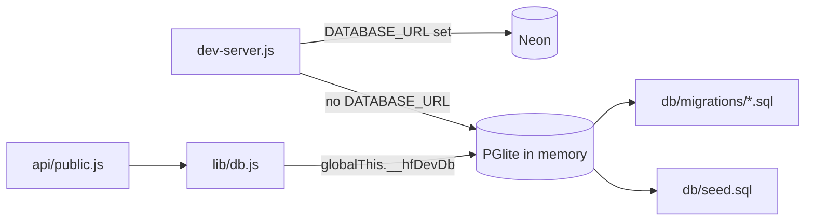

# Hanon Fan Site · project file

The Hanon fan site was built by **copying the Kotoha fan site and rebranding it** (`FORHANON.md`, commit `362fb05` "import the Kotoha code and rebrand it for Hanon"). So this file does not repeat the Kotoha analysis. **Everything in [`kotoha-fansite.md`](kotoha-fansite.md) applies here too, unless this file says otherwise.** Below: the header, a section-by-section map of what is shared, and full detail on everything that is unique to Hanon.

Every fact comes from comparing the two repositories file by file and from the live site; the Sources section lists where. Nothing here has been applied to Tabane yet.

| | |
|---|---|
| Name | Hanon Fan Site — unofficial, non-profit, bilingual (日本語 / English) fan site for Hanon (はのん) of HaKoniwalily, sister site of the Kotoha fan site |
| Kind | Own project (Moeko Works) |
| Live site | https://hanon-fansite.vercel.app/ |
| Repository | [PastelSalt/hanon-fansite](https://github.com/PastelSalt/hanon-fansite) (private) |
| Local folder | `C:\Users\Myaako\Documents\MoekoWorks\hanon-fansite` |
| Read at | commit `24afad0` (`main`, 2026-10-21), 13 commits, read 2026-10-25. **Updated** for the admin UI refresh at `114682e` (`main`, 2026-10-25, 16 commits): §1, §3.5, §4, §5, §6, §7 and §10 |
| Derived from | Kotoha fan site at its 2026-10-09 `main` (after the performance pass) |
| Target | Website (public site + private admin panel) |
| Theme | "Sazanami Scrapbook" (さざなみ, ripples): the Kotoha scrapbook system in Hanon's blue and penguin gold |
| Embeddable | **No.** `X-Frame-Options: DENY`, same CSP as Kotoha |
| Built | in one day, 2026-10-09 (11 commits), then the Moeko Works rebrand on 2026-10-21 |

---

## 1. What is shared with Kotoha

| Kotoha file section | For Hanon |
|---|---|
| 1 Overview | Same site shape: five sections + footer over a crossfading backdrop, admin panel, bilingual, cookieless, no build step |
| 2 Stack | Same, **plus** `@electric-sql/pglite` ^0.5.8 (development only, §3.3) |
| 3 Architecture (all diagrams) | Same, **plus** the preview database path in §3.3 |
| 4 Repository structure | Same, **minus** `MIGRATION.md`, `docs/DESIGN_V2_PLAN.md`, the four `docs/kotoha_*` data sheets and `public/js/public/motion/wipe.js`; **plus** `scripts/dev-db.js` and `scripts/perf/` (six files) |
| 5 Visual design | **Different identity** (§2): tokens, sticker sprite, loader spinner, About stage, favicon. Layout, breakpoints, layering and the surface vocabulary are unchanged |
| 6 How the front end operates | Same modules and behaviour, with the changes in §3.1 and §3.2. The **admin panel** got Kotoha's 2026-10-25 UI refresh (Kotoha §6.10) with the same layout, components, behaviour and locale keys; only its theme differs (§3.5) |
| 7 How the back end operates | Same code; only names change (cookie `__Host-hf_session`, storage keys `hf_lang` / `hf_motion`, Cloudinary folder `hanon-fansite/gallery`, User-Agent, guessable-word list), **plus** the preview database hook in `lib/db.js` (§3.3) |
| 8 Data model | Identical schema (`0001_init.sql` differs only in comments); seed data is Hanon's |
| 9 Process | Different: a copy-and-rebrand process with its own phases (§4) |
| 10 Reusable pieces | Every Kotoha piece exists here too; see §5 for the new ones |
| 11 Gotchas | All apply; §6 adds Hanon's own |

---

## 2. Unique: the "Sazanami Scrapbook" identity

### 2.1 Tokens (`public/css/v2/tokens.css`)

The pink/green scales are replaced; every other token (type, space, shape, motion) is unchanged.

| Group | Values |
|---|---|
| Sky scale | 50 `#f3f9fe` · 100 `#e2f0fb` (footer, soft panels) · 200 `#cde4f6` · **300 `#b7d7ef` (brand base, Hanon's image colour, page background)** · 400 `#79b5ff` (decorative fills) · 500 `#4a90d9` (title fills, borders) · 600 `#3576bd` (white on it 4.7:1) · **700 `#1f5e9e` (buttons, links, stickers; white on it 6.7:1, as text on paper 6.4:1)** · 900 `#163f6b` |
| Gold scale | 100 `#fff3c4` (beak tint) · 300 `#ffd66b` (penguin gold) · 500 `#f2b632` · 600 `#c27a0c` (white large text 3.4:1) · **700 `#a35f00` (NEW stamp, ribbons, active link; white on it 5.0:1)** |
| Logo pink | `#f898c0`, from her name logo and hair tips — decorative only, never text |
| Paper / ink | paper `#f7fbff` (cool white, `247 251 255`), ink `#22324a`, ink-soft `#4a5b72` |
| Section accents | picked from each artwork: home gold `#ffe3a0` (penguin crown and beak), about pink `#ffc0ce`, news café peach `#f6cfb2`, disco space lavender `#cbc8f5`, gallery balloon aqua `#c5e8e4` |
| Shadows | same shapes, tinted navy/blue (`rgb(31 63 107 / …)`) instead of pink |
| Focus ring | white + gold-700 |
| Pattern | `.sazanami-pattern`: faint drops and ripple rings (replaces `.clover-pattern`); grain recoloured blue |
| Scrims, veil, lightbox backdrop | sky-white and navy versions of the Kotoha ones |

Every colour pair has its measured contrast ratio written next to it in the tokens file (the source notes say the ratios are in `FORHANON.md` §5.2).

### 2.2 One sticker sprite, one class (`v2-sprite.svg`, 7.3 KB)

Kotoha had clover symbols (`.cl` class). Hanon has seven symbols, all drawn by **one class, `.pg`**, recoloured through custom properties:

| Symbol | Use |
|---|---|
| `#pg-penguin` | pins, timeline markers, footer credits, social fallback, empty/error states, mascot cameo, stream days in the week strip, sleeve covers |
| `#star` | sparkles, gold timeline stars, the About stage |
| `#drop`, `#ripple`, `#shell` | decorations, the About stage ring, fan-art title |
| `#spark`, `#heart` | kept from Kotoha |

- **Penguin colours:** `--pg-body`, `--pg-shade`, `--pg-bow`.
- **Other shapes:** `--c1` main, `--c2` inner, `--c3` light, `--c4` deep line (same scheme as Kotoha's clovers).
- **Variants recolour both at once:** `.pg--gold` (gold bow and gold star), `--pink`, `--mint`, `--lav`, `--navy`, `--pale`, `--white`.
- **Why it matters:** one class and one variable scheme for several different shapes, so any sticker can sit anywhere with any variant. Kotoha's sprite only had one family (clovers).

### 2.3 Star-and-penguin loader (`motion/spinner.js`, loader markup)

Same timing model, tiers, facts, whoosh and iris exit as Kotoha (Kotoha §6.2). The shape changes:

| | Kotoha | Hanon |
|---|---|---|
| Shape | clover arcs, viewBox `15 30 545 545` | four-point star `M0 -48 C 7 -13 13 -7 48 0 C 13 7 7 13 0 48 C -7 13 -13 7 -48 0 C -13 -7 -7 -13 0 -48 Z`, viewBox `-52 -52 104 104` |
| Progress pieces | four quadrant rectangles (`.petal`) | four triangular wedges between the diagonals (`.ray`): top, right, bottom, left |
| Fill colour | green petals | rays light up gold on a pale-blue star |
| Centre | green dot + gloss | **a small penguin that never rotates**: it sits in its own SVG outside the two turning stars |
| Inner size | 50 % of the outer | 70 % of the outer |

Detail worth keeping: the penguin `<svg>` has no `viewBox`, because the `<symbol>` brings its own; a second one shifted it by half its size.

### 2.4 About: ripple stage (`.ripple-stage`, replaces `.clover-stage`)

The full-body model stands on a pale star (`.ripple-stage__star`, `pg--pale`) with a ripple ring at her feet (`.ripple-stage__ring`), instead of Kotoha's big sky clover. The mascot cameo becomes the penguin sticker, because Hanon has no mascot art.

### 2.5 Other identity changes

| Where | Change |
|---|---|
| Stickers | `.sticker--gold` (gold gradient) replaces `.sticker--pink` for "coming soon" |
| Vertical text | `.v-text--blue` replaces `--green` |
| Nav progress | `.pg-meter`: a pale penguin filled from the bottom by a real one (was the clover meter) |
| Confetti | 🐧 shape; blue, white, gold colours |
| Special days | March 6 (birthday) and July 9 (VTuber debut), JST |
| Sparkles | gold and blue sparkles, pink heart, gold star, blue drop (no clovers) |
| Favicon | the penguin sticker flattened to fixed colours (no CSS variables, no `<use>`) inside `optimize-images.js`, so every renderer can draw it; apple-touch icon on the sky background |
| Logo | name logo recovered from the archived aiceclass.com, trimmed to its content (822 × 270) before resizing |
| Artwork | 7 owner-supplied backgrounds mapped to 5 sections + 1 loader; loaders 2 and 3 reuse section art as placeholders (own output files, so each slot is one line to swap) |

---

## 3. Unique: behaviour and tooling

### 3.1 Marquee bug fix (`motion/marquee.js`) — ported to Kotoha on 2026-10-25 (branch `marquee-reverse-fix`, not merged yet)

When the marquee plays in reverse after scrolling up, an infinite Web Animation reaching `currentTime = 0` finishes, and `play()` can't rewind a reversed infinite animation from 0 (it throws). Hanon starts the timeline `HEADROOM = 1000` loops in, and resets to `HEADROOM × duration` before `play()` if it ever got below one loop. It also guards `currentTime == null`. Found by the committed behaviour suite ("marquee runs again after calm → full").

### 3.2 Smaller behaviour changes

| Module | Change |
|---|---|
| `countdown.js` + `home.js` | **The duplicated schedule is fixed:** `export const STREAM_DAYS = [1, 4]` (Mon, Thu, `getUTCDay` numbering) is the one constant; the week strip maps its Monday-first index with `(i + 1) % 7`. Kotoha hard-codes it twice (Kotoha gotcha G9). Stream name #はのらじ, Mon/Thu 21:00 JST |
| `loader.js` | "Did you know?" facts = the About pills **plus** loader-only sentences from `about.facts` in the locale files |
| `render.js` `stateNote` | the penguin sticker instead of a mascot image |
| `data.js` | Hanon's socials and official links, adds Music (TuneCore) and StellaPhizz (her duo) |
| Text sizes | inherited 9–12 px labels raised so nothing readable is under 13 px (ticket stub, LIVE, flip units, ribbon, stamp, profile kana, fact labels, tile credit, label chips, week strip) |

### 3.3 Preview database without Neon (`scripts/dev-db.js`, `lib/db.js`, `scripts/dev-server.js`)

- **What:** when `DATABASE_URL` is missing, the dev server opens an in-memory Postgres (PGlite, WASM), runs every migration and the seed, and puts it on `globalThis.__hfDevDb`. `lib/db.js` returns that object instead of the Neon client. It exposes the same `query(text, params) → rows` shape.
- **Gives:** the public pages with real seed content before any database exists, and a check that the migrations and seed run on real Postgres (`node scripts/dev-db.js` prints row counts).
- **Limits:** public API only; admin and auth need the real database (they use the `sql` tagged template and transactions).

### 3.4 Committed test harness (`scripts/perf/`, 636 lines)

Kotoha's tests lived in a scratchpad and were lost (Kotoha gotcha G16). Hanon commits them. **They run against any site built from this codebase**, Kotoha included.

| File | What it does |
|---|---|
| `cdp.js` (119) | a minimal Chrome DevTools Protocol client: launches headless Chrome with a debugging port and drives one page over Node's global `WebSocket` (**no Puppeteer**): `newPage`, `goto`, `waitFor(expr)`, `eval`, `send`, `screenshot` |
| `server.js` (57) | test server: serves a site's `public/` with the CSP and headers from its `vercel.json`, **proxies `/api/public/*` to a deployed site** (read-only, cached in memory) and **swallows `/api/track` with 204** so tests never pollute analytics |
| `behaviour.js` (132) | 21 checks, one PASS/FAIL line each, non-zero exit on failure (list below); gallery checks skip when the gallery is empty |
| `scroll-bench.js` (101) | wheel-scrolls the whole page down and up, records every frame (time + scrollY) and long tasks; env `SIZE`, `CPU` slowdown, `GPU`, `RUNS`, `LANG`, `TRACE` (devtools timeline, main-thread time per event type), and **`OFF="css"` isolation experiments** that inject a style to switch one effect off |
| `shots.js` (45) | screenshots of every section at 1920×1080, 1366×768 and 390×844, per language and motion mode, optionally the loader |
| `admin-smoke.js` (182) | 50 API-level checks of every admin flow (list below); **refuses non-localhost URLs**; run against a throwaway Neon branch copy of production; needs a test owner with a forced password change |

**Behaviour checks:** loader spinner is static markup and turns from first paint · confetti not loaded during the loader · confetti loads after (idle) · page opens on Home with its artwork active · one wheel notch scrolls and stays (no snap) · marquee is one Web Animation · progress meter fills · lean never written to far off-screen cards · no per-frame custom property on `<html>` · PageDown scrolls · far sections marked `.is-far` · lightbox opens, locks scroll, Escape closes · marquee reverses scrolling up · motion toggle → calm · → full · marquee runs again after calm → full · switch to Japanese · no console errors or CSP violations · reduced-motion device starts calm · phone menu opens and locks scroll · phone menu link closes the menu and lands on the section.

**Admin smoke checks:**
- **Auth:** me without a session → 401 · wrong password → 401 · forced change · API blocked until changed → 403 · weak password → 422 · change → 200.
- **Videos:** YouTube lookup · draft not public · duplicate → 409 · publish · archive · restore.
- **News:** 4 links → 422 · no headline → 422 · publish · edit · archive.
- **Achievements and releases:** achievements draft/publish/archive · future release shows as Coming soon.
- **Gallery:** credit edit and revert.
- **Accounts:** admin can't manage accounts → 403 · owner resets and removes an admin · removed admin can't log in.
- **Other:** activity log records actions · analytics → 200, bad range → 400 · logout closes the API · request without Origin → 403 · lockout → 429.

**Recorded results:**
- **Admin smoke:** 50/50.
- **Scroll bench:** on the owner's GPU class (AMD Radeon Vega 3, headless Chrome, 1920×1080), the rebrand costs nothing: Hanon 13.1 fps · Hanon design on Kotoha's data 13.6 · Kotoha 12.6 · a plain text page 60.
- **Where the time goes:** the GPU process (raster and compositing). All animations off → 14 fps; backdrop off → 17.6; animations + backdrop + filters + shadows + text strokes off → 27.9.
- **Comparing with Kotoha:** Kotoha's earlier 35–38 fps came from a different machine, so the numbers aren't comparable.

### 3.5 Admin UI refresh, ported from Kotoha (2026-10-25; `docs/ADMIN_UI_PLAN.md` v0.2, commit `27caad2`, merge `bb32e5e`)

Everything described in Kotoha §6.10 "Admin UI refresh" applies here. Hanon's plan lists only what differs, under one rule: **the two admin panels stay identical in layout, components, behaviour and locale keys; only the theme differs.**

- **Starting point:** Hanon's admin was Kotoha's old admin re-skinned sky blue, with every `js/admin/*` file byte-identical to Kotoha's pre-refresh version. So the port was: take Kotoha's refreshed `admin.html`, `login.html`, `js/admin/{analytics,content,gallery,main,pages,ui}.js` and admin locales as they are; put Hanon's branding back (titles, `logo-400.webp` 400×131, `hanon` / `penguin` in the password blocklist); re-theme `css/admin.css` and swap the sprite references. After the port, `content.js` and `gallery.js` are still identical to Kotoha's; `analytics.js`, `main.js`, `pages.js` and `ui.js` differ only in a few lines (sprite helper and colour flag names).
- **Theme mapping (Clover Scrapbook → Sazanami Scrapbook), by colour role:**

| Role | Kotoha | Hanon |
|---|---|---|
| Page | pink-300 + white dots | sky-300 `#b7d7ef` + the same dots (0.36 alpha); ink on it 8.6:1 |
| Paper / sunken paper | `#fffaf2` / `#f7efe3` | `#f7fbff` / `#eaf2fa` |
| Ink / ink-soft | `#2b3326` / `#56614f` | `#22324a` / `#4a5b72` (6.7:1 on paper) |
| **Content** (buttons, tiles, active nav, split bars, drop zone, hours bars) | green | sky-500/600/700/900 (sky-700 on paper 6.4:1; white on sky-700 6.7:1) |
| **Visitors** (KPI numbers, visits chart, chart tip, legend, visitor sticker, record row icons, topbar "Admin" badge) | pink | **gold** 200–700 (+ admin-only gold-50 `#fff8e6`); sticker = Hanon's `.sticker--gold`; KPI numbers gold-700 on paper 4.8:1 |
| Sidebar link hover | pink | sky-50 / sky-900, as the public nav pill (10:1) |
| Focus ring | pink-700 | gold-700 |
| Shadows | pink/green-tinted | Hanon's navy-tinted shadows + a gold sticker shadow |
| Draft dashes, hairlines | beige | `--dash #a9c3dd`, `--line #d6e3ef` |
| Dialog backdrop, mobile scrim | plum | navy `rgb(16 36 64)` |

- **Sprite icons:** `clover(variant)` became `penguin(variant, extraClass, symbol = 'pg-penguin')` with class `.pg` (`.pg--gold`, `.pg--white`), same call sites; `sticker(…, { pink })` became `{ gold }`. Sidebar group labels: Content = penguin, Records = gold `#shell`, Account = `#star`. Welcome card corner: gold star. Avatar: penguin for owner, gold-bow penguin for admin. Empty states: penguin (big), `#drop` (small). Login card: penguin top left, gold star bottom right.
- **Judgment calls:** visitors became **gold**, because gold-700 is Hanon's public warm accent (NEW stamp, ribbons, active nav link) and it stays clearly apart from the blue content colour; the logo pink was rejected because the public design system keeps it decorative only. White text on the sky and gold sticker gradients is 3.3–5.0:1, so small sticker titles went from 18 to 19 px bold to count as AA large text.
- **Preview:** the same kind of mock server as Kotoha's (scratchpad only), on port **3001** so both previews can run side by side, proxying to the Hanon production public API, with mock users and two Japanese mock drafts. Checked: all 10 routes in EN and JA at 1920 / 1366 / 1024 / 375 px, chart hover, range switch, edit dialog and save, mobile menu, CSP, clean console. Owner approved with no changes; production files match the commit byte for byte. The real-data check (owner signs in) is still open.

---

## 4. Unique: the copy-and-rebrand process

`docs/IMPLEMENTATION_PLAN.md` (Hanon's own) and `docs/PROGRESS.md`, all on 2026-10-09:

| Phase | What happened |
|---|---|
| 0 Planning | read `FORHANON.md`; recovered the name logo and transparent front model from the Wayback copy of aiceclass.com; asset gap table vs. Kotoha; artwork mapping; owner questions with recommendation + confidence ("do all the recommended") |
| 1 Import | copy Kotoha's `main`, strip Kotoha: the `FORHANON.md` rename checklist (grep `kotoha\|Kotoha\|KOTOHA\|ことは\|ことリス\|Kotorisu\|kf_\|clover\|cl-leaf\|🍀`; cookies, storage keys, Cloudinary names, guessable words, schedule, special days, copy, palette, sprite) |
| 2 Identity | palette, sprite, loader — style tile checkpoint ✋ |
| 3 Art | artwork wired in, image script updated |
| 4 Copy | EN/JA locale review fixes |
| 5 Infra | Neon, Cloudinary, Vercel created only with the owner's OK for **each** resource; sister-site link |
| 6 Admin smoke | throwaway Neon branch (copy of production), 50/50 |
| 7 Harness | perf + behaviour harness committed; marquee fix |
| 8–9 | QA ✋ and launch ✋ (open at read time) |
| Admin refresh (2026-10-25) | port of Kotoha's admin UI refresh the same day: read Hanon's design docs and Kotoha's plan and commit, confirm the admin JS was identical to Kotoha's old version, port and re-theme on branch `admin-ui-refresh`, mock preview ✋, merge and deploy (§3.5) |

Asset gaps handled: no mascot → penguin sticker; only one loader artwork left after sections → reuse section art; no favicon/OG → generated in the image script; no clover frames or divider → not needed.

Artwork credits were researched (reverse image search, cover thumbnails, X): bg4 and bg5 @snowclole, bg7 @Parfait_Pie_12, bg6 逢坂レイ (@6963Saki); bg1 and bg2 unknown ("Artist unknown").

---

## 5. Reusable pieces unique to Hanon

| # | Piece | Files | What it gives a new project | Reuse |
|---|---|---|---|---|
| H1 | Committed CDP test harness | `scripts/perf/*.js` | browser tests without Puppeteer: behaviour suite, scroll benchmark with isolation experiments, multi-size screenshots, a test server that proxies a live read API and swallows analytics | High |
| H2 | Admin API smoke test on a throwaway branch | `scripts/perf/admin-smoke.js` | 50 end-to-end checks of auth, CRUD, archive/restore, accounts, analytics and security rules, with a localhost-only guard | High |
| H3 | In-memory Postgres preview | `scripts/dev-db.js`, hooks in `lib/db.js` and `dev-server.js` | previewing a database-backed site with seed data before the database exists, and checking migrations on real Postgres | High |
| H4 | Multi-shape recolourable sticker sprite | `v2-sprite.svg`, `.pg` rules in `components.css` | one class + custom properties for several illustrated shapes and colour variants | High |
| H5 | Re-theming the scrapbook system | `tokens.css`, `base.css`, `sections.css`, `FORHANON.md` §5 | a worked example of moving the whole design system to a new palette with contrast-checked pairs and artwork-picked accents | Medium |
| H6 | Star loader variant with a still centre figure | `motion/spinner.js`, loader markup, `.star-spinner` | how to swap the loader's shape (wedge rays instead of quadrants) and keep a figure still inside two turning shapes | Medium |
| H7 | Reverse-safe infinite Web Animation | `motion/marquee.js` | the HEADROOM fix for infinite animations played in reverse | High |
| H8 | Single schedule constant | `countdown.js`, `home.js` | one exported schedule for the countdown and the week strip | High |
| H9 | Flattened SVG favicon from a sprite sticker | `scripts/optimize-images.js` | a favicon generated from the site's own sticker, with fixed colours so every renderer draws it | Medium |
| H10 | Porting a redesign to a sister site by theme only | `css/admin.css`, `js/admin/ui.js` (`penguin`, `sticker`), `docs/ADMIN_UI_PLAN.md` | keep layout, components, behaviour and locale keys identical and map only colour roles (content, visitors, draft) and sprite symbols, so one redesign serves several sites | High |

---

## 6. Gotchas unique to Hanon

| # | Gotcha | Detail |
|---|---|---|
| HG1 | Reversed infinite Web Animations end at 0 and `play()` throws | start far into the timeline (HEADROOM) |
| HG2 | A `<symbol>` brings its own viewBox | don't add another on the `<svg>` that uses it, or it shifts by half its size |
| HG3 | Favicons can't rely on CSS variables or `<use>` | flatten the sticker to fixed colours |
| HG4 | The preview database covers the public API only | admin and auth need Neon |
| HG5 | The admin smoke test changes data | only against a throwaway database branch, never production; delete the branch afterwards (`smoke-test-2026-10-09` was still open at read time) |
| HG6 | Rebranding leaves leftovers | grep the whole rename list again after the copy (EN and JA), keeping only intentional duo mentions |
| HG7 | Scroll benchmarks differ by machine | compare back-to-back on one machine only |
| HG8 | Stale note in `docs/PROGRESS.md` | "Known issues" still says the image and seed scripts list Kotoha file names, but the code already uses Hanon's |
| HG9 | White text on light brand gradients | Hanon's sky and gold sticker gradients give 3.3–5.0:1, so sticker labels must stay ≥ 19 px bold (AA large text) |
| HG10 | A role colour must not be a decorative-only colour | the admin's "visitors" role couldn't use the logo pink (decorative only in the design system), so it became gold |

---

## 7. Proposed entries

### 7.1 Kotoha entries that should also list Hanon

All 29 proposed Kotoha entries exist unchanged (apart from names and colours) in Hanon, so each should get **Used in: Hanon Fan Site**, with these notes:

| Kotoha entry | Note to add |
|---|---|
| `kotoha-clover-loader` | Hanon variant: star rays + still penguin (H6) |
| `kotoha-scrapbook-design-system` | Hanon re-theme: Sazanami (H5) |
| `kotoha-scroll-life` | Hanon's marquee fix (H7); ported to Kotoha on branch `marquee-reverse-fix` (`c4dcee4`), live once merged |
| `kotoha-stream-ticket-week` | use Hanon's single schedule constant (H8) |
| `kotoha-image-pipeline` | Hanon adds the flattened sticker favicon (H9) |
| `kotoha-db-scripts` | Hanon adds the PGlite preview (H3) |
| `kotoha-admin-panel` | Hanon has the same refreshed admin in the Sazanami theme, visitors in gold (H10, §3.5) |

### 7.2 New entries

All new entries: Origin Own project, Status Proven, Target Website, Shared off, `projectFile: hanon-fansite`, ref `24afad0`.

| Slug | Title | Layer | Pieces | Stack | Feature | Related |
|---|---|---|---|---|---|---|
| `hanon-cdp-test-harness` | Hanon · Headless Chrome test harness without Puppeteer | Backend | H1 | nodejs, javascript | testing *(new)* | `kotoha-scroll-life`, `kotoha-scroll-reveals` |
| `hanon-admin-smoke-test` | Hanon · Admin API smoke test on a throwaway branch | Backend | H2 | nodejs, neon-postgres | testing *(new)*, auth | `kotoha-admin-auth`, `kotoha-content-crud-archive` |
| `hanon-pglite-preview` | Hanon · In-memory Postgres preview with PGlite | Backend | H3 | nodejs, pglite *(new)* | database *(new)* | `kotoha-db-scripts`, `kotoha-grouped-functions` |
| `hanon-sticker-sprite` | Hanon · Multi-shape recolourable sticker sprite | UI/UX | H4 | css | design-system *(new)* | `kotoha-scrapbook-design-system` |
| `hanon-sazanami-theme` | Hanon · Sazanami Scrapbook re-theme | UI/UX | H5, H6 | css, javascript | layout, design-system *(new)* | `kotoha-scrapbook-design-system`, `kotoha-clover-loader` |

H7, H8 and H9 are small fixes, and H10 is a way of working rather than code of its own, so they go into the Kotoha entries as notes rather than entries of their own (H10 also into the `replicate-hanon-fan-site` guide).

### 7.3 Replication guide

`replicate-hanon-fan-site` · Replication guide · Draft · Website: **"derive a sister fan site from Kotoha"**. Steps follow §4 (plan → import + rename checklist → identity → art → copy → infra with per-resource OK → admin smoke → harness → QA → launch), based on `FORHANON.md`. This is the more reusable of the two guides: it shows how to stamp out the next fan site.

---

## 8. Proposed new tag values

In addition to the Kotoha file's list:

| Tag | Value | Label |
|---|---|---|
| Stack | `pglite` | PGlite |
| Feature | `testing` | Testing |

---

## 9. Open questions

1. **Apply the marquee fix to Kotoha?** That is a change to the Kotoha repository, which Tabane work never touches; it would be its own task.
2. **Merge or keep separate:** keep `hanon-sazanami-theme` as its own entry, or fold it into `kotoha-scrapbook-design-system` as a "theme variant" section?
3. **Replication guides:** keep both (`replicate-kotoha-fan-site` and `replicate-hanon-fan-site`), or make the Hanon one the main guide for new fan sites, with Kotoha's as history?
4. **Harness reach:** the harness also works on Kotoha. List Kotoha under its Used in?

---

## 10. Sources

| Area | What was read |
|---|---|
| Comparison | file lists of both repos; changed-line counts for every shared file; full diffs of `spinner.js`, `loader.js`, `marquee.js`, `sparkles.js`, `home.js`, `fx.js`, `main.js`, `countdown.js`, `scroll-life.js`, `render.js`, `dev-server.js`, `lib/db.js`, `lib/password.js`, `tokens.css`, `base.css`, `sections.css`, `motion.css`, `optimize-images.js`, `package.json`; class-name comparison of `components.css` and `layout.css`; markup structure comparison of `index.html` |
| Hanon only | `scripts/dev-db.js`; headers and check lists of all six `scripts/perf/*.js` |
| Hanon docs | `docs/IMPLEMENTATION_PLAN.md` (headings, asset gaps), `docs/PROGRESS.md` (phases 6–7, known issues, session log), `public/js/public/data.js`, sprite symbol list |
| History | `git log` (13 commits, 2026-10-09 → 2026-10-21) |
| Admin refresh update (`114682e`) | `docs/ADMIN_UI_PLAN.md` (full), `git log` and `diff --stat` since `24afad0`, the head of the new `css/admin.css`, and a file-by-file diff of the refreshed admin against Kotoha's (`admin.html`, `js/admin/*.js`) |
| Live | `https://hanon-fansite.vercel.app/` headers (`X-Frame-Options: DENY`); `/api/public/home` 200 (3.5 s, database waking), `geo` and `gallery` 200 (2026-10-25) |
| Base analysis | [`kotoha-fansite.md`](kotoha-fansite.md) for everything shared |
