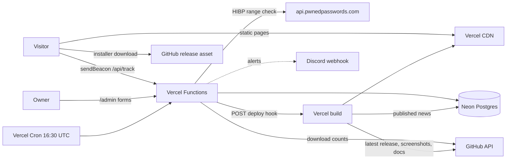
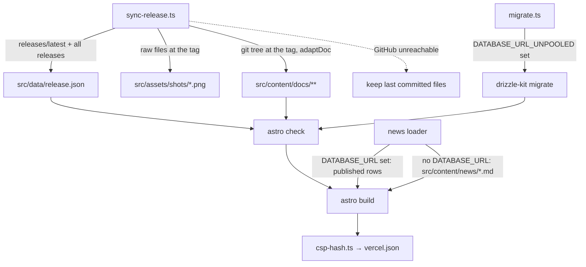
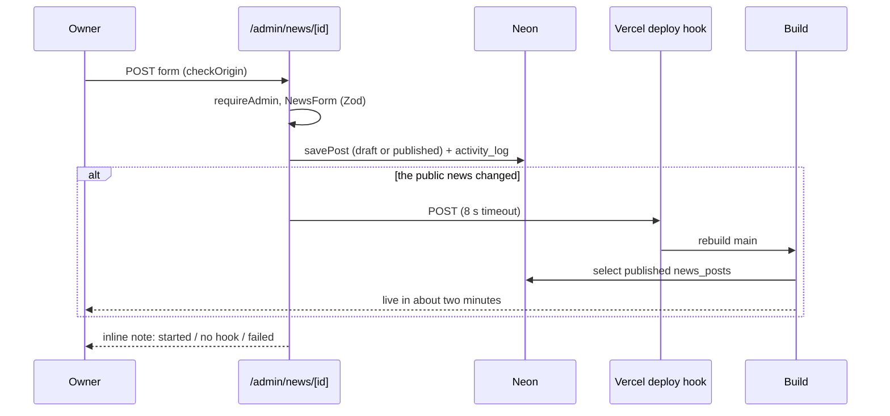
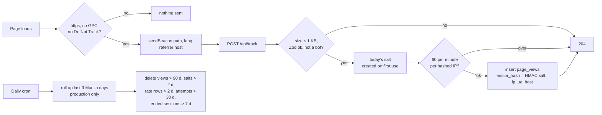
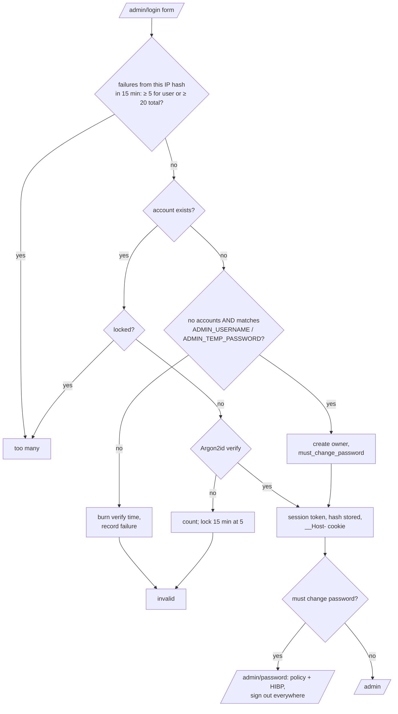

# Himawari Website · project file

Full architectural analysis (visual, operation, process, code) of the Himawari website, written for Tabane so its reusable parts can become entries. **The site only:** the Himawari engine and Himawari Studio (in the `himawari-c` repository) are out of scope. The only thing read from that repository is the site's own plan, `planning/WEBSITE.md`, because it is the website's spec. Every fact below comes from the website repository, that plan, or the live site; the Sources section lists where. Nothing here has been applied to Tabane yet.

The site was built on top of Aqua Iro Archive and the Kotoha fan site, and its code says so in many places ("as in Aqua", "as on the Kotoha fan site", "the portfolio's /api/track"). Pieces copied with little change point to those project files instead of being described again; what is new or different is written out in full.

| | |
|---|---|
| Name | Himawari website: the public site for Himawari, Moeko Works' free, open-source visual novel engine and editor (Himawari Studio), in English (`/`) and Japanese (`/ja`) |
| Kind | Own project (Moeko Works) |
| Live site | https://himawari-moekoworks.vercel.app/ |
| Repository | [PastelSalt/himawari-website](https://github.com/PastelSalt/himawari-website) (private) |
| Local folder | `C:\Users\Myaako\Documents\MoekoWorks\himawari-website` |
| Read at | commit `4eb655c` (`main`, 2026-10-23), 6 commits, read 2026-10-25. Plan: `himawari-c/planning/WEBSITE.md` at `d934e8f`. Applied at `4eb655c` |
| Target | Website (static public site + a small private admin panel at `/admin`) |
| Status on the site | Live, showing Himawari Studio 0.4.1. Admin panel and statistics added 2026-10-23 |
| Embeddable | **No.** The site sends `Content-Security-Policy: … frame-ancestors 'none'`, so Tabane must show screenshots, not a live frame |
| Size | ≈ 9,000 lines of code (TypeScript, Astro, CSS, SQL, tests) plus ≈ 740 lines of Markdown content (pages, news, copied docs) |

## Contents

1. [Overview](#1-overview)
2. [Stack](#2-stack)
3. [Architecture](#3-architecture)
4. [Repository structure](#4-repository-structure)
5. [Visual design](#5-visual-design)
6. [How the front end operates](#6-how-the-front-end-operates)
7. [How the back end operates](#7-how-the-back-end-operates)
8. [Data model](#8-data-model)
9. [How it was built (process)](#9-how-it-was-built-process)
10. [Reusable pieces catalogue](#10-reusable-pieces-catalogue)
11. [Gotchas and quirks](#11-gotchas-and-quirks)
12. [Proposed entries](#12-proposed-entries)
13. [Proposed replication guide](#13-proposed-replication-guide)
14. [Proposed new tag values](#14-proposed-new-tag-values)
15. [Open questions](#15-open-questions)
16. [Sources](#16-sources)

---

## 1. Overview

- **What it is:** a product site for a desktop app. One long home page with anchored sections, plus Download, News, Docs, About, Privacy and a 404, each in both languages.
- **Home sections, in order** (`HomePage.astro`): news bar → hero (with a live Studio window) → three promises (About) → features → a black "coming soon" band → download → Learn → news → FAQ → Get involved. Small flower ornaments sit between sections.
- **What makes it different from the earlier sites:**
  - **It keeps itself current:** every build reads the engine's latest GitHub release (version, date, size, SHA-256, every earlier version) and copies that release's screenshots and docs into the site.
  - **Static news written in a panel:** news is edited in `/admin`, stored in Neon, and pulled in at build time by a custom content loader; saving calls a Vercel deploy hook to rebuild.
  - **No cookies and no third-party requests** for visitors; the e2e tests fail if either happens.
  - **A script-free admin panel:** plain HTML forms and server-drawn charts.
- **Look:** taken from nanahira.jp's layout (pill section titles on a rule, a speech-bubble news bar, ornaments between sections), re-coloured to the logo's sunflower yellow, with thick black outlines and offset shadows on buttons and windows (`WEBSITE.md` §6.1).
- **What it is for (Tabane's view):** a small, clean template for a free product's site (download, docs, news, privacy-friendly counts), and the third use of the shared Moeko Works stack.

## 2. Stack

| Layer | What | Tabane tag |
|---|---|---|
| Language | TypeScript 6, Astro components, plain CSS (`lightningcss` minify) | `typescript`, `css` |
| Framework | Astro 7.3, `output: 'static'`, on-demand routes for `/api/*` and `/admin/*`, hover prefetch, `checkOrigin` | `astro` |
| Islands | Preact is installed and configured but no island exists (G6) | — |
| Hosting | Vercel (region `sin1`), `@astrojs/vercel` (`maxDuration` 30), one cron, a deploy hook | `vercel` *(Kotoha)* |
| Database | Neon Postgres over HTTP (`@neondatabase/serverless`), Drizzle ORM 0.45 + drizzle-kit migrations | `neon-postgres`, `drizzle` *(Aqua)* |
| Auth | Own code: Argon2id (`@node-rs/argon2`), hashed sessions, HIBP range check (Kotoha's design) | `argon2` *(Kotoha)* |
| Libraries | BudouX 0.9 (Japanese line breaks), canvas-confetti 1.9 (loaded on first click), `@phosphor-icons/core` (sprite), sharp (images, share images) | `budoux` *(new)*, `canvas-confetti` *(Kotoha)*, `sharp` *(Kotoha)* |
| Fonts | Fredoka 400–700 (inlined by `<Font>`), Zen Maru Gothic 500/700 (served from `/fonts/jp.css`) | — |
| Data source | GitHub REST API + raw files of `PastelSalt/himawari-c` at the latest release tag | — |
| Tests | Vitest 5 (unit; integration on PGlite with the real migrations), Playwright 1.64 (Chromium, WebKit, mobile) + axe | `vitest`, `playwright` *(Aqua)*, `pglite` *(Hanon)* |
| CI | GitHub Actions: lint, contrast, tests, build (retried once), JS budget, e2e, `npm audit` | — |
| Runtime | Node ≥ 24 | `node-js` |

## 3. Architecture

### 3.1 Level 1 · System



### 3.2 Level 2 · Build



### 3.3 Level 2 · Publishing news



### 3.4 Level 2 · Counting a visit



### 3.5 Level 2 · Admin sign-in



## 4. Repository structure

```text
astro.config.ts          static output, Vercel adapter, sitemap with i18n, fonts, env schema, rolldown stub
vercel.json              sin1, daily cron, security headers + CSP (hashes from csp-hash.ts), caching, noindex for /api and /admin
drizzle.config.ts        migrations in db/migrations
db/migrations/           0000_init (counter), 0001_admin_and_news, 0002_seed_news (+ meta snapshots)
scripts/                 sync-release, migrate, csp-hash, check-budget, contrast-check, make-og; dev/serve-dist.mjs
src/layouts/             Base.astro (meta, hreflang, pre-paint Motion, chrome), Page.astro, Admin.astro
src/pages/               index, download, about, privacy, 404, news/{index,[slug]}, docs/[...slug], fonts/jp.css.ts;
                         ja/ mirrors them; admin/{index, login, logout, password, stats, news/[id]}; api/{track, cron/daily}
src/components/home/     HomePage, Hero, StudioScene, About, Features, FeatureRow, ComingSoon, Download, LinkCards, News, Faq
src/components/pages/    DownloadPage, DocsPage, NewsIndex, NewsPost, ProsePage (shared by both languages)
src/components/chrome/   Header, NavPanel, NewsBar, Footer, Sprite
src/components/ui/       Button, Window, SectionTitle, Flower, Ornament, Icon, NewsRows, ReleaseMeta, Requirements, SmartScreen
src/components/admin/    BarChart, BarList (server-drawn)
src/i18n/                en.ts, ja.ts (typed copy), index.ts (copyFor)
src/lib/                 site (constants, release, langOf, path), news, news-loader, docs, doc-links, phrase (BudouX)
src/content/             pages/{en,ja}/{about,privacy}.md, news/{en,ja}/*.md (offline copies), docs/** (copied at build)
src/data/release.json    the latest release, written by sync-release.ts
src/scripts/             global (Motion, menu, panels, FAQ hash, fonts, beacon), hero, reveal, offscreen, confetti
src/server/              track (counter + housekeeping), stats, auth, password, news, admin, ua, alerts; db/{schema, http, types}
src/styles/              tokens, base, components, sections (956), motion, admin
tests/                   unit (site, text), integration (track, stats, admin on PGlite), e2e (home, pages + fixtures)
```

## 5. Visual design

### 5.1 Identity: sunflower on paper

From `WEBSITE.md` §6.1 (what is taken from nanahira.jp, and what is changed):

| nanahira.jp | Himawari site |
|---|---|
| near-white background, one coral accent for everything; coral text fails WCAG (1.85:1) | warm paper `#FFFCF2`; yellow only for fills, highlights and shadows; body text `#45404D` (9.77:1) |
| thin double-line pill section titles on a rule | the same, in dark gray, with letters that pop in |
| ribbon ornament between sections | a five-petal flower drawn in SVG, yellow or white, from the logo |
| sticker hero art among desktop windows | a live Studio window with a thick outline and a yellow offset shadow |
| coral speech-bubble news bar | yellow speech bubble with a bobbing white flower |
| thin lines everywhere | thin lines, except **thick black outlines on buttons and window frames** |
| no dark sections | **one** black band: coming soon |
| no animation | one moving thing per screen |

- **Rule of weight:** thick (2.5 px black) only on things you click and on window frames; 1.5 px on pills and small controls; 1 px on cards.
- **Labels in capitals stay English in both languages** ("as on nanahira.jp"), with the Japanese name under them in the phone menu on the Japanese pages (`Header.astro`: `lang === 'ja'`).
- **Light theme only** for v1.

### 5.2 Tokens (`src/styles/tokens.css`)

- **Sunflower:** `--sun #f5d57c`, `--sun-deep #f1cb60`, `--sun-wash #fdf3d4`. Never text on light.
- **Paper and text:** `--paper #fffcf2`, `--white`, `--ink #2e2a33` (headings), `--text #45404d` (body), `--gray-600 #5d5869` (secondary, nav), `--gray-500 #77727f` (dates and small captions only), `--line #ddd6c8`, `--line-strong #4a4550`, `--black #1e1a24`.
- **Black band:** `--band-head` (sun), `--band-text #d9d3c4`, `--band-strong #f3eedf`.
- **Hero game (decoration):** sky, grass, sun, skin, hair colours.
- **Type:** `--font` (Fredoka then Zen Maru), `--font-ja`; fluid steps `--step--2 … --step-6` (≈ 12 px to ≈ 52 px hero), label tracking 0.18 em, pill 0.16 em.
- **Layout:** `--column: 1000px`, `--gutter: 16px`, spacing `--s-1 … --s-9`.
- **Outlines and radii:** `--bw-thick 2.5px`, `--bw-thin 1.5px`, `--bw-hair 1px`; pill, 10, 16 (button), 18 (window), 20 (card), 22 (bubble).
- **Offset shadows:** `--sh-btn: 4px 5px 0 black`, `--sh-btn-sun` (yellow), `--sh-btn-press: 1px 1px 0` (pressed), `--sh-win: 8px 10px 0 sun`.
- **Focus:** `--ring`: a 3 px black ring with a 2 px white gap.
- **Motion tokens:** `--ease-pop`, `--ease-rise`, `--ease-float`, `--dur-1/2/3` (120, 220, 700 ms), **set to 0 ms when Motion is off** (and under reduced motion unless Motion was turned on), so every transition built on them stops at once.
- **Checked:** `scripts/contrast-check.ts` asserts every text pair at WCAG AA in CI.

### 5.3 Components

| Component | What it looks like |
|---|---|
| Sticker button (`Button.astro`) | thick black outline and offset shadow that closes up when pressed; `primary` yellow with a black shadow, `ghost` white with a yellow shadow, `wide` the pale-yellow full-width "more" button |
| Window frame (`Window.astro`) | thick outline, sunflower offset shadow, pale-yellow title bar with three dots; can be one image to assistive technology with a label |
| Pill section title (`SectionTitle.astro`) | one capitalised word in a thin double-line pill on a full-width rule; each letter its own span so it can pop in; screen readers hear the label once |
| News bar (`NewsBar.astro`) | yellow speech bubble with the latest post and a bobbing white flower |
| Promise card (`About.astro`) | thin border, duotone icon |
| Feature row (`FeatureRow.astro`) | kicker with icon, heading, paragraph, list with yellow markers, visual (a real screenshot in a window frame, or real script) |
| Coming-soon band (`ComingSoon.astro`) | the page's one dark moment; flowers fall behind it, CSS only, positions fixed at build |
| News rows (`NewsRows.astro`) | icon tile, title, "date \| category", one line |
| FAQ (`Faq.astro`) | native `<details>`, each with an address `#faq-n` |
| Requirements, SmartScreen, release meta | thin-bordered table; the SmartScreen step and the installer's SHA-256; "0.4.1 · 22 October 2026 · 146 MB" with silent dots |
| Flower and ornament (`Flower.astro`, `Ornament.astro`) | the logo's five-petal flower drawn in code: yellow with a dark centre, or white with a yellow centre |

### 5.4 Icons

One inline sprite (`Sprite.astro`). Phosphor icons copied in at build time: duotone as `#ph-<name>`, regular as `#phr-<name>`. `.icon--duo` makes every icon black with a solid sunflower fill (via `--ph-fill` / `--ph-op`). The two flowers are `#flower` and `#flower-white`. No emoji anywhere; the docs import strips them (section 7.6).

### 5.5 Art without an art budget (`WEBSITE.md` §6.6)

- Hero: an HTML/CSS recreation of Studio, with logo flowers drifting behind.
- Feature visuals: real Studio screenshots, refreshed from the release by the build.
- Share images and icons: `make-og.ts` (sharp), English and Japanese 1200×630 images with the logo, tagline and a screenshot in a window frame; favicon from the code-drawn flower. Run by hand; outputs committed.
- 404: flowers drifting off the page.

### 5.6 Admin look

`admin.css` reuses the site's tokens and buttons with a small header (`Admin.astro`); no decoration and no scripts.

## 6. How the front end operates

### 6.1 Pre-paint Motion (`Base.astro`)

An inline script (hashed into the CSP) reads `hws:prefs` from localStorage, falls back to `prefers-reduced-motion`, and sets `html[data-motion]`. **`?still` in the address turns motion off for that visit without saving it.** Same pattern as Aqua's pre-paint script, with only Motion (the language is in the URL).

### 6.2 Languages by URL

- `/` is English, `/ja/...` Japanese; `langOf(url)` and `path(p, lang)` in `src/lib/site.ts`. Each page receives `alternate: { en, ja }` for hreflang links and the language switch (`x-default` is English).
- Copy lives in typed files (`src/i18n/en.ts`, `ja.ts`), picked with `copyFor(lang)`; the Japanese file has to match the English `Copy` type.
- Shared page components (`components/pages/*`, `HomePage.astro`) render either language; `src/pages/ja/*` are thin wrappers.
- Sitemap carries i18n alternates; `/api` and `/admin` are excluded.

### 6.3 Japanese line breaks (`src/lib/phrase.ts`)

BudouX splits a headline into phrases at build time; each phrase becomes a `<span class="ph">` that does not wrap, so lines break between phrases, never inside a word. Only text between tags is split, so `<mark>` and `<code>` survive. It replaced `<wbr>` with `word-break: keep-all`, which broke inside words in Chrome where a phrase met a tag.

### 6.4 Header, navigation panels and phone menu (`Header.astro`, `NavPanel.astro`, `global.ts`)

- **Header:** logo, `EN / 日本語`, a MOTION ON/OFF pill (`aria-pressed`), GitHub and contact icon buttons.
- **Sticky nav row:** "HIMAWARI", a thin rule, and the home sections. On the home page the links are anchors; elsewhere they go to `/#section`.
- **Panels (wide screens):** DOWNLOAD, LEARN, NEWS and FAQ open a panel under the bar **on hover or keyboard focus, in CSS**. The panels hold the download button with its meta and links, five "learn" cards, the latest three posts, or the seven questions. Escape closes the open one and returns focus to its link, and choosing a link closes it too (content shown on hover must be dismissible, WCAG 1.4.13); it can open again once the pointer or focus has left (`is-dismissed`).
- **Phone menu:** a yellow button with `popovertarget`, a native popover that needs no script to open or close; choosing a link hides it.

### 6.5 The live Studio window (`StudioScene.astro`, `src/scripts/hero.ts`)

- An HTML/CSS Studio: a screenplay row (speaker, mood chip, typed text, caret, add buttons) beside a tiny game (sky, field, a character with a face, a textbox).
- A line types itself into the screenplay row and the game's textbox together (42 ms per character, `[...text]` so Japanese counts by character), holds 1.7 s, then the mood chip and face change with a small bump (Web Animations) and the next line starts; three lines loop.
- **Server-rendered with the first line finished**, which is what Motion OFF shows; turning Motion off puts that line back. The loop stops off screen (IntersectionObserver) and while the tab is hidden.
- The whole window is one image to assistive technology, described by its label.

### 6.6 Reveals, off-screen pausing, confetti

- **Reveals (`reveal.ts`, Aqua's pattern):** `.reveal` blocks rise and `.sec-title` letters pop in when they arrive. It uses the observer's first report (no `getBoundingClientRect` at load) to leave anything already on screen alone; hooks come off after `animationend`; switching Motion off shows everything.
- **Off-screen pausing (`offscreen.ts`, Aqua's):** zones get `[data-offscreen]`; `motion.css` pauses every loop inside.
- **Confetti (`confetti.ts`):** buttons with `data-confetti` (the download buttons) burst into yellow, white and black confetti; canvas-confetti loads on the first click; drawn on the main thread because its worker needs a `blob:` URL the CSP doesn't allow; Motion ON only.
- **Idle motion (`motion.css`):** bob, float, blink, fall; transform and opacity only; with Motion off, nothing moves at all.

### 6.7 Small behaviours (`global.ts`)

- A link to one question (`#faq-3`) opens that `<details>`, also on `hashchange`.
- The Japanese font stylesheet is switched from `media="print"` to `all` after load (non-blocking), with a `<noscript>` fallback.
- Motion changes dispatch `hws:motion` for the hero and reveals.

### 6.8 Pages

- **Download (`DownloadPage.astro`):** installer button, install steps, requirements, SmartScreen, SHA-256, and every earlier version from `release.history`. Below 760 px the download blocks add a note (`.dl__phone`) to open the page on a computer, since Himawari runs on Windows PCs.
- **Docs (`DocsPage.astro`, `src/lib/docs.ts`):** one page of the engine's docs at the released version, with a sidebar of a "Start" group (pages in no group) and four groups (Tutorials, How-to guides, Reference, Explanation), and a line "For Himawari 0.4.1" with "This page on GitHub". Japanese pages list their own first, then the English ones, marked. The language switch goes to the same page in the other language when it exists, else that language's docs home. Code blocks are plain (G9).
- **News:** index and post pages from the news collection.
- **About and Privacy:** Markdown from `src/content/pages/<lang>/`; Privacy describes exactly what the counter stores, and the code comment says to keep the two in step.

## 7. How the back end operates

### 7.1 Static with two kinds of on-demand route

Prerendered: every public page and `/fonts/jp.css`. On demand (`prerender = false`): `/api/track`, `/api/cron/daily`, and every `/admin` page. `vercel.json` adds `no-store` and `noindex` to both groups.

### 7.2 The release sync (`scripts/sync-release.ts`)

- Before every build, reads `releases/latest` and all releases of `PastelSalt/himawari-c`. Finds the installer by name (`Himawari-Studio-Setup-*.exe`) and takes its SHA-256 from the asset's `digest` field.
- Writes `src/data/release.json`: tag, version, name, date, notes URL, installer (name, URL, bytes, sha256, downloads), and `history` (every non-draft, non-prerelease release with an installer).
- Copies three screenshots from the tagged source (`docs/images/`) and every `docs/**/*.md` from the tag's git tree, passing each through `adaptDoc`.
- **Fail-safe:** everything is downloaded first and written only once it has all arrived; if GitHub can't be reached the committed files stay and the build goes on. `release.json` is rewritten only when it changed. `GITHUB_TOKEN` is optional (rate limit on shared build machines).
- `site.ts` exposes `RELEASE`, `atTag(path)` (links pinned to the released tag), `releaseDate(lang)` in Manila time, and `installerSize()` in MB as Windows shows it (1024 × 1024).

### 7.3 Docs adaptation (`src/lib/doc-links.ts`)

- `docs/how-to/x.md` → `/docs/how-to/x`; `docs/ja/…` → `/ja/docs/…`; `index` drops out.
- Relative links to other docs pages become site URLs; links to anything else in the engine repository point at GitHub at the released tag.
- Emoji are removed (not ©, ®, ™).
- Fenced code blocks and inline code are left exactly as they are.

### 7.4 News: database at build, Markdown offline (`src/lib/news-loader.ts`, `src/server/news.ts`)

- **Custom Astro content loader:** with `DATABASE_URL` (every Vercel build) it reads published rows from `news_posts` and stores one entry per language that has a title, summary and body (`en/<slug>`, `ja/<slug>`), rendering the Markdown body. Without it (local builds, CI) the Markdown files in `src/content/news` stand in.
- **If the database is configured but can't be read, the build fails** rather than publishing out-of-date news; Vercel keeps the last good deployment live.
- **Editor form (`NewsForm`, Zod):** slug (lowercase, single hyphens), date, category (`Release` or `Announcement`), optional `https://` link, English title/summary/body required, and Japanese all three or none.
- **Save, publish, unpublish, delete** write `activity_log` rows. Any change to what's public calls `triggerRebuild(VERCEL_DEPLOY_HOOK_URL)` (8 s timeout) and the page shows one of three notes: rebuilding (live in about two minutes), no hook set, or rebuild failed.
- `0002_seed_news.sql` moved the two Markdown release posts into the database "so all news is edited in the admin panel".

### 7.5 Admin panel: plain forms, no scripts (`src/server/admin.ts`, `src/pages/admin/*`)

- Pages: overview (news list and recent activity), news editor, statistics, password, login, logout.
- **No scripts at all:** admin pages are rendered on demand, so their inline scripts couldn't be hashed into the build-time CSP. Forms are plain HTML posts guarded by Astro's `checkOrigin`; charts are drawn on the server.
- `requireAdmin()` returns the database and session, or redirects to the login page, or to the password page while the temporary password is still in use.
- Times shown in Manila time.

### 7.6 Admin auth (`src/server/auth.ts`, `password.ts`; Kotoha's design in TypeScript)

- **Owner from environment values on first sign-in:** when no account exists and the username and password match `ADMIN_USERNAME` / `ADMIN_TEMP_PASSWORD` (compared in constant time through SHA-256), the account is created with `must_change_password`. Once an account exists those values are ignored, so the temporary password stops working the moment it's replaced. (Kotoha used a bootstrap script instead.)
- **Sessions:** 32-byte random token, only its SHA-256 stored; cookie `__Host-hws_admin` (`hws_admin_dev` over plain http), httpOnly, `SameSite=Strict`; ends after 2 idle hours or 7 days; `last_seen_at` refreshed at most every 5 minutes.
- **Throttling:** failures counted per daily-salted IP hash over 15 minutes (5 for one username, 20 in total); 5 wrong passwords lock the account for 15 minutes; unknown usernames burn a dummy Argon2 verify so timing doesn't reveal accounts.
- **Passwords:** Argon2id at the OWASP baseline (19 MiB, 2 iterations, 1 lane); 12–128 chars; rejects passwords containing the username, the same as the current one, or made **only** of guessable site words (a word-break check over a list: himawari, studio, sunflower, moeko, password, admin…); HIBP k-anonymity range check with padding and a 3 s timeout (unreachable doesn't block).
- **Changing the password** signs out every browser and returns a fresh session for this one.

### 7.7 Cookieless visit counter (`src/server/track.ts`, `ua.ts`, `/api/track`)

- **Client:** sent with `sendBeacon` only over HTTPS and only when neither Global Privacy Control nor Do Not Track is set; carries path, language and the referring site's host name (not the full address).
- **Endpoint:** body ≤ 1 KB, Zod-validated; **always answers 204 with no body**; errors go to Discord, never to the caller. Reads `x-forwarded-for` (G2).
- **Visitor hash:** HMAC of a **daily random salt** stored in `analytics_salts`, created on first use and deleted after two days, over IP, user agent and host. Visitors can't be followed across days; IPs and full user agents are never stored.
- **Stored per view:** path, language, referrer host (not if it's this site), device type and browser family (`parseUA`), country (from Vercel's header, two letters only), visitor hash, environment (production, preview, development).
- **Bots:** a user-agent pattern (crawlers, previewers, headless browsers, Lighthouse, curl, node-fetch…) is never counted.
- **Rate limit:** a generic `overLimit(bucket, keyHash, limit, windowMs)` on fixed windows with an upsert (`rate_limits`), 60 views a minute per hashed IP.
- **Daily housekeeping (cron 16:30 UTC, about 00:30 Manila):** rolls the last three Manila days of production views into `daily_page_views` (per path plus a `*` total), idempotent so late or repeated runs are fine; deletes views after 90 days, salts and rate rows after 2, sign-in attempts after 30, ended sessions after 7. The cron checks `Bearer CRON_SECRET` with `timingSafeEqual`.

### 7.8 Statistics (`src/server/stats.ts`, `/admin/stats`, `BarChart.astro`, `BarList.astro`)

- Visits per day (30 days), per week from Monday (12 weeks) and per month (12 months); breakdowns for 7, 30 or 88 days (totals, plus top tens of pages, sources, countries, devices, browsers, languages, and views by hour).
- Recent days come from single views (kept 90 days); older days from the daily totals. 88 days, not 90, so the cron's deletion never cuts a day in half.
- A visitor counts once per day: one person on two days is two visitors (stated in the code).
- **Installer downloads per release** read live from GitHub's own counts; nothing stored.
- **Charts drawn on the server** as SVG (sunflower bars for visitors, a dark line for views), with the numbers also in a table for screen readers.

### 7.9 Security and delivery (`vercel.json`, `scripts/csp-hash.ts`)

- **Headers (live):** CSP `script-src 'self'` + 2 sha256 hashes, `connect-src 'self'`, `img-src 'self' data:`, `frame-ancestors 'none'`, `object-src 'none'`, `form-action 'self'`, `upgrade-insecure-requests`; HSTS with preload; `nosniff`; strict-origin referrer; Permissions-Policy; **`Cross-Origin-Opener-Policy: same-origin`** (new compared with Aqua).
- **No cookies for visitors** (confirmed live: no `Set-Cookie` on `/`).
- **CSP hashes at build:** Aqua's `csp-hash.ts`.
- **Caching:** `_astro/*` immutable; `/fonts/jp.css` one day plus a week stale; `/api` and `/admin` no-store.
- **Migrations in the build:** `migrate.ts` runs `drizzle-kit migrate` when `DATABASE_URL_UNPOOLED` is set; with the Neon integration each Vercel preview has its own database branch.

## 8. Data model

### 8.1 Database (`src/server/db/schema.ts`, `db/migrations/*`)

| Table | Holds | Notes |
|---|---|---|
| `analytics_salts` | day (PK), salt | deleted after 2 days |
| `page_views` | identity id, `occurred_at`, path, lang, `referrer_host`, `device_type`, browser, country, `visitor_hash`, environment | deleted after 90 days |
| `daily_page_views` | day, path (`*` = total), views, visitors | rollup |
| `rate_limits` | bucket, `key_hash`, `window_start`, hits | unique (bucket, key_hash, window_start); deleted after 2 days |
| `admin_users` | username (unique), `password_hash`, `must_change_password`, `password_changed_at`, `failed_login_count`, `locked_until`, `last_login_at` | one owner |
| `admin_sessions` | user, `token_hash` (unique), created, `last_seen_at`, `expires_at`, `revoked_at` | deleted 7 days after ending |
| `login_attempts` | `attempted_at`, `ip_hash`, `username_attempted`, succeeded | deleted after 30 days |
| `activity_log` | at, username, action, details jsonb | audit |
| `news_posts` | slug (unique), `posted_on`, category, link, title/summary/body in `en` and optional `ja`, status (draft or published), `published_at`, created/updated | read at build |

### 8.2 Content collections (`src/content.config.ts`)

`news` (custom loader, section 7.4), `docs` (copied Markdown), `pages` (About and Privacy per language).

### 8.3 Release data (`src/data/release.json`)

Written by the build, committed; holds the latest release and the history list (section 7.2).

## 9. How it was built (process)

### 9.1 Timeline (6 commits, 2026-10-22 → 2026-10-23)

| Commit | What |
|---|---|
| `8b83619` W1 | the page's bones |
| `a90cbe9` W2–W4 | motion, Japanese, the other pages, counting, and docs |
| `680d29f` | API routes crashing on Vercel: the rolldown import leak (stubbed "as Aqua Iro Archive does") and `clientAddress` |
| `bb6093a` | admin panel for the news, "as on the Kotoha fan site" |
| `ae72324` | statistics in the admin panel, "as on the Kotoha fan site" |
| `4eb655c` | panels under the navigation for download, learn, news and FAQ |

### 9.2 Working method seen in the repo

- **Plan first, in the product's repo:** `planning/WEBSITE.md` (purpose, visitors and their questions, principles, site map, section-by-section home page, design taken from a named reference site, motion, words, "how it's built, the way the previous projects are", quality bars, milestones W1–W4, questions for the owner with recommendations, "done when"), plus an approved HTML mockup.
- **Reuse by name:** almost every module's comment says where it came from (Aqua, Kotoha, the portfolio), so the lineage is traceable.
- **Quality bars as tests:** no third-party requests, no CSP violations, no cookies, no broken links, axe on every page, one `h1`, correct `lang`, no sideways scroll, 40 KB JS per page.
- **Honest copy:** no dates or names for the coming visual novel "until the owner announces them"; feature cards without screenshots say nothing is drawn rather than faking art.
- **Commit messages explain the why** in plain words, including the WCAG rule behind a behaviour.

### 9.3 Operations (README)

- Work on `dev`; `main` deploys production. Secrets only in Vercel and `.env.local`.
- First admin sign-in from the environment values, then delete them.
- Publishing news rebuilds through the deploy hook in about two minutes.
- `npm run og` after art or tagline changes; commit the output.
- CI: lint (ESLint + Prettier), contrast, tests, build with one retry, budget, Playwright on Chromium, WebKit and mobile, `npm audit --omit=dev --audit-level=high`.

## 10. Reusable pieces catalogue

Reusability: **High** = lift with little change · **Medium** = needs rebranding or untangling · **Low** = specific to Himawari.

### 10.1 UI/UX pieces

| # | Piece | Files | What it gives a new project | Reuse | What to change when lifting |
|---|---|---|---|---|---|
| H-U1 | Sunflower sticker design system | `tokens.css`, `components.css`, `Button`, `Window`, `SectionTitle`, `Flower`, `Ornament`, `WEBSITE.md` §6 | warm paper, one accent used only for fills, thick outlines with offset shadows on clickable things and windows, pill titles on a rule, motion tokens that zero out | High | accent colour, flower |
| H-U2 | Product home page layout | `HomePage.astro` and `components/home/*` | news bar → hero → promises → features → one dark band → download → learn → news → FAQ → get involved, with ornaments between | High | sections, copy |
| H-U3 | Live app-window hero | `StudioScene.astro`, `hero.ts` | an HTML/CSS recreation of the product with a typing loop, finished line as the still state, pause off screen, one labelled image to assistive tech | Medium | the scene |
| H-U4 | Hover/focus navigation panels + script-free phone menu | `Header.astro`, `NavPanel.astro`, `global.ts` | CSS mega-panels that open on hover and focus, Escape-dismissible (WCAG 1.4.13), and a native popover menu | High | panel contents |
| H-U5 | Release-aware download block | `Download.astro`, `DownloadPage.astro`, `ReleaseMeta`, `Requirements`, `SmartScreen`, `site.ts` | button, version · date · size, requirements, SmartScreen step, SHA-256, all versions, all from the release data | High | platform notes |
| H-U6 | Docs pages from a product repo | `DocsPage.astro`, `lib/docs.ts` | docs at the released version with a four-group sidebar and language fallback | High | groups |
| H-U7 | Pill section title with letter pop | `SectionTitle.astro`, `reveal.ts`, `motion.css` | per-letter pop-in that reads once to screen readers | High | — |
| H-U8 | BudouX phrase spans | `lib/phrase.ts`, `.ph` in `base.css` | Japanese headlines that break between phrases, tags preserved | High | — |
| H-U9 | Native FAQ with addressable answers | `Faq.astro`, `global.ts` | `<details>` with `#faq-n` that opens when linked | High | — |
| H-U10 | Download confetti | `confetti.ts` | lazy confetti on a marked button, CSP-safe (no worker), Motion ON only | High | colours |
| H-U11 | Motion switch with `?still` | `Base.astro` pre-paint, `global.ts`, `tokens.css` | Aqua's switch plus a URL flag for a still visit and duration tokens that zero out | High | — |
| H-U12 | Server-drawn admin charts | `BarChart.astro`, `BarList.astro` | SVG bar chart and top-ten bars with no client JS, with a table for screen readers | High | colours |

### 10.2 Backend pieces

| # | Piece | Files | What it gives a new project | Reuse | What to change when lifting |
|---|---|---|---|---|---|
| H-B1 | Release sync at build | `scripts/sync-release.ts`, `src/data/release.json` | a download section that follows GitHub releases (SHA-256 from the asset digest, history), all-or-nothing writes, offline fallback | High | repo, asset pattern |
| H-B2 | Docs import with link adaptation | `scripts/sync-release.ts`, `lib/doc-links.ts` | another repo's docs at a tag as site pages, links rewritten, code untouched | High | URL scheme |
| H-B3 | Database-backed news on a static site | `lib/news-loader.ts`, `server/news.ts`, `pages/admin/news/[id].astro` | a custom content loader (database at build, Markdown offline, fail on unreadable database) plus deploy-hook rebuilds | High | fields |
| H-B4 | Script-free admin panel | `server/admin.ts`, `layouts/Admin.astro`, `pages/admin/*` | on-demand admin with plain forms under `checkOrigin`, no scripts so the static CSP still holds | High | pages |
| H-B5 | Env-bootstrapped owner with forced password change | `server/auth.ts` | first sign-in creates the owner from temporary env values, which then stop working | High | — |
| H-B6 | Sessions, lockout and password policy | `server/auth.ts`, `server/password.ts` | Kotoha's auth in TypeScript + Drizzle: hashed sessions, `__Host-` cookie, idle and absolute expiry, per-IP-hash throttle, lockout, dummy verify, guessable-word check, HIBP | High | word list |
| H-B7 | Daily-salt cookieless counter | `server/track.ts`, `server/ua.ts`, `pages/api/track.ts`, `global.ts` | GPC/DNT-respecting beacon, always-204 endpoint, daily random salt in the database, bot filter, production-only rollups | High | time zone |
| H-B8 | Generic fixed-window rate limit | `overLimit()` in `server/track.ts` | one upsert per hit, any bucket | High | — |
| H-B9 | Admin statistics with GitHub downloads | `server/stats.ts`, `pages/admin/stats.astro` | day/week/month charts, top tens, the 88-day margin, live download counts per release | Medium | sources |
| H-B10 | Migrations in every build with Neon branches | `scripts/migrate.ts` | previews migrate their own branch, production migrates production | High | — |
| H-B11 | Privacy-first e2e fixture | `tests/e2e/fixtures.ts`, `pages.spec.ts`, `scripts/dev/serve-dist.mjs` | every test fails on page errors, CSP violations or any request leaving the site; built site served with the real headers; axe, links, `h1`, `lang`, sideways scroll | High | routes |

## 11. Gotchas and quirks

| # | Gotcha | Detail |
|---|---|---|
| G1 | `@astrojs/vercel` 11.0.13 leaks `import "rolldown"` into the function | every on-demand route failed with `FUNCTION_INVOCATION_FAILED`; alias to an empty stub, as in Aqua (`680d29f`) |
| G2 | `clientAddress` throws on this adapter | read `x-forwarded-for` (then `x-real-ip`) instead |
| G3 | On-demand pages can't use hashed inline scripts | the CSP hashes are computed from the static build, so the admin panel runs no scripts at all |
| G4 | canvas-confetti's worker needs `blob:` | `useWorker: false` instead of loosening the CSP |
| G5 | `<wbr>` with `keep-all` broke inside words in Chrome | where a phrase met a tag; BudouX phrase spans fixed it |
| G6 | Preact is installed and configured but unused | the plan called the hero "a small island"; it is a plain script (see question W3) |
| G7 | sharp's text renderer can't read woff2 | `make-og.ts` fetches the fonts as TTF into `node_modules/.cache/og-fonts` |
| G8 | Hover content must be dismissible | Escape closes nav panels and choosing a link closes them; they reopen once pointer or focus has left (WCAG 1.4.13) |
| G9 | Default dark code theme fails contrast | `markdown.syntaxHighlight: false`; ink on white passes |
| G10 | A configured but unreadable database must fail the build | otherwise old news would be published; Vercel keeps the last good deploy |
| G11 | Neon returns bigint as a string | `Number(r.id)` in the news loader |
| G12 | Deleting at 90 days can cut a day in half | statistics use single views for at most 88 days |
| G13 | Daily salts mean daily visitors | one person on two days counts as two visitors |
| G14 | GitHub can be unreachable or rate-limited at build | download everything first, write only when all arrived, keep the committed files otherwise; optional `GITHUB_TOKEN` |
| G15 | Installer size | shown in MiB as Windows shows it (1024 × 1024), not MB |
| G16 | `__Host-` cookies need HTTPS | plain-http local development gets another cookie name |
| G17 | Stale comment copied from Aqua | `scripts/dev/serve-dist.mjs` says it doesn't serve `/_actions` and `/keeper`, which don't exist here |
| G18 | Builds run migrations | any build with `DATABASE_URL_UNPOOLED` set (including a local one pointed at production) migrates that database |

## 12. Proposed entries

All own-project entries start as **Proven** (live site), **Shared off**, Target **Website**, `projectFile: himawari-website`, Used in: Himawari Website. Live site: https://himawari-moekoworks.vercel.app/ with **Embeddable: false**. Code location ref: `4eb655c`. Slugs use the `himawari-` prefix.

*Applied 2026-10-25:* all 18 entries and `replicate-himawari-website` written at code ref `4eb655c` (no changes since the read). Himawari added to Used in, with a note, on `aqua-csp-build-hashes`, `aqua-build-gates`, `aqua-motion-budget`, `aqua-data-build` and `kotoha-admin-auth` (answer W1). `himawari-server-charts` has no live-site link or screenshot (the charts are behind sign-in). The link from `himawari-daily-salt-counter` to `moekoworks-event-analytics` (answer W4) is added when the portfolio file is applied. Checked while capturing: the docs sidebar's "Start" group, the phone menu's Japanese names (Japanese pages only) and the phone download note, now in §5.1 and §6.8.

**Shared with earlier projects instead of new entries** (Himawari is added to their Used in when both files are applied): Aqua's `aqua-csp-build-hashes`, `aqua-build-gates` (contrast, budget), `aqua-motion-budget` (reveal and off-screen patterns), `aqua-data-build` (`make-og`), and Kotoha's `kotoha-admin-auth` (design reused; Himawari's TypeScript version is H-B6, see question W2).

### 12.1 UI/UX entries

| Slug | Title | Pieces | Stack | Feature | Related |
|---|---|---|---|---|---|
| `himawari-sticker-design-system` | Himawari · Sunflower sticker design system | H-U1, H-U7, H-U11 | css, astro | design-system *(Kotoha)*, layout | `aqua-harbour-design-system`, `kotoha-scrapbook-design-system` |
| `himawari-product-home` | Himawari · Product home page layout | H-U2, H-U9 | astro | layout | `himawari-nav-panels` |
| `himawari-live-app-hero` | Himawari · Live app-window hero | H-U3 | astro, typescript | motion *(Kotoha)* | `himawari-product-home` |
| `himawari-nav-panels` | Himawari · Hover/focus nav panels and popover menu | H-U4 | astro, css | navigation *(Kotoha)* | `aqua-bottom-dock` |
| `himawari-release-download` | Himawari · Release-aware download block | H-U5 | astro | download *(new)* | `himawari-release-sync` |
| `himawari-docs-pages` | Himawari · Docs pages from a product repo | H-U6 | astro | docs *(new)*, localization *(Kotoha)* | `himawari-docs-import` |
| `himawari-budoux-phrases` | Himawari · Japanese line breaks with BudouX | H-U8 | budoux, astro | localization | `aqua-bilingual-islands` |
| `himawari-download-confetti` | Himawari · CSP-safe download confetti | H-U10 | canvas-confetti, typescript | motion | `kotoha-sparkles-confetti` |
| `himawari-server-charts` | Himawari · Server-drawn admin charts | H-U12 | astro | dashboard, statistics | `kotoha-analytics-dashboard`, `himawari-admin-stats` |

### 12.2 Backend entries

| Slug | Title | Pieces | Stack | Feature | Related |
|---|---|---|---|---|---|
| `himawari-release-sync` | Himawari · Release sync at build | H-B1 | typescript, astro | download, api *(Kotoha)* | `himawari-release-download`, `himawari-docs-import` |
| `himawari-docs-import` | Himawari · Docs import with link adaptation | H-B2 | typescript | docs | `himawari-docs-pages` |
| `himawari-db-news-static` | Himawari · Database news on a static site | H-B3 | astro, neon-postgres, drizzle | admin-panel, database *(Kotoha)* | `kotoha-content-crud-archive` |
| `himawari-scriptless-admin` | Himawari · Script-free admin panel | H-B4, H-B5 | astro, neon-postgres | admin-panel, security *(Kotoha)* | `kotoha-admin-panel`, `aqua-keeper-panel` |
| `himawari-admin-auth` | Himawari · Sessions, lockout and password policy (TypeScript) | H-B6 | typescript, argon2, drizzle | auth | `kotoha-admin-auth`, `aqua-keeper-auth-totp` |
| `himawari-daily-salt-counter` | Himawari · Daily-salt cookieless counter | H-B7, H-B8 | typescript, neon-postgres, drizzle | statistics | `kotoha-cookieless-analytics`, `aqua-first-party-umami` |
| `himawari-admin-stats` | Himawari · Admin statistics with release downloads | H-B9 | typescript, astro | statistics, dashboard | `himawari-server-charts` |
| `himawari-build-migrations` | Himawari · Migrations in every build (Neon branches) | H-B10 | neon-postgres, drizzle | database, cron *(Aqua)* | `aqua-db-drivers-pglite` |
| `himawari-privacy-e2e` | Himawari · Privacy-first e2e checks | H-B11 | playwright | testing *(Hanon)*, security | `aqua-build-gates`, `hanon-cdp-test-harness` |

**18 entries** in total (9 UI/UX, 9 Backend). Not proposed as entries: Himawari's own copy, screenshots and docs (product content), the coming-soon band as a whole (one section of H-U2), the logo and flowers (brand assets, not under an open license per the README).

### 12.3 Key code candidates

| Entry | Excerpt |
|---|---|
| `himawari-release-sync` | the release object and the all-or-nothing write (`sync-release.ts`) |
| `himawari-docs-import` | `resolveDocHref` + `adaptDoc` (`doc-links.ts`) |
| `himawari-db-news-static` | `newsLoader()` (`news-loader.ts`) and `triggerRebuild` (`news.ts`) |
| `himawari-scriptless-admin` | `requireAdmin` (`admin.ts`) and the env bootstrap branch of `login` (`auth.ts`) |
| `himawari-admin-auth` | `onlyGuessableWords` + `isLeakedPassword` (`password.ts`) |
| `himawari-daily-salt-counter` | `saltFor`, `overLimit`, `recordPageView` (`track.ts`) and the beacon guard (`global.ts`) |
| `himawari-budoux-phrases` | `phrase()` (`phrase.ts`) |
| `himawari-live-app-hero` | the `tick()` loop (`hero.ts`) |
| `himawari-nav-panels` | the Escape dismissal (`global.ts`) |
| `himawari-privacy-e2e` | the `errors` fixture (`tests/e2e/fixtures.ts`) |

---

## 13. Proposed replication guide

`replicate-himawari-website` · Replication guide · Draft · Website. A product site for a free desktop app, following the commit history and `WEBSITE.md` milestones.

| # | Step | From |
|---|---|---|
| 1 | Write the plan in the product's repo (visitors' questions, site map, sections, reference site and what changes, motion, quality bars, owner questions) and an HTML mockup | 9.2 |
| 2 | Astro project: static output, Vercel adapter with the rolldown stub, sitemap with i18n, fonts (`/fonts/jp.css`), typed env, `checkOrigin` | 2, G1 |
| 3 | Tokens, sprite (Phosphor + code-drawn mark), sticker button, window, pill title, ornaments; contrast script | H-U1 |
| 4 | Base layout: meta, hreflang, pre-paint Motion with `?still`; English at `/`, Japanese at `/ja` with typed copy files; BudouX | H-U8, H-U11, 6.2 |
| 5 | Release sync and the download block; docs import and docs pages | H-B1, H-B2, H-U5, H-U6 |
| 6 | Home page sections, header with nav panels and popover menu, FAQ, hero scene | H-U2–H-U4, H-U9 |
| 7 | Motion: reveals, letter pops, off-screen pausing, idle loops, confetti | H-U7, H-U10 |
| 8 | Neon + Drizzle schema; migrations in every build; PGlite integration tests | H-B10 |
| 9 | Cookieless counter, rate limit, daily cron; Privacy page that matches it | H-B7, H-B8 |
| 10 | Security headers and build-time CSP hashes | 7.9 |
| 11 | Admin panel: env-bootstrapped owner, auth, script-free pages, database news with the custom loader and deploy hook | H-B3–H-B6 |
| 12 | Admin statistics and server-drawn charts | H-B9, H-U12 |
| 13 | e2e with the privacy fixture, axe, links; JS budget; CI | H-B11 |
| 14 | Share images and icons; deploy; set the env values, sign in, change the password, delete the temporary values | 5.5, 9.3 |

Gotchas for the guide: G1–G18. Finished looks like: every page passes the e2e checks in both languages with no cookies and no third-party requests, the download button shows the latest release on its own after a new release and a rebuild, and a news post published in `/admin` is live in about two minutes.

---

## 14. Proposed new tag values

To add to `tags.yml` when this file is applied. Values already proposed by the Kotoha, Hanon or Aqua Iro files are not repeated.

| Tag | Value | Label | Used by |
|---|---|---|---|
| Stack | `budoux` | BudouX | Japanese line breaks |
| Feature | `download` | Download | release sync, download block |
| Feature | `docs` | Documentation | docs import and pages |

---

## 15. Open questions

For Kyle to answer before this file is applied (also in `OPEN-QUESTIONS.md`):

1. **Shared pieces:** where Himawari reuses Aqua's or Kotoha's code (CSP hashes, build gates, reveals, `make-og`), add Himawari to those entries' Used in rather than making new entries (proposed)?
2. **Auth:** Himawari's admin auth is Kotoha's design rewritten in TypeScript with Drizzle and an env bootstrap. Keep it as its own entry (proposed, because the code differs), or fold it into `kotoha-admin-auth` as a second implementation?
3. **Preact:** it is installed and configured but nothing uses it. Remove it from the site later, or is an island planned?
4. **The portfolio:** the counter and the user-agent parser say they come from "the portfolio" (`moekoworks_official`). Write that project file next, so these entries can point to the original?
5. **Shared:** every entry starts with Shared off. Are any safe to show visitors (for example the release sync or the design system)?
6. **Replication guide order:** is the order in section 13 how you would rebuild it?
7. **New tag values:** add all 3 in section 14?

---

## 16. Sources

All in the `himawari-website` repository at `4eb655c`, unless marked otherwise.

| Area | Files read |
|---|---|
| Project docs | `README.md`; `himawari-c/planning/WEBSITE.md` at `d934e8f` (headings, §6 Visual design, §7 Motion) |
| Config | `package.json`, `astro.config.ts`, `vercel.json`, `.env.example`, `.github/workflows/ci.yml` (steps) |
| Layouts | `src/layouts/Base.astro` (full), `Page.astro`, `Admin.astro` (headers) |
| Components | `Header.astro`, `NavPanel.astro`, `NewsBar.astro`, `StudioScene.astro` (full); every other component's header comment; `HomePage.astro` (section order) |
| Scripts | `src/scripts/global.ts`, `hero.ts`, `reveal.ts`, `confetti.ts`, `offscreen.ts` (all full) |
| Libraries | `src/lib/site.ts`, `doc-links.ts`, `phrase.ts`, `news-loader.ts` (full); `docs.ts` (head); `src/i18n/index.ts` |
| Server | `src/server/track.ts`, `ua.ts`, `auth.ts`, `password.ts`, `news.ts`, `admin.ts` (full); `stats.ts` (outline); `db/schema.ts` (columns); `src/pages/api/track.ts`, `api/cron/daily.ts` (full); admin page headers |
| Database | `db/migrations/0002_seed_news.sql` (head) |
| Styles | `src/styles/tokens.css` (full), `motion.css` (keyframes and gates) |
| Build scripts | `scripts/sync-release.ts`, `migrate.ts` (full); `check-budget.ts` (budgets); `make-og.ts` (header); `scripts/dev/serve-dist.mjs` (head) |
| Tests | `tests/e2e/fixtures.ts`, `pages.spec.ts` (checks); test counts per file |
| Content | `src/content/pages/en/privacy.md` (headings); content tree |
| History | `git log` (6 commits, 2026-10-22 → 2026-10-23); `git show` of `680d29f` and `4eb655c` |
| Live (2026-10-25) | `/` and `/ja` (200, ≈ 64 KB and 70 KB), headers (CSP with `frame-ancestors 'none'`, COOP, no `Set-Cookie`), `/admin` (302 to login, noindex, no-store), `/api/track` (204), `/api/cron/daily` (401 without the secret), `/docs/tutorials/first-game` (200), installer 0.4.1 linked |
