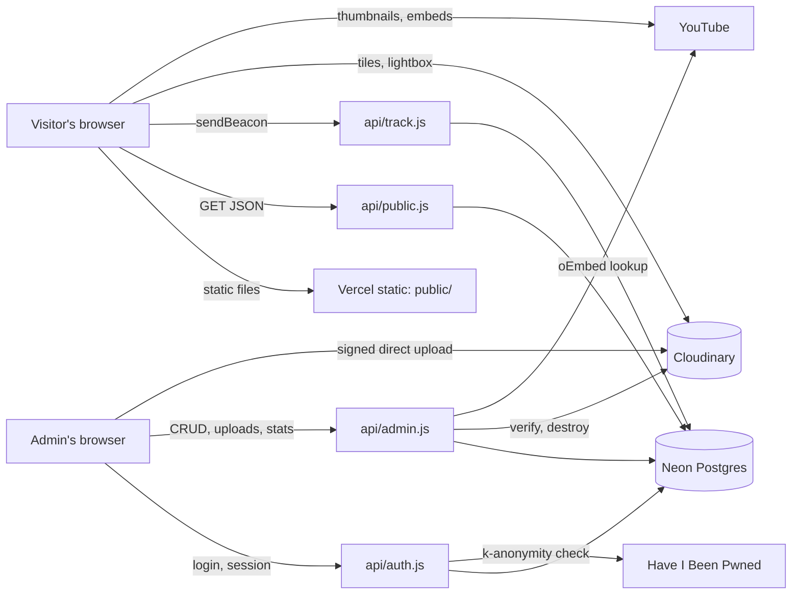
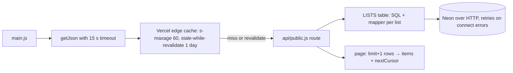
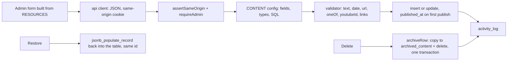
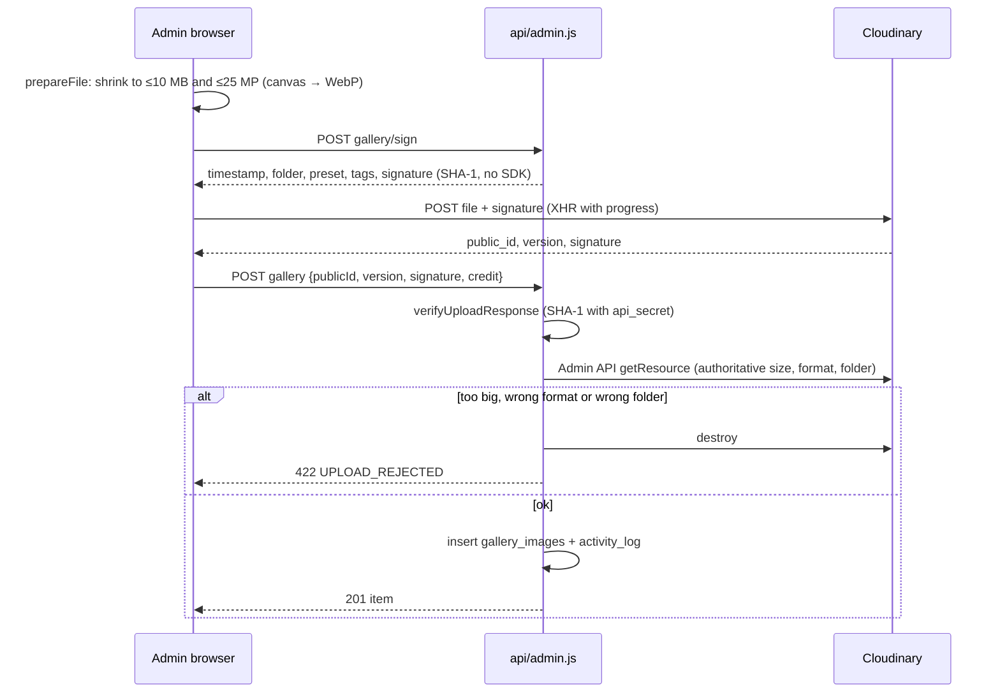
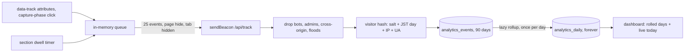
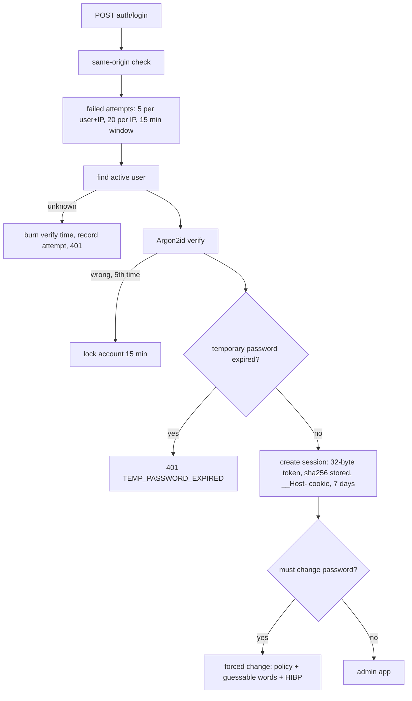

# Kotoha Fan Site · project file

Full architectural analysis (visual, operation, process, code) of the Kotoha fan site, written for Tabane so its reusable parts can become entries. Every fact below comes from the repository or the live site; the Sources section lists where. Nothing here has been applied to Tabane yet.

| | |
|---|---|
| Name | Kotoha Fan Site — unofficial, non-profit, bilingual (日本語 / English) fan site for Kotoha (ことは) of HaKoniwalily |
| Kind | Own project (Moeko Works) |
| Live site | https://kotoha-fansite.vercel.app/ |
| Repository | [PastelSalt/kotoha-fansite](https://github.com/PastelSalt/kotoha-fansite) (private) |
| Local folder | `C:\Users\Myaako\Documents\MoekoWorks\kotoha-fansite` |
| Read at | commit `79bbd5e` (`main`, 2026-10-21), 41 commits, read 2026-10-25. **Updated** for the admin UI refresh at `2fa67f2` (`main`, 2026-10-25, 44 commits): sections 4, 6.10, 9, 10, 11, 12, 15 and 16 |
| Target | Website (public site + private admin panel) |
| Status on the site | Live; design v2 "Clover Scrapbook" since 2026-10-02; performance pass 2026-10-09; admin UI refresh live 2026-10-25 (a check with real data, by the owner signing in, is still open) |
| Embeddable | **No.** The site sends `X-Frame-Options: DENY` and `frame-ancestors 'none'`, so Tabane must show screenshots, not a live frame |
| Size | ≈ 8,000 lines of code (HTML, CSS, JS, SQL) plus ≈ 3,500 lines of docs |

## Contents

1. [Overview](#1-overview)
2. [Stack](#2-stack)
3. [Architecture](#3-architecture)
4. [Repository structure](#4-repository-structure)
5. [Visual design](#5-visual-design)
6. [How the front end operates](#6-how-the-front-end-operates)
7. [How the back end operates](#7-how-the-back-end-operates)
8. [Data model](#8-data-model)
9. [How it was built (process)](#9-how-it-was-built-process)
10. [Reusable pieces catalogue](#10-reusable-pieces-catalogue)
11. [Gotchas and quirks](#11-gotchas-and-quirks)
12. [Proposed entries](#12-proposed-entries)
13. [Proposed replication guide](#13-proposed-replication-guide)
14. [Proposed new tag values](#14-proposed-new-tag-values)
15. [Open questions](#15-open-questions)
16. [Sources](#16-sources)

---

## 1. Overview

A one-page fan site with five sections (Home, About, News, Discography, Gallery) and a footer, over a fixed artwork backdrop that crossfades between sections. Content (videos, news, achievements, releases, fan art) lives in Postgres and is managed through a private admin panel. The site is bilingual, cookieless, and runs with **no build step**: plain HTML, modern CSS and native ES modules, served by Vercel with four grouped serverless functions.

What makes it worth mining for Tabane:

- **A complete, documented design system** ("Clover Scrapbook": paper notes, washi tape, die-cut stickers, stitches) with tokens, cascade layers and a component catalogue.
- **A motion system** built around one tempo (128 BPM), a single scroll ticker, native CSS scroll-driven animations and a calm mode, already performance-tuned and measured.
- **A full small-CMS back end** without a framework: auth with sessions and lockout, config-driven CRUD with drafts, archive-instead-of-delete with restore, activity log, signed Cloudinary uploads, cookieless analytics with daily rollups.
- **Hardening that transfers to any project**: CSP + SRI, no inline scripts, same-origin checks, edge caching that hides a sleeping database.
- **It has already been reused once**: `FORHANON.md` is a 522-line guide for copying this codebase into the Hanon fan site, including a rename checklist.

---

## 2. Stack

| Area | What | Version / detail | Tabane tag value |
|---|---|---|---|
| Markup | HTML5, one static page + `login.html` + `admin.html` | no templating, no build | `html` |
| Styles | CSS with cascade layers, `@property`, scroll-driven animations, View Transitions, `@starting-style`, `color-mix()` | six files in `public/css/v2/`, one admin file | `css` |
| Scripts | JavaScript, native ES modules | no framework, no bundler | `javascript` |
| Runtime | Node.js ≥ 22 | Vercel Functions, plain `(req, res)` signature | `nodejs` |
| Database | Neon Postgres over the HTTP driver | `@neondatabase/serverless` ^1.1.0 | `neon-postgres` |
| Images | Cloudinary, signed direct uploads, no SDK | free tier: 10 MB, 25 MP per image | *proposed: `cloudinary`* |
| Passwords | Argon2id | `@node-rs/argon2` ^2.2.1 (19 MiB, 2 iterations) | *proposed: `argon2`* |
| Animation | GSAP 3.15.0 + SplitText (CDN, SRI-pinned, async) | home intro, title letter pops | `gsap` |
| Effects | canvas-confetti 1.9.4 (CDN, SRI, loaded when idle) | clover confetti | *proposed: `canvas-confetti`* |
| Icons | Lucide (inline sprite on the public page, UMD in admin) | ISC licence | *proposed: `lucide`* |
| Admin effects | Animate.css 4.1.1 (admin pages only) | toasts, transitions | — |
| Fonts | Fredoka (EN), M PLUS Rounded 1c (JA), Yomogi (doodle notes) | Google Fonts, added from script | — |
| Image tooling | sharp ^0.35.4 (dev only) | `scripts/optimize-images.js` | *proposed: `sharp`* |
| Hosting | Vercel, region `sin1` (Singapore) | `vercel.json` rewrites + headers | *proposed: `vercel`* |
| External APIs | YouTube oEmbed (no key), Have I Been Pwned range API, Vercel geo header | | — |

---

## 3. Architecture

### 3.1 Level 1 · System



Four grouped functions (one per area) keep cold starts and the function count low. Vercel rewrites `/api/<group>/<route>` to `/api/<group>?__route=<route>`.

### 3.2 Level 2 · Public read path



### 3.3 Level 2 · Admin write path



### 3.4 Level 2 · Gallery upload path



### 3.5 Level 2 · Analytics path



### 3.6 Level 2 · Admin sign-in



### 3.7 Page boot sequence

```mermaid
sequenceDiagram
  participant H as head scripts
  participant M as main.js
  participant L as loader.js
  participant P as page
  H->>H: motion-boot.js sets data-motion (calm or full)
  H->>H: prepaint.js: language choice, random loader art, add font CSS
  Note over P: static loader paints, clovers already spinning (pure CSS), 12 s CSS failsafe
  M->>M: tracking, lang switches, motion toggles, socials, lists, gallery
  M->>L: waitForAssets(tier 1, tier 2)
  Note over L: tier 1: language, fonts, GSAP (≤6 s), home art, home data (≤4 s)
  Note over L: tier 2: other arts, pose, avatar, all lists, first gallery page
  L-->>M: min 3 s, soft 6 s, cap 10 s; petals fill with real progress
  M->>P: scroll life, marquee, sparkles, backdrop, nav progress, menu, countdown
  M->>L: hideLoader: whoosh spin → iris opens from the clover
  M->>P: is-far observer, dwell timer, home intro (GSAP), special-day confetti, title letter pops
```

---

## 4. Repository structure

```text
kotoha-fansite/
  api/                    4 Vercel Functions (grouped)
    public.js             GET home, geo, videos, news, achievements, discography, gallery
    auth.js               login, logout, me, change-password, preferences, logout-others
    admin.js              content CRUD, YouTube lookup, gallery, archive, activity, summary, analytics, accounts
    track.js              POST analytics beacon
  lib/                    shared server code
    db.js                 Neon client, retry on connect errors, transaction helper
    http.js               HttpError, send, routeOf, readJson, clientIp, assertSameOrigin, handle, cache presets
    paging.js             keyset cursors (base64url "key|id")
    validate.js           field validator, YouTube ID parser, enums
    password.js           Argon2id, policy, guessable-word DP, HIBP, temp passwords
    auth.js               sessions, cookies, role guards, activity log
    archive.js            archive instead of delete, restore
    cloudinary.js         signing, verification, Admin API, destroy, delivery URLs
    analytics.js          beacon parsing, aggregation SQL, rollups, dashboard
  db/
    migrations/0001_init.sql   12 tables, triggers, constraints
    seed.sql              idempotent researched content
  scripts/                command-line tools (not deployed)
    dev-server.js         local stand-in for vercel dev (rewrites + headers)
    migrate.js            ordered migrations with schema_migrations table
    run-sql.js, _db.js    SQL runner, pooled client + transaction helper
    admin-bootstrap.js    create the Owner once from env
    optimize-images.js    sharp pipeline for every image
    seed-gallery.js       idempotent Cloudinary + DB seed with credits
    prelaunch-reset.js    dry-run-by-default wipe before launch
  public/                 everything served
    index.html            the whole public page (loader, backdrop, nav, menu, 5 scenes, footer, lightbox)
    login.html, admin.html
    css/v2/               tokens, base, components, sections, layout, motion
    css/admin.css
    js/motion-boot.js, js/prepaint.js        pre-paint classic scripts (CSP: no inline)
    js/shared/            dom.js (el builder), i18n-core.js
    js/public/            main, render, lists, loader, countdown, home, gallery, scroll, fx, track, data
    js/public/motion/     prefs, beat, scroll-life, marquee, sparkles, backdrop, spinner, text, wipe
    js/admin/             main, api, ui, content, gallery, pages, analytics, password, login, styles, prepaint
    locales/              en.json, ja.json, admin/en.json, admin/ja.json
    assets/               bg/ (36 WebP), img/ (15), svg/ (sprite + generated)
  assets/, references/    untouched originals and design references (not deployed)
  docs/                   implementation plan, progress log, design system, design v2 plan, performance plan, admin UI plan, JA review list, data sheets
  MIGRATION.md            handoff for the next Claude session
  FORHANON.md             guide for copying this site into the Hanon fan site
  vercel.json             rewrites, security headers, caching
  .vercelignore           anchored patterns (see gotchas)
```

---

## 5. Visual design

### 5.1 Identity: "Clover Scrapbook"

A fan's scrapbook: fan artworks are the photos; content sits on **paper notes** taped onto them; headings are **die-cut stickers**; a dashed **stitch** marks only the special items. The owner's direction: a *dense, layered, Japanese fan-site feel, never Western minimalism*; no large empty areas; clovers are always illustrated and filled, never hollow outlines. Motion has "music-video quality" in its movement, but the site stays a normal, readable website.

### 5.2 Tokens (`public/css/v2/tokens.css`)

| Group | Values |
|---|---|
| Pink scale | 50 `#fff5f8` · 100 `#ffe2eb` · 200 `#ffc6d6` · **300 `#fe9fb9` (brand base, page background)** · 500 `#ef5f8d` · 700 `#b8325f` (AA text, white-on) |
| Green scale | 50 `#f2f9ec` · 100 `#dcefcb` · 200 `#bfe0a5` · 300 `#a3d37f` · **500 `#63a23d` (brand)** · 600 `#4e8a2c` · 700 `#2f7a1f` (AA text, buttons, 5.4:1 white-on) · 900 `#1f4f15` |
| Neutrals | paper `#fffaf2` (cards at 94 %), ink `#2b3326`, ink-soft `#56614f` |
| Section accents | home lavender `#c9b6f4` · about sky `#bfe4ff` · news rose `#ffb3c7` · disco peach `#ffd3b0` · gallery mint `#c8ecd9`, set with `data-accent` |
| Type | Fredoka + M PLUS Rounded 1c; fluid sizes from 13 px (meta) to 92 px (display); **nothing under 13 px**; line-height 1.6, Japanese 1.75 |
| Space | 4 · 8 · 12 · 16 · 24 · 32 · 48 · 64 · 96 px; gutter 16–40 px |
| Shape | chip 12, card 20, panel 28, pill 999 px |
| Depth | `--shadow-paper` → `--shadow-lift` → `--shadow-modal`, `--shadow-sticker` (green-tinted); **never grey-black shadows** |
| Motion | `--beat` 469 ms (128 BPM), tap 120, pop 350, move 560, glide 820 ms; `--ease-pop` springy cubic-bezier(0.34, 1.56, 0.64, 1) |
| Focus | white 3 px + pink-700 3 px ring |

Registered properties: `@property --iris` (length, the loader's circle) and `--fill` (number, the nav clover meter), so both animate smoothly.

### 5.3 Cascade layers

`@layer legacy, tokens, base, components, sections, motion;` is declared first in `tokens.css`. Later layers win regardless of specificity, so motion rules can override component rules without `!important` wars. Files: `tokens.css` → `base.css` → `components.css` → `sections.css` + `layout.css` (both in `sections`) → `motion.css`.

### 5.4 Surface vocabulary (`components.css`)

| Piece | Look | Rule |
|---|---|---|
| `.paper` | cream note, 94 % fill, white 1 px edge, soft tinted shadow, 20 px radius | default container over artwork; **no `backdrop-filter`** (performance) |
| `.paper--grid` / `--lined` / `.lace` | grid paper, notebook lines with a red margin, scalloped bottom edge | mix so notes don't all look alike |
| `.stitch` | inset 2 px dashed green line | featured items only, ≈ 4–6 per screen |
| `.tape` | translucent washi strip in the section accent, torn edges by `clip-path` polygon, ±6° tilt | at most one per card |
| `.sticker` | white-outlined green (or pink) pill heading, −2° tilt | headings |
| `.stamp`, `.stamp--pickup`, `.label-chip` | outlined rotated stamp ("NEW"), solid "PICK UP!", uppercase label chips | |
| `.bubble` | white speech bubble with a tail | the **site's** voice only, never words put in Kotoha's mouth |
| `.bg-word` | giant outlined word behind content (KOTOHA, PROFILE, NEWS, MUSIC, FAN ART), −5° | decoration |
| `.v-text` | vertical Japanese text with a white stroke | never over the character's face |
| `.badge-round` | rotating circular text badge ("KOTOHA ✿ FAN SITE ✿ ことは") with a clover centre | `textPath` must be inline (can't use the external sprite) |
| `.cl` clovers | illustrated four-leaf clover from the sprite, colours via `--c1…--c4`; variants pink, mint, gold, sky, lav, white | always filled |
| `.grain`, `.clover-pattern` | inline SVG noise and faint clover dots (no download) | plain areas are never flat |

### 5.5 Section compositions (`layout.css`)

| Section | Layout | What is on it |
|---|---|---|
| Loader | full screen over random art (1 of 3), bottom scrim | logo bottom-left, spinner + "Loading…" wave + "Did you know?" fact on the right, "made by Moeko Works" bottom-right, floating clovers and sparkles |
| Nav | floating pill centred at the top | logo, five links with a sliding clover dot, clover progress meter, JP/EN pill, motion toggle; under 1000 px a "menu" button replaces the links |
| Mobile menu | full-screen gingham, opens as a circle from the menu button | big pill links, socials, language + motion, Moeko Works credit |
| Home | 3 columns (35 / 31 / 30 fr), character in the middle column | left: logo, unit chips, socials, next-stream ticket + this week's strip, coming-soon card, fan art of the moment; right: "LATEST NEWS 最新情報", two news notes, "PICK UP!" video polaroid with a bubble; rotating badge, "scroll for more!" cue, tilted marquee ribbon at the bottom, giant "KOTOHA" word |
| 01 About | 3 columns: profile card · bio + hashtags · clover stage | stitched profile card with avatar and fact list, lined bio note with lace edge, hashtag chips, full-body pose on a big sky clover (tap → boing + confetti), mascot peeking at the bottom |
| 02 News | 1.3 : 0.9 | scrolling two-column grid of news notes; "LATEST WORKS 最新作" polaroid player + film strip |
| 03 Discography | wide coming-soon card, then 1.2 : 0.9 | record sleeves (2 columns, scrolling), achievements timeline in a panel |
| 04 Gallery | full width | "thank you, artists!" bubble + credit note, JS masonry 2–5 columns, load more / end sticker |
| Footer | 4 columns on pink-100 with a scalloped top edge | logo, disclaimer note, contact, maker card; section links, privacy note, sister sites; official links; artwork credits + settings |

Every section: numbered title block (`NO. 01` badge, giant EN word with a 9 px white stroke, JA subtitle pill, dotted line), scrim only behind the content side so the character stays bright.

### 5.6 Breakpoints

| Query | Change |
|---|---|
| ≤ 1099 px | Home 2 columns; About pose moves below; news list 1 column; badge and vertical home text hidden |
| ≤ 999 px | nav links hidden, menu button shown |
| ≤ 899 px | left/right scrims become a bottom-up gradient |
| ≤ 799 px | every composition 1 column; scrolling lists become full height; vertical text hidden; footer 2 columns |
| ≤ 699 px | loader stacks: logo top, spinner centre, credit bottom |
| ≤ 599 px | nav shrinks (smaller logo, motion label hidden, progress clover hidden) |
| ≤ 499 px | footer 1 column; only the first 3 decorations per section |
| ≥ 1100 px **and** ≤ 960 px tall | "short laptop" Home: smaller logo, hide coming-soon, fan art and the 2nd news note so Home fits one screen |
| `max-aspect-ratio: 3/4` | portrait art crops (focal-point crops made by the image script) |

### 5.7 Layering (z-index)

backdrop −10 · section art −2 · scrim −1 · decorations 0 · content 1 · stamps/tape 2–3 · nav 50 · mobile menu 400 · wipe 900 · loader 1000 · skip link 2000 · sparkle layer 9999.

### 5.8 Imagery and assets

- **Backdrop art:** 5 section artworks + 3 loader artworks, each as WebP at 1280/1920/2560 wide plus 720/1080 portrait crops (8 × ≈ 4–5 files = 36 files).
- **UI images:** logo, Moeko Works logo, profile avatar, full-body pose, mascot, social icons, all WebP at 1x/2x.
- **SVG sprite** `v2-sprite.svg` (4.3 KB): `#cl-leaf` (illustrated four-leaf clover), `#cl-round` (filled brand clover), `#spark`, `#heart`, coloured through `--c1…--c4`.
- **Clover path** used everywhere (spinner, favicon, mask): `M286 85 A153 153 0 1 1 505 300 A153 153 0 1 1 288 517 A153 153 0 1 1 68 300 A153 153 0 1 1 286 85 Z` (viewBox `15 30 545 545`).
- **Icons:** Lucide subset inlined as a `<symbol>` sprite (x, chevrons, external, arrow-up, radio).

---

## 6. How the front end operates

### 6.1 Pre-paint (no flicker, no inline scripts)

| File | Job |
|---|---|
| `motion-boot.js` | sets `html[data-motion]` to `calm` (device reduced-motion or stored `kf_motion=off`) or `full` before the first paint |
| `prepaint.js` | language from `?lang=` or `localStorage kf_lang`; random `data-loader-art` 1–3; adds Google Fonts CSS from script so it never blocks paint; Animate.css only for admin pages |
| inline `<style>` in `index.html` | pink background, loader layout and a **12 s CSS failsafe** that fades the loader even if no script runs |

### 6.2 Loader (`loader.js`, `motion/spinner.js`, static markup)

- **Spinner:** two filled clovers in static inline SVG; outer turns clockwise every 4 s, inner counter-clockwise every 2.5 s, from the first paint (CSS animation, compositor). Calm mode: 12 s / 8 s, still turning (it is the loading indicator).
- **Progress:** the inner clover's four quadrant rectangles, clipped to the clover path, scale in clockwise as tasks finish (`setProgress(finished / total)`).
- **Tiers:** `waitForAssets({ tier1, tier2 })` → returns when ≥ 3 s **and** tier 1 done **and** (tier 2 done **or** 6 s), or at the 10 s cap. Failures count as done (pages show fallbacks).
- **Text:** "Loading…" as a wave of per-character spans (screen readers get a hidden plain copy); "Did you know?" facts from the About data rotate every 2.8 s.
- **Exit:** all petals lit → fast spin (`.is-whoosh`) → circular iris opens from the spinner's centre (`--iris` mask, `--iris-x/y`) → removed from the DOM. Calm or no `@property` → fade.

### 6.3 Language (`shared/i18n-core.js`)

- JSON dictionaries in `/locales/{en,ja}.json` (admin: `/locales/admin/`), cached per language.
- `data-i18n="a.b"` replaces text; `data-i18n-attr="attr:key;attr2:key2"` replaces attributes; `t('key', {vars})` fills `{placeholders}`; arrays and objects are allowed (`about.pills`, `home.days`).
- Initial language: explicit choice (URL or storage) → else `/api/public/geo` (Vercel country header: JP → ja) within 2.5 s → else English. Only explicit choices are stored.
- `onLangChange` listeners re-render everything that was built from data; the URL gets `?lang=`.
- `mountLangSwitches` renders JP/EN buttons into every `[data-lang-switch]` (nav, menu, footer); the sliding highlight is pure CSS (`data-active`).

### 6.4 Motion system (`js/public/motion/`, `motion.css`)

| Module | API | How it works |
|---|---|---|
| `prefs.js` | `motionMode()`, `isCalm()`, `onMotionChange(cb)`, `setMotionOff(bool)`, `mountMotionToggles()` | calm = device reduced-motion **or** the visitor's toggle; the toggle is disabled when the device asks |
| `beat.js` | `BPM` 128, `beats(n)`, `beatsMs(n)`, `EASE`, `whenGsap(ms)` | every duration and stagger is in beats |
| `scroll-life.js` | `startScrollLife()`, `onScrollVelocity(cb)`, `scrollVelocity()`, `pageProgress()` | **the single scroll ticker**: one rAF loop while scrolling + 150 ms; smoothed velocity → `--lean` (±2°) written only on on-screen `.lean` cards (IntersectionObserver + MutationObserver); subscribers get velocity; page height cached via ResizeObserver |
| `marquee.js` | `startMarquee(el, {speed})` | one looping Web Animation over the width of one copy; scroll speed only changes `playbackRate` (negative = reversed when scrolling up); pauses off screen and in calm mode |
| `backdrop.js` | `startBackdrop(backdrop, sections, {onChange})` | the section crossing the viewport's middle picks the active art; 0.9 s crossfade; faded art becomes `visibility: hidden` |
| `sparkles.js` | `startSparkles({perShape, every})` | mouse-only cursor trail; a pool of 4 SVGs per shape in one `contain: strict` layer; never re-points `<use>` |
| `spinner.js` | `mountSpinner(host)` → `{ setProgress, complete, reset }` | adopts the static loader markup or builds it |
| `text.js` | `waveText(el, text)`, `popLetters(el, gsap)` | accessible split text (hidden readable copy; SplitText `aria: 'auto'`) |
| `wipe.js` | `playWipe({direction, accent, onCovered})` | striped panel sweep; **written but not wired** since the snap was removed |

CSS side (`motion.css`), all inside `@supports (animation-timeline: view())` and `prefers-reduced-motion: no-preference`:

- `.reveal` rises in on entry and eases back on exit; `.reveal-pop` pops headings in; `.art-camera` pans/zooms art; `.deco-parallax` drifts decorations; `.backdrop__pan` pans with `scroll(root)`.
- Idle loops (full motion only): `.twinkle`, `.float`, `.bob`, `.drift`, `.wave`, ticket pulse, badge turn.
- **Property ownership** so effects never fight: `transform` = scroll-driven keyframes; `translate`/`scale` = hover and tap; `rotate` = resting tilt + lean.
- Far sections: main.js toggles `.is-far` (more than a screen away) → `animation: none !important`.
- Calm mode: transitions shortened to 0.15 s, hovers flattened, View Transitions disabled, lean fixed.

### 6.5 Scrolling (`scroll.js`)

Native free scrolling on every device (the snap and the Lenis library were removed on 2026-10-09 at the owner's request). In-page links glide with `scrollIntoView` (instant in calm mode) and update the hash; `lockScroll()` / `unlockScroll()` toggle `html.scroll-locked`, with `scrollbar-gutter: stable` so nothing shifts.

### 6.6 Data on the page

| Piece | Module | Behaviour |
|---|---|---|
| JSON fetch | `lists.js` `getJson(url, {timeout: 15000})` | 15 s because the free database can take ~10 s to wake |
| Paged lists | `lists.js` `pagedList({container, endpoint, render, emptyKey, limit, onItems, axis})` | first page on `load()`; a sentinel inside the scrolling container loads more (vertical, or horizontal with `axis: 'x'`); `render` may return several nodes (timeline year pills); `rerender()` after a language change; error state with retry |
| Builders | `render.js` | `sprite`, `icon`, `videoPolaroid`, `filmFrame`, `newsNote`, `releaseSleeve`, `achievementRows`, `galleryTile`, `socialBadge`, `stateNote`; **all database text goes through `textContent`** (`shared/dom.js` `el()` builder) |
| Home extras | `home.js` | `renderWeek` (Mon-start JST week, Tue/Fri stream days, today ringed, LIVE), `renderSoon` (nearest future release, mini + wide cards with days left), `renderFanArt` (one random credited artwork per visit), `isRecent` (NEW stamp ≤ 45 days) |
| Countdown | `countdown.js` | `nextStream(now)` for Tue/Fri 21:00 JST (= 12:00 UTC), LIVE for 2 h; flip digits restart their animation only when the value changes; local-time tooltip; screen-reader sentence once a minute |
| Gallery | `gallery.js` | JS masonry: 2–5 columns by container width, each image into the shortest column (by aspect ratio, no layout reads); infinite load (sentinel 600 px early) + "Load more"; ResizeObserver relayouts only when the column count changes; lightbox = native `<dialog>`, arrows/keys, prev/next preloads more near the end; **View Transition grows the artwork out of its tile** (temporary `view-transition-name` on thumb then viewer) |
| Video | `render.js` `videoPolaroid` | click-to-load facade: a thumbnail button until clicked, then a `youtube-nocookie.com` iframe with autoplay |
| Static data | `data.js` | `SOCIALS`, `OFFICIAL_LINKS`, `CREDITS` (null = artist unknown) |

### 6.7 Effects (`fx.js`)

- **Confetti:** canvas-confetti injected with SRI when the browser is idle after the loader (or on first burst); 🍀 shape from text; site colours; never in calm mode. Bursts on the logo and the About pose; two bursts on June 10 and July 8 (JST).
- **`boing(el)`:** a Web Animations squash-and-tilt, no library.
- **`homeIntro()`:** GSAP slides the nav and both Home columns in, spins the badge, lifts the marquee, all in beats; animates wrapper columns (never the elements that own a scroll-driven `transform`).
- **`popTitlesOnArrival()`:** section titles pop in letter by letter the first time they reach 60 % visibility.

### 6.8 Tracking (`track.js`)

Cookieless: a random visit id in memory only; `data-track`, `data-track-id`, `data-track-target`, `data-track-type` attributes on any element are captured in the capture phase (before facades replace the element); section dwell time from the active-section observer; batched and sent with `sendBeacon` (fallback `fetch` keepalive) at 25 events, on page hide and when the tab hides.

### 6.9 Failure handling

- The loader never traps visitors: `boot().catch` hides it; CSS failsafe at 12 s.
- CDN libraries are optional: `librariesReady(6000)` waits at most 6 s; every effect checks for its library and skips itself.
- Each list shows a mascot state note with a retry button on error.
- Home data waits at most 4 s during the loader; cards show their loading state until data arrives.

### 6.10 Admin panel (front end)

- **Shell** (`admin/main.js`): checks `auth/me`, applies the user's language, hash router (`#/videos` …), each navigation renders into its own container with a `renderSeq` guard so a slow page can't overwrite the current one; forced password change screen; owner-only links.
- **API client** (`admin/api.js`): JSON in/out, same-origin cookies, translated error codes, "waking up" toast after 2.5 s of waiting, redirect to `/login` on `UNAUTHENTICATED`.
- **Config-driven forms** (`admin/content.js` `RESOURCES`): each resource lists its fields (`text`, `textarea`, `date`, `url`, `select`, `youtube`, `links`, `status`) and how to show list items (date, title, text, thumbnail); one form builder, one list renderer.
- **Gallery manager** (`admin/gallery.js`): `prepareFile` shrinks oversize images in the browser (canvas → WebP, scale and quality stepped down up to 6 times) to Cloudinary's free limits; XHR upload with progress; credit editing; permanent delete.
- **Dashboard** (`admin/analytics.js`): KPIs, visits per day/week/month and a 24-hour chart **in plain SVG, no chart library**; bar lists for devices, browsers, languages, countries, sources, sections, videos, outbound links, news links, gallery.
- **UI kit** (`admin/ui.js`): toasts, a promise-based `<dialog>` (`openDialog({title, body, actions, onSubmit})`), form fields, Lucide icons that render once the async script arrives.

#### Admin UI refresh (2026-10-25, front end only; `docs/ADMIN_UI_PLAN.md`, commit `dc82320`, merge `4568cac`)

A redesign of `/admin` and `/login` that changed only `admin.html`, `login.html`, `css/admin.css`, `js/admin/*` and the admin locales. **Ground rules:** no API, `lib/`, database, script or `vercel.json` change; every number comes from what the endpoints already return (totals and splits may be computed in the browser); no new features or libraries; every behaviour kept (routes, dialogs, validation, paging, archive/restore, owner-only screens, forced password change, the render guard, the "waking up" hint).

- **Problems it fixed** (plan §1.4, 14 found): content counts and visitor KPIs looked identical; drafts were easy to miss; the range control sat *below* the two KPIs it changes (Avg visit, Avg loading) while Today/Week/Month and the chart ignore it; a small chart with only slow native `<title>` tooltips; twelve breakdown cards in one flat grid; a 24 px tick-font hack for phones; a mobile sidebar with no backdrop or Esc; a flat 10-link sidebar; inline styles in JS; filler `<span>`s to fill grid columns; 2 px borders everywhere; an admin palette that had drifted from the public tokens.
- **Look: the public site's theme, calmer.** `admin.css` (490 lines) copies the v2 token values (pink and green scales, paper `#fffaf2`, sunken paper, ink, tinted shadows) into its own `:root` (no `@layer` import, to avoid cascade surprises). Brand-pink page with a white dot pattern, paper cards, green **sticker titles** with the illustrated clover from the public sprite (`/assets/svg/v2-sprite.svg#cl-leaf`), the dashed "stitch" only on the welcome card and the drop zone. No tape, no tilt on data. **Colour meaning:** green = site content and primary actions, pink = visitors, dashed = draft.
- **Shell:** sidebar in groups (Dashboard; Content: videos → gallery; Records: archive, activity; Account: accounts, my account) with clover group labels, a floating paper sidebar and a sticker-style active link; user badge with a clover avatar (green for owner, pink for admin) and a role pill. **Mobile menu:** a scrim behind it; tap outside, Esc or a route change closes it; focus moves into the menu when it opens and back to the toggle when it closes. Inline styles moved to classes.
- **Dashboard, top to bottom:** welcome card with today's date in Japan time → **Site content** tiles (the sidebar's Lucide icon, published count, a draft pill only when there are drafts, a thin published/draft split bar, the whole tile a link) → **Visitors**: a compact Today / This week / This month strip, then the visits chart → **Details for 7 / 30 / 90 / 365 days**: the range control together with Avg visit, Avg loading and "N visits in this period", and the breakdown cards grouped **Audience** (devices, browsers, languages, countries), **Traffic** (sources, busiest hours) and **Engagement** (sections reached, video plays, official link clicks, news links, gallery), with ranks and the busiest hour highlighted.
- **Visits chart:** drawn at the box's real pixel width (re-drawn by a `ResizeObserver` when the width changes by more than 30 px), so tick labels stay readable on phones without the font hack; three grid lines; totals for the shown series summed in the browser; a value label on hover, tap and **arrow keys** (the chart box is focusable, the label is `aria-live`); the SVG `<title>`s stay for screen readers.
- **Loading and errors:** skeleton cards and rows at their final size (`skeletonRows()`), so nothing jumps; on a range change the old content dims with `aria-busy`; one `stateBox(text, { kind, small, action })` for empty and error states (clover or alert icon, optional Retry button).
- **Other screens:** rows get an icon instead of filler elements (content without thumbnails, archive, activity, accounts); draft rows dashed; gallery cards with a 1 px border and shadow; the dialog gets a header, body and a sticky action row; toasts get an icon per kind (`check`, `circle-alert`, `info`); password rules become CSS badges.
- **Login page:** a paper card with a sticker title and clover decorations.
- **New strings:** about ten keys (`dashboard.contentTitle`, `dashboard.draftsN`, `analytics.groups.*`, `analytics.totalShown`, `nav.groups.*` …) in both admin locales, with the Japanese appended to `docs/JA_REVIEW_LIST.md`.
- **Wide screens:** after the owner's preview ("right side too empty at 1920 px") the content max-width became sidebar + 1640 px and tile and stat grids use `auto-fit`.

---

## 7. How the back end operates

### 7.1 Routing and HTTP helpers (`lib/http.js`)

- Plain Node `(req, res)` handlers. `routeOf(req, group)` reads `?__route=` (from the rewrite) or the path (local), so one file serves many routes.
- `handle(fn)` turns `HttpError(status, code, message, fields)` into `{ error: { code, message, fields } }` and hides unexpected errors as `500 SERVER_ERROR`.
- `readJson(req, limitBytes)` with a size cap (413), `methodGuard`, `clientIp` (x-forwarded-for).
- `assertSameOrigin(req)`: state-changing requests must carry an `Origin` matching the host, `VERCEL_URL` or `ALLOWED_ORIGINS` (CSRF defence alongside `SameSite=Strict`).
- Cache presets: `PUBLIC_CACHE` = `public, max-age=0, s-maxage=60, stale-while-revalidate=86400` (the edge hides the sleeping database); `NO_STORE`.

### 7.2 Database access (`lib/db.js`)

`neon()` HTTP client created lazily; `sql\`…\`` tagged templates (always parameterised), `query(text, params)` for dynamic SQL, `transaction(build)`. A custom `fetchFunction` retries up to 3 times **only** when the connection itself failed to open (`UND_ERR_CONNECT_TIMEOUT`, `ECONNREFUSED`, `ENOTFOUND`, `EAI_AGAIN`), so a statement can never run twice.

### 7.3 Pagination (`lib/paging.js`)

Keyset pagination, newest first, stable on ties by id: fetch `limit + 1`, cursor = base64url of `"<date or timestamp>|<id>"`, validated on decode; `page(rows, limit, keyOf)` → `{ items, nextCursor }`. Default 20, max 50. The SQL pattern is `($1 is null or (date_col, id) < ($1, $2)) order by date_col desc, id desc limit $3`.

### 7.4 Public API (`api/public.js`)

A `LISTS` table maps each list name to its SQL, cursor kind, key and mapper (snake_case → camelCase). `home` runs two queries in parallel (1 video, 2 news). `geo` returns the Vercel country header (never cached). Only `published` rows are ever returned.

### 7.5 Validation (`lib/validate.js`)

`validator(body)` returns field methods (`text`, `date`, `url`, `oneOf`, `youtubeId`, `links`, `id`) that clean values or record an error code per field; `throwIfInvalid()` → `422 VALIDATION_FAILED` with `fields`. `parseYouTubeId` accepts bare IDs and youtu.be / watch / embed / shorts / live / music URLs. Links are up to 3 `{url, label_key}` with `label_key` from a fixed list (watch, listen, details, tickets, official, shop).

### 7.6 Auth (`lib/auth.js`, `lib/password.js`, `api/auth.js`)

- **Passwords:** Argon2id (OWASP baseline: 19 MiB, 2 iterations, 1 lane); policy: 12–128 chars, must not contain the username, must differ from the current one, and must not consist **only** of guessable site words (a word-break dynamic-programming check over a blocklist such as kotoha, clover, password, admin); then Have I Been Pwned k-anonymity (only 5 hex chars leave the server; unreachable → don't block).
- **Unknown users:** `burnVerifyTime` verifies against a dummy hash so timing doesn't reveal which usernames exist.
- **Throttling:** failed attempts per (IP hash, username) ≤ 5 and per IP hash ≤ 20 in 15 minutes; 5 wrong passwords lock the account for 15 minutes. IPs are stored only as salted hashes.
- **Sessions:** 32 random bytes as base64url in a `__Host-kf_session` cookie (HttpOnly, SameSite=Strict, Secure; `kf_session_dev` on plain-http localhost); only the SHA-256 is stored; 2-hour idle timeout, 7-day absolute; `last_seen_at` touched at most every 5 minutes.
- **Guards:** `requireAdmin(req, { allowPasswordChange, ownerOnly })` → 401, `403 PASSWORD_CHANGE_REQUIRED`, `403 FORBIDDEN`.
- **Accounts:** exactly one Owner (unique partial index); Owner creates admins with auto-numbered usernames (`<owner><n>` from a sequence, never reused) and 8-character temporary passwords without look-alike characters, valid 7 days and shown once; reset revokes all their sessions; removal deactivates and archives a snapshot without the hash. Password change signs out every other device, then keeps this one signed in.

### 7.7 Content CRUD, archive and activity (`api/admin.js`, `lib/archive.js`)

- **Config-driven:** `CONTENT` defines each resource's table, date column, select list, fields (`key`, `col`, `type`, `required`, `max`, `default`) and mapper. `readFields` validates all fields on create and only the present ones on update. One set of functions serves videos, news, achievements and discography.
- **Drafts:** status `draft` or `published`; `published_at` is set on first publish only.
- **YouTube:** `videos/lookup` and empty titles use YouTube oEmbed (no API key) to fetch the title and validate the video.
- **Archive instead of delete:** `archiveRow` copies the row as JSONB into `archived_content` (with reason, who, when) and deletes it, in one transaction; `restoreArchived` puts it back with its original id via `jsonb_populate_record` and `overriding system value`; unique conflicts → 409. Gallery files are destroyed on Cloudinary, so gallery archive entries are history only.
- **Activity log:** every write records `admin_username`, `action` (`news.create`, `gallery.delete`, `account.reset_password` …), entity and details.
- **Summary:** one query counts published and draft items per type and unrestored archive entries.

### 7.8 Cloudinary (`lib/cloudinary.js`)

No SDK: `signParams` (sorted `key=value` joined with `&` + secret, SHA-1); `signedUploadParams()` for the browser; `verifyUploadResponse` (public_id + version signature); `getResource` (authoritative size/format/folder from the Admin API, Basic auth); `destroyImage` with CDN invalidation; `deliveryUrl` with `f_auto,q_auto,c_limit,w_<n>`. Public tiles use `cloudinaryUrl(url, width)` with `srcset` 400/800.

### 7.9 Analytics (`lib/analytics.js`, `api/track.js`)

- **Events:** page_view, section_dwell, video_play, outbound_click, news_link_click, gallery_open, gallery_credit_click, language_switch, loader_timing; each field is validated or dropped (`parseBeacon`); ≤ 50 events per beacon; dwell capped at an hour.
- **Privacy:** visitor hash = SHA-256 of `salt | JST day | IP | user agent`, truncated; rotates daily; no raw IP; no cookie; admin sessions, bots (UA regex), cross-origin posts and floods (200 events per visitor per 5 minutes, per function instance) are ignored. Always answers 204 so tracking can never break the page.
- **Rollups:** one aggregation SQL computes every metric per Japan-time day (visits, uniques, page views, device, browser, language, country, source, hour, dwell per section, reach, visit length, video plays, outbound, news links, gallery opens and credit clicks, loader time). `rollupIfStale()` runs lazily from the tracker and the dashboard (at most once per day per instance, retried every 10 minutes on failure): rolls finished days into `analytics_daily` (idempotent upserts + a `_rolled` marker), deletes raw events older than 90 days and stale sessions/login attempts older than 30 days. **No cron needed.**
- **Dashboard:** rolled days from `analytics_daily` + today computed live; daily (30), weekly (12, Monday) and monthly (12) series; breakdowns for 7/30/90/365 days; ids resolved to titles.

### 7.10 Security and delivery (`vercel.json`)

| Header | Value |
|---|---|
| Content-Security-Policy | `default-src 'self'`; scripts only from self, cdnjs, jsdelivr; styles self + inline + Google Fonts + CDNs; images self, data, blob, i.ytimg.com, res.cloudinary.com; connect self + api.cloudinary.com; frames only youtube-nocookie.com; `object-src 'none'`; `frame-ancestors 'none'` |
| Subresource Integrity | every CDN script and stylesheet pinned (sha256/sha384), except Google Fonts CSS (varies per browser) |
| Others | `X-Frame-Options: DENY`, `X-Content-Type-Options: nosniff`, `Referrer-Policy: strict-origin-when-cross-origin`, `Permissions-Policy` (camera, mic, geolocation, payment, usb off), HSTS 2 years |
| Admin and API | `X-Robots-Tag: noindex, nofollow`; admin/login `no-store` |
| Caching | `/assets/` 7 days + SWR 1 day; `/locales/` 5 minutes + SWR 1 hour; CSS/JS default revalidation (file names aren't versioned) |

No inline scripts anywhere (that is why the pre-paint scripts are files); inline styles are allowed.

---

## 8. Data model

`db/migrations/0001_init.sql` (12 tables, Postgres):

| Table | Purpose | Notable rules |
|---|---|---|
| `admin_users` | Owner and admins | username pattern; exactly one owner (unique partial index); owner always active; admin number from a sequence starting at 2; lockout and temp-password columns |
| `admin_sessions` | session tokens (hashed) | expires, revoked, last seen, user agent |
| `login_attempts` | throttling | IP hash, username, success |
| `videos` | latest works | YouTube id unique and pattern-checked; status; posted_on defaults to today in Tokyo |
| `news` | news | headline ≤ 200, summary ≤ 500, `links` JSONB array ≤ 3 |
| `achievements` | timeline | date, text ≤ 500, optional link |
| `discography_items` | releases | type enum (single, album, ep, tie_in, cover, collab, other), optional YouTube id, links |
| `gallery_images` | fan art | Cloudinary id/version/url/size/format/bytes, author name, source url |
| `archived_content` | deleted items | full JSONB snapshot, reason, note, restored at/by |
| `activity_log` | audit trail | username kept even if the user goes |
| `analytics_events` | raw events (90 days) | checked enums for type, section, content type, device, environment |
| `analytics_daily` | daily totals (forever) | primary key (day, metric, dimension) |

Conventions: all timestamps `timestamptz`; "today" means Japan time; a shared `set_updated_at()` trigger on every content table; text is single-field and shown as typed in both languages.

---

## 9. How it was built (process)

### 9.1 Timeline

| Date | What |
|---|---|
| 2026-09-26 | Day one, 17 commits: plan, schema, seed and public API → auth API → admin API → image pipeline → public site v1 (loader, sections, i18n, snap scrolling) → sleeping-database handling → admin UI → cookieless analytics → CSP → pre-launch reset → SRI → official TwitCasting icon → `.vercelignore` fix → gallery seed + admin race fix |
| 2026-09-26 → 28 | Design v2 planning (v0.2 → v0.3, owner Q&A), D1 style tile with the design system and a motion sample, D1.1 density pass after owner feedback |
| 2026-10-02 | D2–D4 + D6: the real page moves to the new design; style tile removed; merged into `main` with the owner's OK; `MIGRATION.md` handoff written |
| 2026-10-09 | Performance pass (snap and Lenis removed, blur removed, single ticker, backdrop layer merge, `.is-far`); discography data fixes; `FORHANON.md` guide for the sister site |
| 2026-10-21 | Rebrand Moesoft → Moeko Works; footer maker card, sister sites, contact form |
| 2026-10-25 | Admin UI refresh (front end only): plan `docs/ADMIN_UI_PLAN.md` written after analysing every admin file, approved ("make sure it still adheres to the actual site theme"), built on branch `admin-ui-refresh`, previewed by the owner on a mock server, one wide-screen fix, merged and deployed (`dc82320`, `4568cac`, docs `2fa67f2`) |

### 9.2 Working method seen in the repo

- **Plan first, in writing:** `docs/IMPLEMENTATION_PLAN.md` (16 sections: understanding, assets, references, requirements, open questions with a clarity score, architecture, database, pages, animation, security, phases, risks, checklist, decision log) before any code.
- **Living progress log:** `docs/PROGRESS.md` with a resume protocol, hard rules, phase checklist (17 phases), decisions log, known issues and a session log.
- **Design as a separate branch and plan:** `designupdatev2`, a style tile first, numbered checkpoints (✋) for owner review, merge only with explicit OK.
- **Measured performance work:** diagnosis ranked by cost, targets, a plan, then before/after numbers in `docs/PERFORMANCE_PLAN.md`.
- **Handoff documents:** `MIGRATION.md` for the next Claude session; `FORHANON.md` for reusing the codebase.
- **Testing:** headless Edge/Chrome over the DevTools protocol (screenshots per section, ≈ 50 behaviour checks, frame timing). The scripts lived in a temporary scratchpad and were lost; the docs say to commit them next time.
- **Front-end-only redesigns with a fence:** the admin refresh plan lists exactly which files may change and which may not, "existing data only", "no new features", "keep every behaviour", then the problems found, the target layout as an ASCII wireframe, new strings, risks and a phase checklist with owner checkpoints.
- **Mock preview when the real backend isn't reachable:** the checkout had no `.env.local`, so a scratchpad server served `public/` with the `vercel.json` headers (CSP), proxied `/api/public/*` read-only to production for real content, faked `/api/auth/*` and `/api/admin/*` in memory (any sign-in works, saves only change memory) and swallowed `/api/track`. The owner reviewed the redesign there before it went live. The server itself stayed in the scratchpad (not committed).

### 9.3 Operations

| Task | Command |
|---|---|
| Local site | `node --env-file=.env.local scripts/dev-server.js` (mirrors rewrites and headers, port 3000) or `npx vercel dev` |
| Migrations | `npm run db:migrate`, `npm run db:status` |
| Seed | `npm run db:seed` (idempotent), `npm run gallery:seed` (idempotent, uploads to Cloudinary) |
| First Owner | `npm run admin:bootstrap` (from env, refuses if an Owner exists) |
| Images | `npm run images:optimize` (`-- --force` to rebuild) |
| Pre-launch wipe | `npm run prelaunch:reset` (dry run; `-- --yes-reset-everything` to run) |
| Deploy | push to `main` = production; other branches = protected previews; rollback by promoting the previous deployment |
| Test languages | `?lang=ja`, `?lang=en`; `?debug` exposed scroll internals in v1 |

---

## 10. Reusable pieces catalogue

Reusability: **High** = lift with little change · **Medium** = needs rebranding or untangling · **Low** = specific to Kotoha.

### 10.1 UI/UX pieces

| # | Piece | Files | What it gives a new project | Reuse | What to change when lifting |
|---|---|---|---|---|---|
| U1 | Clover loader | `index.html` loader markup + inline `<style>`, `loader.js`, `motion/spinner.js`, `motion/text.js`, loader rules in `layout.css`, `components.css`, `motion.css` | a loading screen that paints and spins before any script, shows real progress, rotates facts, has a min/soft/cap timing model and an iris exit with a CSS failsafe | High | the spinner shape (clover path), art, colours, the task lists |
| U2 | Crossfading artwork backdrop | `.backdrop` markup, `sections.css`, `motion/backdrop.js`, `.backdrop__pan` in `motion.css` | one fixed layer of section artworks that crossfades as sections cross the middle, with a cheap scroll pan and a veil | High | the art set, veil colour |
| U3 | Scrapbook design system | `tokens.css`, `base.css`, `components.css` (surfaces), `docs/DESIGN_SYSTEM.md` | a complete token set + cascade-layer setup + paper/stitch/tape/sticker/stamp/bubble/label vocabulary + paper textures + grain and pattern fills | High | palette, fonts, clover symbols |
| U4 | JP fan-site section title block | `.sec-title`, `.mini-title`, `.bg-word`, `.v-text`, `.badge-round` in `components.css`, markup in `index.html` | dense numbered EN/JA headings, giant outlined background words, vertical Japanese taglines, a rotating circular text badge | Medium | words, colours |
| U5 | Floating nav pill + circle-reveal mobile menu | nav and menu markup, `components.css` nav rules, `layout.css`, `main.js` `markNav`/`setupMenu`/`setupNavProgress` | a pill nav with a sliding active marker, a scroll-progress icon, language and motion controls; a full-screen menu that opens as a circle from the button, with focus trap, Escape and auto-close on resize | High | links, logo, the progress icon |
| U6 | Next-stream ticket + this-week strip | ticket and week markup, `countdown.js`, `home.js` `renderWeek`, `.ticket`/`.flip`/`.week` in `components.css` | a notched ticket with flip-digit countdown, LIVE state, local-time tooltip and once-a-minute screen-reader text, plus a Mon-start week strip with stream days | High | schedule (days, hour, time zone, live length) — and unify the duplicated schedule (gotcha G9) |
| U7 | YouTube polaroid + film strip | `render.js` `videoPolaroid`, `filmFrame`, `.polaroid`/`.film` in `components.css` | a click-to-load YouTube facade (no iframe until asked, privacy-enhanced domain) styled as a tilted polaroid with a shine sweep, and a scroll-snap film strip to pick other videos | High | styling |
| U8 | Paper news notes | `render.js` `newsNote`, `.note`, `.stamp`, `.pin` | news cards with a date chip, NEW stamp for recent items, pin or tape, and tracked link chips | Medium | look |
| U9 | Record sleeves + coming-soon cards | `render.js` `releaseSleeve`, `home.js` `renderSoon`, `.sleeve`/`.soon` | release cards whose vinyl slides out on hover, a designed placeholder cover when there is no art, and "coming soon" cards with days left | High | look, release types |
| U10 | Year-grouped timeline | `render.js` `achievementRows`, `.timeline` | a stitched timeline where a year pill appears whenever the year changes (render returns several nodes) | High | look |
| U11 | Masonry gallery + growing lightbox | `gallery.js`, `render.js` `galleryTile`, `.masonry`/`.tile`/`.lightbox` CSS | a JS masonry (2–5 columns by width, no layout reads), infinite load + load more, credits on tiles, and a native-dialog lightbox whose image grows out of the tile with View Transitions | High | image source (Cloudinary URLs), credit fields |
| U12 | Profile card + clover stage | `.profile`, `.facts`, `.clover-stage`, `main.js` `renderAbout` | a stitched profile card with a fact list from locale data, and a character standing on a big illustrated shape that reacts to taps | Medium | content |
| U13 | Motion preference + calm mode | `motion-boot.js`, `motion/prefs.js`, calm rules in `motion.css`, `.motion-toggle` | a site-wide motion on/off toggle that respects the device setting, applied before first paint, remembered locally | High | storage key |
| U14 | Single scroll ticker: lean, marquee, progress | `motion/scroll-life.js`, `motion/marquee.js`, `.lean` and `.marquee` CSS | one rAF loop for every scroll-linked JS effect: velocity lean on on-screen cards, a marquee whose speed and direction follow the scroll, a page-progress value | High | none |
| U15 | Scroll-driven reveals and far-section pausing | `.reveal`, `.reveal-pop`, `.art-camera`, `.deco-parallax` in `motion.css`; `.is-far` in `layout.css` + observer in `main.js` | native CSS scroll-driven entrances/exits, parallax and art camera as progressive enhancement, with off-screen sections dropping all animations | High | none |
| U16 | Tempo-based motion (128 BPM) | `motion/beat.js`, `--beat` tokens | timing every animation in beats so motion feels coordinated | High | BPM |
| U17 | Cursor sparkle trail | `motion/sparkles.js`, `.sparkle-layer` | a pooled, mouse-only trail of sprite sparkles, hearts and clovers | High | shapes and colours |
| U18 | Confetti and boing | `fx.js` | lazy, SRI-pinned confetti with emoji shapes, special-day bursts in a chosen time zone, and a library-free squash animation | High | dates, emoji, colours |
| U19 | Bilingual i18n with attributes | `shared/i18n-core.js`, `prepaint.js`, `locales/*.json`, `/api/public/geo` | JSON dictionaries, `data-i18n` and `data-i18n-attr`, placeholders, arrays/objects, geo default, explicit choice stored, JP/EN switches, re-render on change | High | languages, storage key |
| U20 | Footer with maker card and credits | footer markup, `.foot`, `.maker-card`, `main.js` `renderFooterCredits` | a scallop-edged footer with a quiet maker card, sister-site links, and artist credits merged from static data and the gallery (unknown artists grouped) | Medium | links, credits |
| U21 | Mascot state notes | `render.js` `stateNote`, `.state-note` | friendly empty/error states with a retry button | High | image, text |
| U22 | Admin panel shell | `admin.html`, `admin/main.js`, `admin/api.js`, `admin/ui.js`, `admin.css` | hash-routed admin with a per-render guard, forced-password-change flow, owner-only links, grouped sidebar, mobile menu with scrim, Esc and focus handling, toasts with icons, promise dialog with a sticky action row, translated errors and a "waking up" hint | High | routes, brand |
| U23 | Config-driven admin forms | `admin/content.js` `RESOURCES`, `buildForm`, `linksEditor` | declaring a resource's fields once to get its list and edit form (text, textarea, date, url, select, youtube, links, status) | High | resources |
| U24 | Browser-side image shrink + upload with progress | `admin/gallery.js` `prepareFile`, `uploadToCloudinary` | shrinking an image in the browser to a size and pixel limit (canvas → WebP, stepping quality and scale), then an XHR upload with progress | High | limits, target |
| U25 | Library-free SVG analytics dashboard | `admin/analytics.js`, `admin/pages.js` | content tiles with draft pills and split bars, a fixed-period KPI strip, a visits chart drawn at real width with a hover/tap/arrow-key value label, a range block holding only the KPIs it drives, grouped breakdown cards with ranks, an hours chart with the peak highlighted; plain SVG with `Intl` formatting | High | metrics |
| U27 | Admin UI kit in the public site's theme | `admin.css`, `admin/ui.js` (`clover`, `sticker`, `stateBox`, `skeletonRows`, toast icons), `login.html` | an admin that reuses the public design tokens and sprite but stays calm: sticker titles, paper cards, one empty/error box, skeletons at final size, colour meaning fixed (content / visitors / draft) | High | tokens, sprite symbol |
| U26 | Section wipe (unused) | `motion/wipe.js`, `.wipe` | a striped accent panel that sweeps across between sections | Medium | not wired today |

### 10.2 Backend pieces

| # | Piece | Files | What it gives a new project | Reuse | What to change when lifting |
|---|---|---|---|---|---|
| B1 | Grouped Vercel Functions + HTTP helpers | `api/*.js`, `lib/http.js`, `vercel.json` rewrites, `scripts/dev-server.js` | few functions serving many routes via `?__route=`, JSON error envelope, body size cap, method guard, same-origin check, cache presets, and a local server that mirrors the rewrites and headers | High | groups |
| B2 | Neon HTTP client with safe retries + edge cache for a sleeping database | `lib/db.js`, `PUBLIC_CACHE`, `getJson` 15 s timeout, admin "waking up" toast | reliable reads from a free database that sleeps: retry only connect errors, serve stale from the edge for a day, warn admins | High | none |
| B3 | Keyset pagination (server + client) | `lib/paging.js`, `lists.js` `pagedList` | cursor pages by (date, id) with validated cursors, and an infinite list inside any scrolling container | High | none |
| B4 | Admin auth | `lib/auth.js`, `lib/password.js`, `api/auth.js`, `scripts/admin-bootstrap.js`, admin tables | Argon2id, guessable-word and HIBP checks, timing-safe unknown users, throttling and lockout, hashed DB sessions with idle/absolute expiry, `__Host-` cookie, forced change, one Owner + numbered admins with temporary passwords, sign out other devices | High | cookie names, blocklist words |
| B5 | Config-driven content CRUD with drafts | `api/admin.js` `CONTENT`, `readFields`, `lib/validate.js` | one CRUD implementation for any number of dated resources: validation per field type, partial updates, publish timestamps, unique-conflict handling | High | resources |
| B6 | Archive instead of delete + restore + activity log | `lib/archive.js`, `archived_content`, `activity_log`, admin archive/activity routes | nothing is ever lost: deletes become JSONB snapshots with who/why, restorable with the same id; every write is logged | High | tables |
| B7 | Cloudinary signed uploads without an SDK | `lib/cloudinary.js`, gallery routes | signing, response verification, authoritative checks, rejection + cleanup, permanent delete with CDN invalidation, delivery URLs | High | folder, preset, limits |
| B8 | Cookieless analytics with lazy rollups | `public/js/public/track.js`, `api/track.js`, `lib/analytics.js`, analytics tables | privacy-friendly visit statistics with daily-rotating hashes, attribute-driven click tracking, dwell time, batched beacons, one-SQL aggregation, cron-free rollups and retention, dashboard data | High | event list, sections, time zone |
| B9 | YouTube oEmbed lookup | `api/admin.js` `youtubeLookup`, `parseYouTubeId` | turning any YouTube link into a validated id and its title without an API key | High | none |
| B10 | Security headers, CSP and SRI | `vercel.json`, `prepaint.js`, `motion-boot.js`, SRI attributes | a strict CSP that needs no hashes (no inline scripts), SRI on every CDN file, frame denial, HSTS, robots rules | High | allowed hosts |
| B11 | Image pipeline with focal-point crops | `scripts/optimize-images.js` | WebP at several widths, portrait 9:16 crops centred on a focal point per image, UI images at 1x/2x, favicon SVG/PNG, apple-touch icon, an OG image composited from art + logo | High | image list |
| B12 | Migrations, seeds and launch scripts | `scripts/migrate.js`, `_db.js`, `run-sql.js`, `db/seed.sql`, `seed-gallery.js`, `prelaunch-reset.js` | ordered SQL migrations with a status view, idempotent seeds, an idempotent media seed, a dry-run-by-default wipe for launch day | High | tables |
| B13 | Visit-country language default | `api/public.js` `geo` | language from the Vercel country header, never cached | High | country mapping |

---

## 11. Gotchas and quirks

Learned in this project (from `MIGRATION.md`, `FORHANON.md`, `docs/PERFORMANCE_PLAN.md`) plus things noticed while reading the code:

| # | Gotcha | Detail |
|---|---|---|
| G1 | `.vercelignore` patterns must start with `/` | an unanchored `assets` also removed `public/assets`; production showed no images |
| G2 | SVG sprite comments must never contain `--` | it silently breaks the whole sprite |
| G3 | `display: grid` overrides the `hidden` attribute | keep `[hidden] { display: none !important }` |
| G4 | Japanese line-height on every `:lang(ja)` element stretches display titles | apply JA leading to body and text blocks only |
| G5 | Admin navigation race | render each page into its own container with a `renderSeq` guard |
| G6 | GSAP and a CSS scroll-driven `transform` on the same element fight | animate wrapper columns instead |
| G7 | `content-visibility: auto` on sections hangs Chrome 154 during any View Transition | use `.is-far` (animation: none) instead; revisit when Chrome fixes it |
| G8 | `textPath` can't reference an external sprite | keep the badge path inline |
| G9 | The stream schedule is duplicated | `countdown.js` `STREAM_DAYS = [2, 5]` and `home.js` hard-codes `i === 1 \|\| i === 4`; export one constant |
| G10 | Smooth-scroll libraries and snapping made the site laggy | Lenis + snap were removed; native scroll only |
| G11 | `backdrop-filter` on cards over a moving backdrop was the most expensive effect | solid 94 % fill instead |
| G12 | A per-frame custom property on `<html>` restyles the whole document | write it on the few elements that need it |
| G13 | A CSS transition on a property JS changes every frame restarts each frame | no transition on per-frame properties |
| G14 | CSS/JS file names aren't versioned | keep default revalidation; a long `max-age` could mix old and new modules after a deploy |
| G15 | The built-in browser pane reports `visibilityState: hidden` | rAF pauses and the loader never ends; test with headless Chrome/Edge over DevTools |
| G16 | Test harness was lost | it lived in a temporary scratchpad; commit tests next time |
| G17 | The free Neon compute sleeps | ~10 s wake: edge SWR, 15 s client timeout, loader waits ≤ 4 s for data (seen live: first `/api/public/home` call took 3.5 s) |
| G18 | Dev and production share one database and Cloudinary folder | hence the pre-launch reset; analytics count production only |
| G19 | Track rate limit is in memory per function instance | best effort, not global |
| G20 | `wipe.js` and generated `clover-fill.svg`, `clover-outline.svg`, `divider.svg` are unused | the `legacy` layer name is unused too |
| G21 | No inline scripts are allowed by the CSP | pre-paint logic must live in small classic files |
| G22 | Speech bubbles must never put words in Kotoha's mouth | they are the site's voice |
| G23 | Short laptops (≥ 1100 wide, ≤ 960 tall) | Home must fit one screen: hide secondary cards there |
| G24 | Marquee can break after scrolling up | an infinite Web Animation played in reverse finishes at `currentTime = 0` and `play()` then throws; fixed in the Hanon site with a HEADROOM start (see [`hanon-fansite.md`](hanon-fansite.md) §3.1). **Fixed in Kotoha on 2026-10-25** (`c4dcee4`, merge `52e0184`, live), checked in headless Chrome before (fails), after (passes) and on the live site (passes) |
| G25 | SVG charts in a `viewBox` scale their text with the box | on phones the tick labels became unreadable (the old fix was a 24 px font hack); the refresh draws the chart at the box's real pixel width and re-draws on resize |
| G26 | A control placed below the numbers it changes | the range switch drove Avg visit and Avg loading above it while the chart beside it ignored it; the refresh puts the control in the heading of the block it drives |
| G27 | No `.env.local` in a checkout means no real admin check | the refresh was verified on a mock server and production files only; the owner's first real sign-in is the real-data check (still open) |

---

## 12. Proposed entries

All own-project entries start as **Proven** (live site), **Shared off**, Target **Website**, `projectFile: kotoha-fansite`, Used in: Kotoha Fan Site (and Hanon Fan Site where `FORHANON.md` shows it was carried over). Live site: https://kotoha-fansite.vercel.app/ with **Embeddable: false**. Code location ref: `79bbd5e`.

*Applied 2026-10-25:* entries use code ref `41d4bd8` (Kotoha's `main` after the admin refresh and the marquee fix), `node-js` for the `nodejs` stack value below (one spelling in `tags.yml`), and `kotoha-content-crud-archive` where `kotoha-youtube-polaroid` names the lookup. Used in starts as Kotoha Fan Site; Hanon is added when its file is applied. `kotoha-analytics-dashboard` has no live-site link or screenshot (the dashboard is behind sign-in); `kotoha-admin-panel` shows the public `/login` page.

### 12.1 UI/UX entries

| Slug | Title | Pieces | Stack | Feature | Related |
|---|---|---|---|---|---|
| `kotoha-clover-loader` | Kotoha · Clover loader with real progress | U1 | html, css, javascript | loader *(new)* | `kotoha-crossfade-backdrop`, `kotoha-motion-calm-mode` |
| `kotoha-crossfade-backdrop` | Kotoha · Crossfading artwork backdrop | U2 | css, javascript | layout | `kotoha-scroll-reveals` |
| `kotoha-scrapbook-design-system` | Kotoha · Clover Scrapbook design system | U3, U4 | css | layout, design-system *(new)* | most UI entries |
| `kotoha-nav-pill-circle-menu` | Kotoha · Floating nav pill and circle-reveal menu | U5 | html, css, javascript | navigation *(new)* | `kotoha-bilingual-i18n`, `kotoha-motion-calm-mode` |
| `kotoha-stream-ticket-week` | Kotoha · Next-stream ticket and week strip | U6 | javascript, css | countdown | `kotoha-content-crud-archive` |
| `kotoha-youtube-polaroid` | Kotoha · Click-to-load YouTube polaroid and film strip | U7 | javascript, css | video *(new)*, cards | `kotoha-youtube-lookup` (inside `kotoha-content-crud-archive`) |
| `kotoha-news-notes` | Kotoha · Paper news notes | U8 | javascript, css | cards | `kotoha-keyset-pagination` |
| `kotoha-record-sleeves` | Kotoha · Record sleeves and coming-soon cards | U9 | javascript, css | cards, countdown | `kotoha-content-crud-archive` |
| `kotoha-year-timeline` | Kotoha · Year-grouped timeline | U10 | javascript, css | timeline | `kotoha-keyset-pagination` |
| `kotoha-masonry-lightbox` | Kotoha · Masonry gallery with growing lightbox | U11 | javascript, css | gallery | `kotoha-cloudinary-uploads` |
| `kotoha-profile-card` | Kotoha · Profile card and clover stage | U12 | html, css | cards | `kotoha-bilingual-i18n` |
| `kotoha-motion-calm-mode` | Kotoha · Motion toggle and calm mode | U13, U16 | javascript, css | motion *(new)* | `kotoha-scroll-life` |
| `kotoha-scroll-life` | Kotoha · One scroll ticker: lean, marquee, progress | U14 | javascript, css | motion *(new)* | `kotoha-scroll-reveals` |
| `kotoha-scroll-reveals` | Kotoha · Scroll-driven reveals and far-section pausing | U15 | css, javascript | motion *(new)* | `kotoha-scroll-life` |
| `kotoha-sparkles-confetti` | Kotoha · Cursor sparkles, confetti and boing | U17, U18 | javascript | motion *(new)* | `kotoha-motion-calm-mode` |
| `kotoha-bilingual-i18n` | Kotoha · Bilingual i18n with attribute bindings | U19, B13 | javascript, nodejs | localization *(new)* | `kotoha-nav-pill-circle-menu` |
| `kotoha-footer-credits` | Kotoha · Footer with maker card and merged credits | U20, U21 | html, css, javascript | layout | `kotoha-masonry-lightbox` |
| `kotoha-admin-panel` | Kotoha · Admin panel shell, UI kit and config-driven forms | U22, U23, U24, U27 | javascript, css | admin-panel, forms | `kotoha-admin-auth`, `kotoha-content-crud-archive`, `kotoha-scrapbook-design-system` |
| `kotoha-analytics-dashboard` | Kotoha · Library-free SVG analytics dashboard | U25 | javascript | dashboard, statistics | `kotoha-cookieless-analytics` |

### 12.2 Backend entries

| Slug | Title | Pieces | Stack | Feature | Diagram levels |
|---|---|---|---|---|---|
| `kotoha-grouped-functions` | Kotoha · Grouped Vercel Functions and HTTP helpers | B1 | nodejs, javascript | api *(new)* | L1 groups → L2 request handling (routeOf, handle, errors) |
| `kotoha-sleeping-db-cache` | Kotoha · Neon with safe retries and edge cache | B2 | nodejs, neon-postgres | database *(new)* | L1 read path → L2 retry + SWR |
| `kotoha-keyset-pagination` | Kotoha · Keyset pagination, server and client | B3 | nodejs, javascript, neon-postgres | pagination *(new)* | L1 → L2 cursor encode/decode |
| `kotoha-admin-auth` | Kotoha · Admin auth: Argon2id, sessions, lockout | B4 | nodejs, neon-postgres | auth | L1 sign-in (section 3.6) → L2 password policy → L2 sessions |
| `kotoha-content-crud-archive` | Kotoha · Config-driven CRUD with archive and activity log | B5, B6, B9 | nodejs, neon-postgres | admin-panel | L1 write path (3.3) → L2 archive/restore |
| `kotoha-cloudinary-uploads` | Kotoha · Signed Cloudinary uploads without an SDK | B7, U24 | nodejs, javascript | uploads *(new)*, gallery | L1 upload sequence (3.4) |
| `kotoha-cookieless-analytics` | Kotoha · Cookieless analytics with lazy rollups | B8 | javascript, nodejs, neon-postgres | statistics | L1 (3.5) → L2 rollup → L2 dashboard |
| `kotoha-security-headers` | Kotoha · CSP, SRI and no inline scripts | B10 | javascript | security *(new)* | L1 headers |
| `kotoha-image-pipeline` | Kotoha · Image pipeline with focal-point crops | B11 | nodejs | image-pipeline *(new)*, export-pipeline | L1 script flow |
| `kotoha-db-scripts` | Kotoha · Migrations, seeds and launch scripts | B12 | nodejs, neon-postgres | database *(new)* | L1 scripts |

**29 entries** in total (19 UI/UX, 10 Backend; `kotoha-cloudinary-uploads` spans both and is filed as Backend). Not proposed as entries: U26 (the unused wipe) and Kotoha's own content (profile facts, news, discography data), which is fan content, not a reusable pattern.

### 12.3 Key code candidates

| Entry | Excerpt |
|---|---|
| `kotoha-clover-loader` | `waitForAssets` timing model (`loader.js`) |
| `kotoha-stream-ticket-week` | `nextStream(now)` (`countdown.js`) |
| `kotoha-scroll-life` | the `frame(t)` loop (`motion/scroll-life.js`) |
| `kotoha-masonry-lightbox` | `openLightbox` with the View Transition (`gallery.js`) |
| `kotoha-sleeping-db-cache` | the retrying `fetchFunction` (`lib/db.js`) |
| `kotoha-keyset-pagination` | `encodeCursor` / `decodeCursor` / `page` (`lib/paging.js`) |
| `kotoha-admin-auth` | `onlyGuessableWords` + `isLeakedPassword` (`lib/password.js`) |
| `kotoha-content-crud-archive` | `archiveRow` (`lib/archive.js`) |
| `kotoha-cloudinary-uploads` | `prepareFile` (`admin/gallery.js`) |
| `kotoha-cookieless-analytics` | `visitorHash` + `rollupIfStale` (`lib/analytics.js`) |

---

## 13. Proposed replication guide

`replicate-kotoha-fan-site` · Replication guide · Draft · Website. Based on every entry above and on `FORHANON.md` (which already did this once).

| # | Step | From |
|---|---|---|
| 1 | Set up the repo: static `public/`, `api/`, `lib/`, `scripts/`, `db/`; `package.json` (Node 22, ES modules); `vercel.json` with rewrites; `.vercelignore` with anchored patterns | B1, G1 |
| 2 | Create the Neon database and Cloudinary account (signed preset, folder); `.env.local` from `.env.example` | B2, B7 |
| 3 | Write `0001_init.sql`, run migrations, write an idempotent `seed.sql` | B12, section 8 |
| 4 | Server libs: http, db, paging, validate; then the public API and the local dev server | B1–B3 |
| 5 | Auth: password lib, sessions, auth API; bootstrap the Owner | B4 |
| 6 | Admin API: config-driven CRUD, archive, activity, YouTube lookup, Cloudinary signing | B5–B7, B9 |
| 7 | Image pipeline: originals in `assets/`, run the optimiser | B11 |
| 8 | Design system: tokens, base, components, sprite; then layout and motion | U3, U4 |
| 9 | Page: loader, backdrop, nav + menu, sections, footer, lightbox; builders and lists | U1, U2, U5–U12, U20, U21 |
| 10 | i18n with JA/EN dictionaries and the geo default | U19 |
| 11 | Motion: prefs, beat, scroll life, marquee, reveals, sparkles, confetti, GSAP arrivals | U13–U18 |
| 12 | Admin panel UI in the public site's theme (tokens copied, sticker titles, grouped sidebar, mobile scrim) | U22–U24, U27 |
| 13 | Cookieless analytics and the dashboard | B8, U25 |
| 14 | CSP + SRI; verify hashes against the served bytes | B10 |
| 15 | Performance pass rules from the start; commit the test harness | section 11 |
| 16 | Deploy; pre-launch reset; Owner changes the password | B12 |

Gotchas for the guide: G1–G27. Finished looks like: the public page passes the behaviour checks in EN and JA, the admin can publish, upload, archive and restore, and the dashboard shows the first visits.

---

## 14. Proposed new tag values

To add to `tags.yml` when this file is applied (none exist yet):

| Tag | Value | Label | Used by |
|---|---|---|---|
| Stack | `cloudinary` | Cloudinary | uploads, gallery |
| Stack | `argon2` | Argon2 | auth |
| Stack | `vercel` | Vercel | functions, headers |
| Stack | `sharp` | sharp | image pipeline |
| Stack | `canvas-confetti` | canvas-confetti | effects |
| Stack | `lucide` | Lucide | icons (optional) |
| Feature | `loader` | Loader | clover loader |
| Feature | `navigation` | Navigation | nav pill |
| Feature | `motion` | Motion | motion entries |
| Feature | `localization` | Localization | i18n |
| Feature | `video` | Video | polaroid |
| Feature | `uploads` | Uploads | Cloudinary |
| Feature | `security` | Security | headers |
| Feature | `image-pipeline` | Image pipeline | optimiser |
| Feature | `database` | Database | sleeping-db cache, scripts |
| Feature | `api` | API | grouped functions |
| Feature | `pagination` | Pagination | keyset pagination |
| Feature | `design-system` | Design system | scrapbook system |

---

## 15. Open questions

For Kyle to answer before this file is applied:

1. **Entry granularity:** 29 entries is fine-grained (for example, the motion system is split into four). Keep this split, or merge into fewer, bigger entries (for example one "motion system" entry)?
2. **Hanon:** `FORHANON.md` says the Hanon site started as a copy of this one. Should these entries list Hanon Fan Site under Used in now, or wait for Hanon's own project file?
3. **The unused wipe (`wipe.js`):** leave it out (proposed), or add it as a Candidate entry?
4. **Shared:** every entry starts with Shared off. Are any of these safe to show visitors (for example the design system or the loader)?
5. **The replication guide:** the build order in section 13 follows the commit history and `FORHANON.md`. Is that how you would rebuild it, or do you prefer another order?
6. **New tag values:** add all 18 in section 14, or only some?
7. **Admin look** *(rewritten 2026-10-25 after the admin refresh)*: the admin now uses the public site's theme, calmer (U27). Fold its look into `kotoha-admin-panel` (proposed), or make "admin UI kit in the site's theme" its own entry?

---

## 16. Sources

All in the `kotoha-fansite` repository at `79bbd5e`, unless marked live. The admin refresh update was read at `2fa67f2`: `docs/ADMIN_UI_PLAN.md` (full), the `docs/PROGRESS.md` diff, `git diff 79bbd5e..2fa67f2` of `admin.html`, `js/admin/main.js` and `ui.js`, the head of the new `css/admin.css`, and the outline of the new `js/admin/analytics.js`.

| Area | Files read |
|---|---|
| Project docs | `README.md`, `MIGRATION.md`, `FORHANON.md` (sections 4, 8, 9), `docs/DESIGN_SYSTEM.md`, `docs/PERFORMANCE_PLAN.md` (sections 1, 2, 7), `docs/PROGRESS.md` and `docs/IMPLEMENTATION_PLAN.md` (headings) |
| Config | `package.json`, `vercel.json`, `.vercelignore`, `.env.example`, `.gitattributes` |
| Page | `public/index.html`, `public/admin.html` |
| CSS | `public/css/v2/tokens.css`, `base.css`, `components.css`, `sections.css`, `layout.css`, `motion.css`; `public/css/admin.css` (head) |
| Public JS | `js/motion-boot.js`, `js/prepaint.js`, `js/shared/dom.js`, `js/shared/i18n-core.js`, `js/public/main.js`, `render.js`, `lists.js`, `loader.js`, `countdown.js`, `home.js`, `gallery.js`, `scroll.js`, `fx.js`, `track.js`, `data.js`, `js/public/motion/*.js` (all nine) |
| Admin JS | `js/admin/main.js`, `api.js`, `prepaint.js`, `styles.js`, `ui.js` (head), `content.js` (resources), `gallery.js` (upload), `analytics.js` (head), outline of `pages.js`, `password.js`, `login.js` |
| Server | `lib/db.js`, `http.js`, `paging.js`, `validate.js`, `password.js`, `auth.js`, `archive.js`, `cloudinary.js`, `analytics.js`; `api/public.js`, `auth.js`, `admin.js`, `track.js` |
| Database | `db/migrations/0001_init.sql`, `db/seed.sql` (outline) |
| Scripts | `scripts/dev-server.js`, `migrate.js`, `_db.js`, `optimize-images.js`, `admin-bootstrap.js`, `prelaunch-reset.js` (head), `seed-gallery.js` (head) |
| Assets | `public/assets/svg/v2-sprite.svg` (symbols), `public/locales/en.json` (keys) |
| History | `git log` (41 commits, 2026-09-26 → 2026-10-21) |
| Live | `https://kotoha-fansite.vercel.app/` response headers; `/api/public/home`, `news`, `videos`, `discography`, `achievements`, `gallery`, `geo` (all 200, 2026-10-25) |
