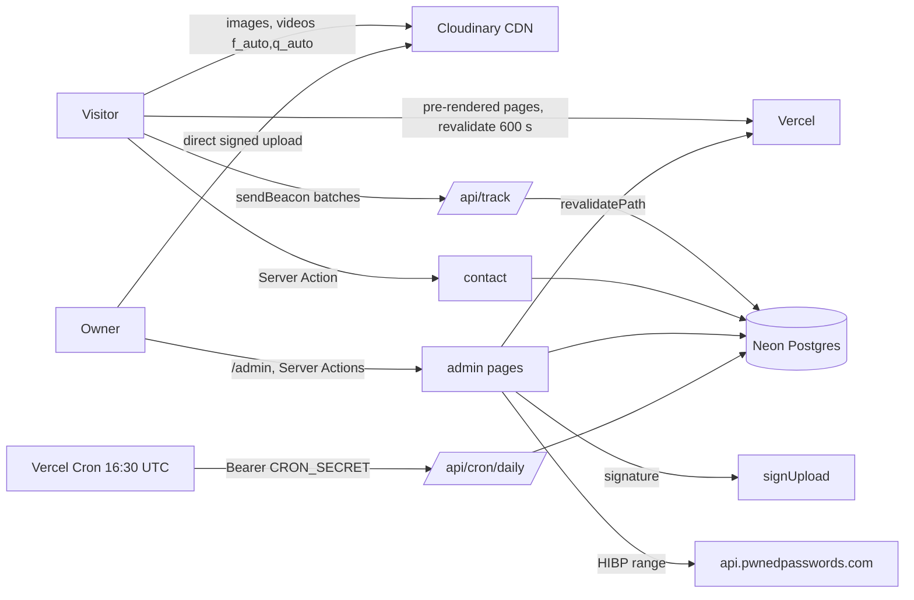
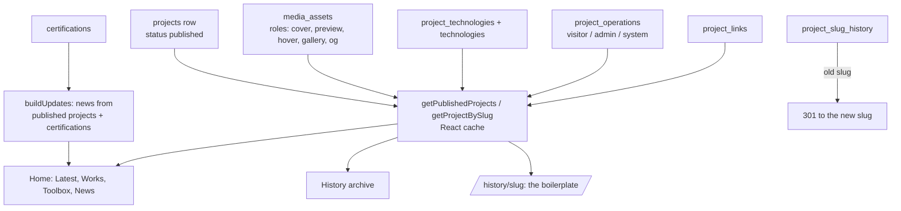
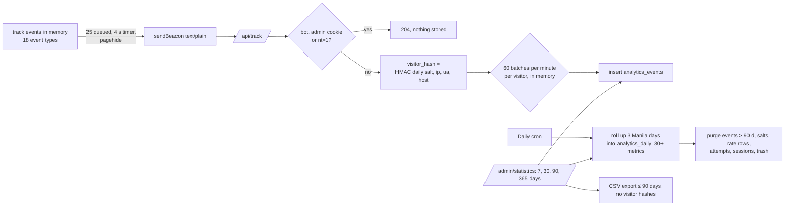
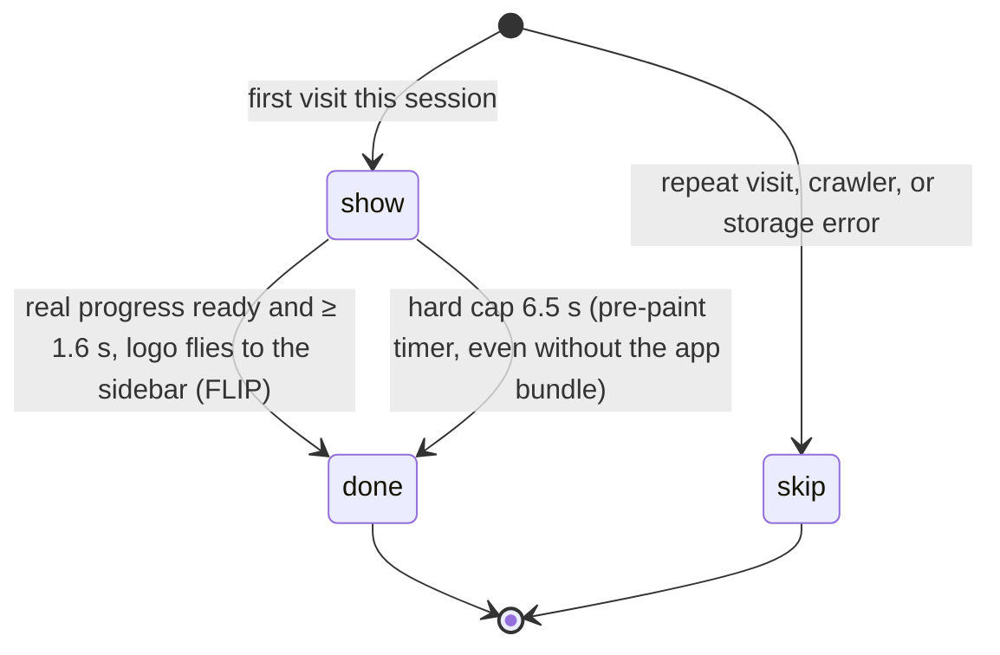

# Moeko Works Portfolio · project file

Full architectural analysis (visual, operation, process, code) of the Moeko Works portfolio, written for Tabane so its reusable parts can become entries. It is a different codebase from the other four (Next.js + React + MUI rather than Astro or plain HTML), so this is a full file. Where an idea matches a Kotoha, Aqua Iro or Himawari piece, the entry links to it. It is also the original of several pieces the later sites copied: the daily-salt counter, the user-agent classifier and the code-drawn flower all say "the portfolio's" in Himawari's code. Every fact below comes from the repository or the live site; the Sources section lists where. Nothing here has been applied to Tabane yet.

| | |
|---|---|
| Name | Moeko Works: Kyle Zoleta's portfolio ("creative websites and the systems behind them"), English only |
| Kind | Own project (Moeko Works) |
| Live site | https://moekoworks.vercel.app/ |
| Repository | [PastelSalt/moekoworks_official](https://github.com/PastelSalt/moekoworks_official) (private) |
| Local folder | `C:\Users\Myaako\Documents\MoekoWorks\moekoworks_official` |
| Read at | commit `eab124f` (`dev`, same as `origin/main`, 2026-10-24), 39 commits, read 2026-10-25 |
| Target | Website (public portfolio + private admin panel at `/admin`) |
| Status on the site | Live since 2026-10-04; renamed from its old brand on 2026-10-20; 5 published projects (Kotoha, Hanon, Moeko Works Portfolio, Himawari, Aqua Iro Archive) and 22 certifications |
| Embeddable | **No.** The site sends `X-Frame-Options: DENY` (and `frame-ancestors 'none'` in its report-only CSP), so Tabane must show screenshots, not a live frame |
| Size | ≈ 13,000 lines of code (TypeScript, TSX, CSS, SQL, scripts) plus ≈ 3,500 lines of docs (a 2,389-line plan, a 735-line playbook, a performance plan, a progress log) |

## Contents

1. [Overview](#1-overview)
2. [Stack](#2-stack)
3. [Architecture](#3-architecture)
4. [Repository structure](#4-repository-structure)
5. [Visual design](#5-visual-design)
6. [How the front end operates](#6-how-the-front-end-operates)
7. [How the back end operates](#7-how-the-back-end-operates)
8. [Data model](#8-data-model)
9. [How it was built (process)](#9-how-it-was-built-process)
10. [Reusable pieces catalogue](#10-reusable-pieces-catalogue)
11. [Gotchas and quirks](#11-gotchas-and-quirks)
12. [Proposed entries](#12-proposed-entries)
13. [Proposed replication guide](#13-proposed-replication-guide)
14. [Proposed new tag values](#14-proposed-new-tag-values)
15. [Open questions](#15-open-questions)
16. [Sources](#16-sources)

---

## 1. Overview

- **What it is:** a portfolio with four public pages (Home, History, About, Contact), a project page template ("the boilerplate"), Privacy, a 404, and an admin panel for projects, certifications, the tech catalog, messages, statistics and activity.
- **Pages:**
  - **Home:** NEWS ticker → key-visual stage → LATEST PROJECT → profile strip → WORKS → TOOLBOX → CERTIFICATIONS → NEWS → contact banner.
  - **History** ("MOEKO WORKS HISTORY"): an archive of every project with a floating hover preview video.
  - **Project page:** key-visual hero with the preview video, INFO table, Overview, What you can do, For admins, Behind the scenes, Built with, Gallery, Access tickets, Credits, Prev/Next.
  - **About:** profile, toolbox, certifications and grade reports. **Contact:** a form with spam scoring.
- **Content comes from the database:** projects, operations, tech, media and certifications are rows in Neon, edited in the admin or seeded by scripts; media lives on Cloudinary.
- **Design idea, "Bloom Expo":** "Miku Expo's structure, Happy Sugar Life's palette and ornaments, and Kotoha's density, all grown from the Moeko Works flowers" (plan §6.1).
- **What it is for (Tabane's view):**
  - the closest stack to Tabane itself (Next.js 16 App Router, React 19, TypeScript, Neon);
  - its project template already splits a project into what visitors do, what admins do and what happens behind the scenes, the same split Tabane uses for entries;
  - it has a written, repeatable pipeline for adding a project (capture, encode, upload, seed).

## 2. Stack

| Layer | What | Tabane tag |
|---|---|---|
| Language | TypeScript 5, TSX, CSS in cascade layers | `typescript`, `css` |
| Framework | Next.js 16.3.8 App Router, React 19.2.8. Classic caching: pages pre-render with `revalidate = 600`, admin saves call `revalidatePath`; Cache Components off. Middleware is `src/proxy.ts` (Next 16's name) | `nextjs`, `react` |
| UI library | MUI 9.4 with Emotion in `@layer mui`, **used only in the admin and the contact form** | `material-ui` |
| Motion | Lenis 1.3 (desktop smooth wheel), canvas-confetti, Web Animations, CSS scroll-driven animations; GSAP + `@gsap/react` installed but unused ("stays installed for later") | `lenis` *(new)*, `canvas-confetti` *(Kotoha)* |
| Icons | Lucide (operation icons, UI), Simple Icons (tech logos, server-side only) | `lucide` *(Kotoha)*, `simple-icons` *(new)* |
| Database | Neon Postgres 17 over HTTP (`drizzle-orm/neon-http`), Drizzle 0.45 + drizzle-kit, one production database | `neon-postgres`, `drizzle` *(Aqua)* |
| Auth | Own code: Argon2id (`@node-rs/argon2`), hashed sessions, lockout, HIBP (Kotoha's rules) | `argon2` *(Kotoha)* |
| Media | Cloudinary: signed direct uploads, two signed presets, eager video derivatives | `cloudinary` *(Kotoha)* |
| Validation | Zod 4 | `zod` *(new)* |
| Fonts | Fredoka 400/700 (text), Lilita One (logo wordmark, giant words, stage pattern), via `next/font` | — |
| Hosting | Vercel, region `sin1`, one cron | `vercel` *(Kotoha)* |
| Tooling | `tsx` CLI scripts (`.mts`), `playwright-core` with the installed Chrome (capture and perf harness), ffmpeg (encode) | `playwright` *(Aqua)* |
| Runtime | Node ≥ 24 | `node-js` |

## 3. Architecture

### 3.1 Level 1 · System



### 3.2 Level 2 · How a project becomes pages



### 3.3 Level 2 · Adding a project (playbook pipeline)

```mermaid
flowchart LR
  I[Intake: facts,<br/>ask Kyle for gaps] --> RS[Research: repo + live site,<br/>verify every fact]
  RS --> CP[Capture: headless Chrome<br/>screenshots + CDP screencast]
  CP --> EN[Encode: ffmpeg preview with end card,<br/>8 s hover loop, WebP stills]
  EN --> AS[Admin shots: site's own server<br/>on an in-memory PGlite copy]
  AS --> UP[Upload: signed requests,<br/>deterministic public IDs]
  UP --> SD[Seed: seed-tech + seed-slug.mts<br/>dry run, then run or --sql]
  SD --> VF[Verify: desktop + phone shots,<br/>lint, typecheck, build]
  VF --> SH[Ship: secret scan, push dev,<br/>checkpoint with Kyle, main]
```



### 3.4 Level 2 · Visit statistics



### 3.5 Level 2 · Splash state machine



## 4. Repository structure

```text
PRELIMENARYPLAN.md       v0.3 plan (2,389 lines): research, brand, IA, design, motion, pages, template, admin, stats, security
CLAUDE.md, AGENTS.md     working notes and the owner's hard rules for Claude sessions
docs/                    PROGRESS.md (status, incident log, decisions), NEW-PROJECT-PLAYBOOK.md, PERFORMANCE_PLAN.md
next.config.ts           security headers, CSP report-only, admin noindex, argon2 as an external package
vercel.json              sin1, daily cron
drizzle/0000_init.sql    the whole schema in one migration
scripts/                 _db.mts, admin-seed, seed-tech, seed-<slug> × 5, rebrand-moekoworks
scripts/capture/         <slug>.mts × 5 (capture), encode*.sh, admin-local.mjs, admin-shots.mjs, uploads-from-db.mts
scripts/perf/            bench.mjs, trace.mjs, idle.mjs (scroll fps, trace decoding, idle CPU)
public/brand/            logo, splash, three flowers, letter pattern, two watercolor washes (SVG)
src/proxy.ts             optimistic cookie gate for /admin
src/app/layout.tsx       fonts, pre-paint script, ThemeRegistry
src/app/(site)/          page (Home), history, history/[slug], about, contact, privacy, error
src/app/admin/           login, change-password, (panel)/{page, projects, projects/[id], certifications, tech, messages,
                         messages/[id], statistics, activity, account}, statistics/export
src/app/api/             track, cron/daily
src/app/                 sitemap, robots, manifest, not-found, OG image, icons
src/components/site/     SiteShell, Sidebar, MobileBar, NavLinks, Splash, SplashController, MotionRoot, MotionToggle,
                         NewsTicker, PageHead, SectionHead, PageTop, Footer, Tracker
src/components/decor/    Decor (Flower, Spark, PatternStage, GiantWord, VerticalText, RotatingBadge, Tape, Sticker, PopText),
                         FlowerFall, Marquee, shapes
src/components/projects/ ProjectCard, LatestProject, PreviewVideo, HoverPreview, Lightbox, Tickets, bits
src/components/admin/    AdminShell, ProjectEditor, Uploader, CertificationManager, TechManager, MessageList, MessageActions,
                         VisitsChart, PasswordForm, LoginForm, CountMyVisits
src/lib/                 site, motion, track, ua, color, cloudinary, confetti, markdown, format, op-icons, tech-icons
src/server/              db (schema, index), auth (session, password, actions), actions/contact, admin (projects, catalog,
                         messages, stats, cloudinary), queries/public
src/theme/ src/styles/   tokens, base, MUI theme; shell, components, home, pages, project, projects, motion
```

## 5. Visual design

### 5.1 Identity: "Bloom Expo" (plan §6.1)

| Signature element | Taken from | In Moeko Works |
|---|---|---|
| Pattern stage | Miku Expo | tone-on-tone "MOEKO WORKS ✿" letter pattern on a blush → ice gradient, ≈ 6% contrast, drifting slowly |
| Watercolor corners | Happy Sugar Life | a pink wash top-left and a blue wash bottom-right on every page (SVG) |
| Giant outlined words | Kotoha / Miku Expo | "MOEKO WORKS", "ABOUT", "HISTORY", "CONTACT" in huge outlined Lilita One, cropped at section edges |
| Tracked titles + long underline | Miku Expo | wide-tracked caps, an underline drawing in from the left, a small page label |
| Micro-labels and data chips | Japanese creative sites | `No.01` · `2026.10.04` · `WEB PLATFORM` · `STATUS ● LIVE` |
| Rotating text badge | HSL / Kotoha | text circling the white flower; doubles as the "VISIT ✿" link on the Latest project |
| Vertical text | HSL | upright stacked capitals in alternating pink and blue |
| Paper and stickers | Kotoha + logo | paper cards with washi tape; die-cut stickers with a dark outline and a **lilac offset shadow** |
| Ribbon banner | Miku Expo tour sites | carries each project's one-sentence description |
| Marquee ribbons | Kotoha | tech and "NEW PROJECT" ribbons that react to scroll speed |
| NEWS ticker + list | HSL / Japanese sites | generated from published projects and certifications |
| PAGE TOP flower | HSL | round pink flower button with a progress ring |
| Sparkles and confetti | Kotoha | desktop cursor sparkles; flower confetti on contact success, admin publish, clicking the logo flowers |

**Guardrails that keep it professional** (plan §6.1): a strict 12-column grid (decoration may break it, content never); every block has a micro-label + title; text always sits on paper or white, never on the pattern; at most 3 moving decorations per viewport, all `aria-hidden`; one accent per block; long descriptions and the admin stay calm; "density comes from information, not noise".

### 5.2 Tokens (`src/theme/tokens.css`)

- **Layer order fixed first:** `@layer reset, tokens, base, mui, components, sections, motion, utilities;` so MUI sits under the site's own components.
- **Registered properties:** `--iris` (length) and `--progress` (number) via `@property`, so they can animate.
- **Scales:** gray 50–500; pastel pink 50–800 (primary `--pink-300 #ffb4e3`, links `--pink-700 #b42a6c`, vivid `--pink-500 #e95399`); pastel blue 50–800 (`--blue-300 #a0cffc`, `--blue-700 #1665ae`); logo accents lilac, violet, rose, butter, peach; state colours with 50-tints.
- **Text:** `--ink #2e2a36`, `--ink-soft #5d5869`, `--ink-muted #77727f` (on white only); `--outline #1e1a24`.
- **Project accent slots:** `--project-accent`, `--project-accent-strong`, `--project-on-accent`, and tints from `color-mix(in oklch, accent 12% / 22%, white)`.
- **Type:** Fredoka for text, Lilita One for the logo font; fluid sizes from `--fs-meta` to `--fs-display` (92 px) and `--fs-giant` (110–300 px); tracking 0.16 em labels, 0.22 em titles.
- **Layout:** 4-px spacing, `--gutter`, `--section-y`, `--sidebar-w: clamp(176px, 14vw, 232px)`, `--content-max: 1200px`.
- **Shape:** chip 12, input 16, card 24, panel 32, pill.
- **Depth, tinted never gray-black:** paper and lift shadows in plum (`rgb(143 31 85 / …)`) and violet; `--shadow-sticker: 4px 5px 0 lilac`; `--outline-sticker: 2.5px solid`.
- **Motion:** one tempo, 120 BPM → `--beat: 500ms`; `--t-tap` 120, `--t-pop` 350, `--t-move` 560, `--t-glide` 820 ms; pop, out, in-out and in easings.
- **Focus:** `--focus-ring`: white 3 px then pink-700 3 px.
- **Measured contrast** in the plan (§6.2): ink on pastel pink 8.59:1 and on pastel blue 8.55:1, so pastel buttons carry ink text; vivid pink and blue are decoration or ≥ 24 px only.

### 5.3 Per-project theming (`src/lib/color.ts`, plan §9.4)

Each project may set an accent (and a second one). On save, the admin computes and stores:

- `strong`: the accent darkened in **OKLCH** until white text on it, and it on white, reach 4.5:1 (links, focus, underlines);
- `on-accent`: ink when ink on the accent reaches 4.5:1, else white;
- **pastelize:** over-saturated accents get their chroma clamped (≤ 0.16, lightness ≥ 0.72) so tints stay pastel.

Tints come from CSS `color-mix()`. `accentVars()` turns a project row into CSS custom properties for its page and card, falling back to Moeko Works pink. All conversions (sRGB ↔ linear ↔ OKLCH, WCAG contrast) are hand-written pure functions.

### 5.4 Shell (`SiteShell`, `Sidebar`, `MobileBar`, `shell.css`)

- **Desktop ≥ 900 px:** a fixed **white sidebar** (Miku Expo) with the logo, nav with sub-captions (the current page on a pink pill), socials, the MOTION toggle and ©.
- **Phones:** a white top bar with the logo and a "MENU" button opening a full-screen sheet.
- **Everywhere:** the splash, falling outline flowers on a fixed layer behind content, the main column, the footer and the PAGE TOP flower.

### 5.5 Admin look

MUI 9 with a theme from the same tokens (`src/theme/theme.ts`), inside `@layer mui`; calm, no decoration.

## 6. How the front end operates

### 6.1 Pre-paint (`src/app/layout.tsx`, `InlineScript.tsx`)

- One inline script decides `html[data-motion]` (`calm` when the visitor turned motion off or the device asks for reduced motion, else `full`) and `html[data-splash]` (`show` on the first visit this session, `skip` for repeat visits and crawlers), adds `.js`, and **arms a 6.5 s timer that ends the splash even if the app bundle never loads**.
- It also migrates the pre-rename storage keys (`ms_*` → `mw_*`) once, so preferences survive the rebrand.
- **`InlineScript`** renders the script as `text/javascript` on the server and `text/plain` on the client, with `suppressHydrationWarning`, so React doesn't warn or run it twice (the Next.js "preventing flash before hydration" pattern).

### 6.2 Splash loader (`Splash.tsx`, `SplashController.tsx`, plan §7.5)

- **Server-rendered inline SVG built from the logo's layers**, so the logo assembles with CSS on the very first paint, before any JavaScript.
- **Real progress:** a quarter each for minimum time (1.6 s), fonts ready, first-screen images complete, and window load; eased toward the target and capped at 96% until ready; shows "LOADING ✿ n %" and a thin bar.
- **Exit:** after ≥ 1.6 s (soft cap 3 s), the logo flies into the sidebar or top-bar logo spot with a **FLIP** Web Animation while the background fades; calm mode just fades. Then `data-splash="done"`, `mw_splash` in sessionStorage, Lenis restarts.
- **Rule:** never animate the sidebar while the splash shows, because the FLIP target must not move.

### 6.3 Motion (`lib/motion.ts`, `MotionRoot.tsx`, `motion.css`, ports of Kotoha's `prefs.js` + `scroll-life.js`)

- **Modes:** `full` or `calm`; the toggle is disabled when the device asks for reduced motion; the choice is stored as `mw_motion`. `saveData()` (Save-Data or 2G) turns off autoplaying video and the petals.
- **Lenis** only on fine pointers in full motion. **Its frame loop runs only while a smooth scroll is in progress** (woken by the wheel or `scrollToY`), not forever. It stops under the splash and skips `dialog` and `[data-lenis-prevent]`.
- **One scroll ticker:** a smoothed velocity (px/ms) published to subscribers (the marquees), running only while scrolling and settling to 0. Nothing per-frame is written on `<html>`.
- **Cursor sparkles:** a pool of 14 SVG nodes reused, at most one every 42 ms, mouse only, off in calm mode and under the splash.
- **Far-section pausing:** sections more than a screen away get `.is-far`, which pauses their animations with `animation-play-state` (so they resume in phase).
- **Marquee:** one compositor Web Animation; scroll speed maps to `updatePlaybackRate` (reverse when scrolling up); paused off screen, when hidden and in calm mode.
- **PAGE TOP ring:** a CSS scroll-driven animation (`scroll(root)`); the button appears via an IntersectionObserver on a sentinel 60 vh down; a JS fallback only without scroll timelines.
- **Falling flowers (`FlowerFall.tsx`):** HTML spans only (outer: fall + sway, inner: spin), outline from one `<symbol>`, compositor-only, paused under the splash; calm mode leaves them scattered and still.
- **Letter pops:** titles split into per-letter spans on the server (`PopText`), animated in CSS; screen readers get the plain text. **Reveals** are CSS scroll-driven animations.

### 6.4 Preview video, one file, three uses (`PreviewVideo.tsx`, `HoverPreview.tsx`, plan §9.6)

- **Hover** in lists (plays while the closest `[data-hover-host]` is hovered or focused, ~480p, starts after scrolling has paused 150 ms), **in view** on the Latest card, and full size in the project hero.
- Muted, looping, poster first, `preload="none"`; calm mode, Save-Data or a hidden tab keep the poster. Reports `video_play` / `video_complete`.
- **History's floating preview:** a muted video follows the cursor over a row with a lerp and a tilt from the horizontal speed (±8°); it also appears beside a row whose link has keyboard focus; desktop pointers only.
- **Cloudinary URLs** mirror the preset's eager transformations exactly (`c_limit,q_auto,vc_h264,w_1280` …) so they hit pre-generated files.

### 6.5 Project page template ("the boilerplate", plan §9)

| # | Section | Shown when |
|---|---|---|
| 1 | Key-visual hero: preview video behind a veil, title, giant outlined word, ribbon with the one-liner, rotating VISIT badge, chips | always |
| 2 | INFO table: Type · Platform · Timeline · Role · Status · Built with | always |
| 3 | No.01 Overview (safe Markdown) | if any |
| 4 | No.02 What you can do (visitor operations) | if any |
| 5 | No.03 For admins (admin operations) | if any |
| 6 | No.04 Behind the scenes (system operations) | if any |
| 7 | No.05 Built with: tech chips by category with usage notes | if any |
| 8 | No.06 Gallery: masonry in device frames (`browser`, `phone`, `tablet`, `window`) + lightbox | if any |
| 9 | Access: tickets with a CTA matrix (Visit website, Download APK, Download for Windows …); **no source-code links, ever** (except owner-approved open source) | if any |
| 10 | Credits and disclaimer | if any |
| 11 | Prev / next + Back to History | always |

- **Operations** are numbered cards (01, 02 …) with a zig-zag image/text rhythm, a Lucide icon, optional media and an anchor.
- **Old slugs** redirect with a 301 (`project_slug_history`).

### 6.6 Other components

- **Lightbox:** native `<dialog>` with `showModal()`; focus trapped, Esc closes, ← / → move.
- **NEWS ticker:** "NEWS" pill + rotating updates; pauses on hover, focus and in calm mode.
- **Markdown:** a small safe subset to React elements (headings, paragraphs, lists, quotes, bold, italic, code, links); no HTML injection because React escapes every text node.
- **Tech logos:** Simple Icons looked up server-side by `icon_key`, so unused icons never reach the browser.
- **Contact form:** MUI `FormLabel` above `OutlinedInput` (floating labels misbehave with React 19 form resets); the signed start-time token is fetched when the visitor starts typing; submitted values come back as `defaultValue` because React 19 resets forms after an action. Copy-e-mail button.

### 6.7 Visit tracker (`lib/track.ts`, `Tracker.tsx`; port of Kotoha's `track.js`)

- **The visit id lives in memory only;** nothing is stored in the browser for tracking.
- 18 event types: page view and dwell, section dwell, loader timing, project view/open/link click, video play/complete, image and certificate opens, outbound clicks, contact start/submit, copy e-mail, motion toggle, filter use, not found.
- Batched; sent at 25 events, after a 4 s timer and on hide (headless Chrome drops unload beacons); `sendBeacon` with `text/plain`, falling back to `fetch` with `keepalive`.
- Context: device class from pointer and screen size, language, referrer host, UTM source/medium/campaign.
- **"Don't count my visits":** a switch on the admin Account page sets `mw_nt`; then nothing leaves the browser.

## 7. How the back end operates

### 7.1 Rendering and caching

- Public pages pre-render with `revalidate = 600` (sitemap 3600); admin saves call `revalidatePath`. React `cache()` dedupes queries per request.
- Server-only modules import `server-only`; CLI scripts share the schema through `scripts/_db.mts`.

### 7.2 Admin auth (`src/server/auth/*`, Kotoha's rules)

- **Owner seeded by a CLI script** (`npm run admin:seed`) from values in `.env.local` only, never in Vercel; `--reset` restores the seed password and forces a change. The first login creates a **restricted session** that can only reach the password change.
- **Sessions:** 32-byte token, SHA-256 stored, `__Host-mw_session` (plain name on localhost), `SameSite=Strict`, 7 days absolute, 24 hours idle, `last_seen_at` touched every 5 minutes; user agent stored; "sign out other browsers".
- **`proxy.ts`** is only an optimistic cookie check; **every admin page and Server Action calls `requireAdmin()`**.
- **Passwords:** Argon2id at OWASP's minimum (19 MiB, t=2, p=1); dummy verify for unknown users; Kotoha's rules with the client mirroring the first four and "guessable" and "leaked" (HIBP range) server-only. Lockout: 10 attempts per hashed IP in 15 minutes, and 5 wrong passwords lock the account for 15 minutes (`login_attempts`, `admin_users.locked_until`); failures go to the activity log.
- IPs are stored only as HMAC with a `HASH_PEPPER`.

### 7.3 Project History editor (`src/server/admin/projects.ts`, `ProjectEditor.tsx`)

- Everything validated on the server with Zod; the editor sends JSON. Fields cover the plan's §11.2: title, slug, tagline, Markdown description, category, platforms, lifecycle, role, dates, credits, accents, status, SEO fields, disclaimer, links, tech with usage notes, operations by audience, media with roles, frames, alt text and captions.
- Saving computes `accent_strong` / `accent_on`; changing a published project's slug writes `project_slug_history`; publishing sets `published_at` once; archive instead of delete; every change goes to `activity_log`.
- **Signed direct uploads:** the server signs (`signUpload(kind, scope)`), the browser uploads straight to Cloudinary, the API secret never leaves the server; deleting media also destroys the Cloudinary file.

### 7.4 Contact messages (`src/server/actions/contact.ts`, `src/server/admin/messages.ts`)

- **Spam handling without a CAPTCHA:**
  - honeypot field `website`: pretend success, store nothing;
  - **signed start time** (HMAC of a timestamp issued when typing starts): under 3 s is rejected with a friendly message; a missing token (no JavaScript) is still accepted but scores +2; a bad signature +4; older than a day +1;
  - more than 3 links +3; spam words +2; shouting +1;
  - **score ≥ 5 lands in Spam instead of being rejected;**
  - 5 messages an hour per hashed IP (fixed-window upsert in `rate_limits`).
- Stores device, browser, country and referrer host with each message.
- **Inbox:** folders (unread, read, archived, spam, trash), star, search, bulk actions, detail, reply by e-mail; messages are plain text (no auto-linking).

### 7.5 Statistics (`/api/track`, `/api/cron/daily`, `src/server/admin/stats.ts`)

- **Ingestion:** body ≤ 16 KB, Zod-validated batch of ≤ 50 events. Not counted: bots, **any request carrying the admin session cookie**, and opted-out visitors. Visitor hash = HMAC(daily salt, IP|UA|host); the salt is created on first use and cached per instance. Soft per-instance rate limit of 60 batches a minute per visitor (no database write per request). Environment (production, preview, development) stored, so only production counts.
- **Daily cron** (16:30 UTC = 00:30 Manila, `maxDuration` 60): rolls one Manila day at a time into `analytics_daily (day, metric, dimension, value)`, idempotently, with 30+ metrics in one SQL statement: visits, uniques, visit and page dwell, loader timing, page views, section reach and dwell, project views, link clicks, video plays and completes, image and certificate opens, outbound clicks, sources, campaigns, countries, devices, browsers, OS, languages, hours, motion-off visits, 404 paths, and the contact funnel (visits → starts → submits). Then purges old rows.
- **Dashboard:** ranges 7, 30, 90 days from raw events and 365 days from the daily table; Manila days, weeks from Monday; custom SVG/CSS bars (no chart library); Kotoha's KPIs plus the portfolio's additions (plan §12). **CSV export** of raw events for ≤ 90 days, without visitor hashes.

### 7.6 Certifications, tech catalog, activity

- Certifications: title, date, image (Cloudinary), status; grade reports are titled `Grades: AY …, n Term · GWA x.xx`, and About explains NU's 4.00-is-highest scale.
- Tech catalog: slug, name, category, Simple Icons key, colour, URL; the About toolbox shows every technology with how many published projects use it.
- Activity log: actor, action, entity, summary, meta.

### 7.7 Security and delivery (`next.config.ts`)

- HSTS, `nosniff`, `X-Frame-Options: DENY`, strict-origin referrer, Permissions-Policy, `poweredByHeader: false`.
- **CSP is report-only** (shipped that way first, plan §14.6), with `script-src 'self' 'unsafe-inline'` (Next inline scripts), images and media from Cloudinary, `frame-ancestors 'none'`. Enforcing it is still open in P9.
- `/admin` gets `X-Robots-Tag: noindex, nofollow`, no links to it anywhere, not in the sitemap or robots.txt.
- SEO: sitemap, robots, manifest, OG image, JSON-LD tying "Moeko Works" and "Kyle Zoleta" together, Search Console verification file.

## 8. Data model

From `src/server/db/schema.ts` and `drizzle/0000_init.sql` (one migration). Constraints are SQL `CHECK`s, not enums.

| Table | Holds | Notes |
|---|---|---|
| `admin_users` | username (`^[a-z0-9_.-]{3,40}$`), password hash, must-change, password changed at, failed count, locked until, last login | one owner |
| `admin_sessions` | user, token hash, **restricted**, created, last seen, expires, revoked, user agent | |
| `login_attempts`, `rate_limits` | hashed IP attempts; generic (bucket, key hash, window start, hits) | |
| `activity_log` | actor, action, entity type/id, summary, meta | |
| `technologies` | slug, name, category, icon key, colour, URL | catalog |
| `projects` | slug (`^[a-z0-9]+(-[a-z0-9]+)*$`, ≤ 60), title (1–80), tagline (10–160), Markdown description, category (web, mobile, desktop, game, tool, research, concept, other), platforms, lifecycle, role, start/finish dates, credits, accent ×2 + strong + on, status (draft, published, archived), SEO title/description, disclaimer, published at | |
| `project_slug_history` | old slug → project | 301s |
| `media_assets` | project, kind (image, video), role (cover, preview, hover, gallery, og …), Cloudinary public id, version, format, size, duration, **frame** (auto, browser, phone, tablet, window, none), alt text, caption, dominant colour, order | roles instead of columns on `projects`, so there are no circular foreign keys |
| `project_links` | kind, label, URL (`^https://`), note, is primary, order | CTA matrix |
| `project_technologies` | project, technology, usage note, order | |
| `project_operations` | project, **audience (visitor, admin, system)**, title (≤ 80), Markdown body, Lucide icon, media, order | the three operation sections |
| `certifications` | title, obtained on, media, status | |
| `contact_messages` | name, e-mail, subject, body (length checks), status (unread, read, archived, spam, trash), starred, read/replied/trashed at, page, referrer, country, device, browser, spam score | |
| `analytics_events` | event type, visit id, visitor hash, path, section, duration, content type/id, target, device, browser, OS, language, country, referrer, UTM ×3, environment | 90 days |
| `analytics_daily` | day, metric, dimension, value | long-term |
| `analytics_salts` | day, salt (bytea) | `bytea` as a custom type that round-trips as hex text through both Neon drivers |

## 9. How it was built (process)

### 9.1 Timeline (39 commits, 2026-10-04 → 2026-10-24)

| Date | What |
|---|---|
| 10-04 | In one day: foundation (Next 16, tokens, schema, auth), shell and pages (Bloom Expo, splash, motion), Kotoha seed with the capture pipeline, messages, statistics, admin inputs, share image and JSON-LD, design checkpoint approved, live; `NEW-PROJECT-PLAYBOOK.md` written |
| 10-11 | Hanon added; Kotoha seed refreshed; admin shots from a local in-memory copy; falling outline flowers |
| 10-14 | Performance plan and harness, then the pass: Home 30 → 54 fps, project pages 22 → 60, idle CPU −50 to −90%; the portfolio added as its own project |
| 10-20 | **Emergency rebrand** to Moeko Works (the old name belonged to an established company), with a cleanup across the database, Cloudinary, Vercel, Neon and docs; SEO tie-in |
| 10-21 | Tightly cropped transparent logo PNG |
| 10-23 | Himawari added (project 11); certifications and grade reports (22 published) |
| 10-24 | Aqua Iro Archive added (project 12) |

### 9.2 Working method seen in the repo

- **A very long plan first** (v0.3, approved 2026-10-04): research of the local machine, the logo, Kotoha, references; goals, audience, scope; brand and voice; IA; design and motion; page specs; the template with "torture tests"; admin, statistics, messages, security; decisions and open questions with recommendations.
- **A resume protocol** (`PROGRESS.md`): read this file and CLAUDE.md, check the real state with git, continue from "Current focus", update after every item.
- **The owner's hard rules in CLAUDE.md:** no credentials in tracked files; secret scan before every commit; design branches merge into `main` only with the owner's OK; archive, never hard-delete; one production database, restore point before every schema change; never link source code, no codenames, no photo, no handle; English only, no sound, only real verified data; ask before downloads or production writes; questions come with a recommendation and a confidence level.
- **An incident log** for the rebrand, written as what happened, what was done, how it was verified, and what is still open.
- **A playbook for repeat work** so later sessions can add a project the same way, with its scripts recreated in the playbook because the scratchpad gets wiped.
- **Performance work as a plan with measurements**, decoded Chrome traces and a "surprising causes" list.

### 9.3 Operations

- Work on `dev`; pushing `main` deploys production.
- Seeds can run directly or produce SQL for the Neon MCP (`seed:<slug> -- --sql`) when the local connection string is stale.
- Production smoke check (playbook §11.8): endpoints without recording anything (`nt=1` → 204, bad body → 400, cron without secret → 401). Confirmed live on 2026-10-25: `nt=1` → 204, cron → 401.

## 10. Reusable pieces catalogue

Reusability: **High** = lift with little change · **Medium** = needs rebranding or untangling · **Low** = specific to the portfolio.

### 10.1 UI/UX pieces

| # | Piece | Files | What it gives a new project | Reuse | What to change when lifting |
|---|---|---|---|---|---|
| M-U1 | Bloom Expo design system | `tokens.css`, `components.css`, `Decor.tsx`, plan §6 | a dense Japanese-expo look with guardrails: pattern stage, washes, giant words, micro-labels, stickers, tape, badge, vertical text, tinted shadows, layer order with MUI underneath | High | palette, wordmark, pattern |
| M-U2 | Per-project accent theming | `lib/color.ts`, `project.css` | any accent becomes a safe palette: OKLCH-darkened strong colour at 4.5:1, ink-or-white on-accent, chroma clamp, `color-mix()` tints | High | defaults |
| M-U3 | Project page template | `history/[slug]/page.tsx`, `project.css`, `Tickets.tsx`, `bits.tsx` | a data-driven case-study page: hero video, info table, operations by audience, tech, framed gallery, CTA tickets, empty-state rules | High | sections, CTA kinds |
| M-U4 | Splash with real progress and FLIP exit | `Splash.tsx`, `SplashController.tsx`, pre-paint script | a logo that assembles before JS, weighted real progress, a fly-to-sidebar exit, once per session, crawler skip, a 6.5 s hard cap | High | logo layers |
| M-U5 | Expo shell: white sidebar + MENU sheet | `SiteShell`, `Sidebar`, `MobileBar`, `NavLinks`, `shell.css` | Miku Expo navigation with sub-captions, socials and a motion toggle; full-screen sheet on phones | High | links |
| M-U6 | One preview video, three uses + floating hover preview | `PreviewVideo.tsx`, `HoverPreview.tsx`, `lib/cloudinary.ts` | hover, in-view and hero playback of one file, poster-first, Save-Data aware, scroll-pause gate; a cursor-following preview with keyboard support | High | sizes |
| M-U7 | Motion root with a performance budget | `MotionRoot.tsx`, `lib/motion.ts`, `motion.css`, `Marquee.tsx`, `PageTop.tsx`, `FlowerFall.tsx` | Lenis that sleeps, one velocity ticker, compositor marquee with playback rate, CSS scroll-driven ring, far-section pausing, sparkle pool, falling flowers on HTML spans | High | decorations |
| M-U8 | Server-split letter pops | `PopText` in `Decor.tsx`, `SectionHead.tsx` | per-letter animation without SplitText, accessible text | High | — |
| M-U9 | Auto news from content | `buildUpdates()` in `queries/public.ts`, `NewsTicker.tsx` | a NEWS ticker and list generated from published projects and certifications, no news table | High | sources |
| M-U10 | Native dialog lightbox | `Lightbox.tsx` | `showModal()`, focus trap, Esc, arrows | High | — |
| M-U11 | Safe Markdown subset | `lib/markdown.tsx` | Markdown → React elements without HTML injection | High | blocks allowed |
| M-U12 | Server-side brand icons | `lib/tech-icons.ts`, `lib/op-icons.ts` | Simple Icons and Lucide picked by key on the server, so only used icons ship | High | lists |
| M-U13 | Admin panel UI (MUI) | `components/admin/*`, `app/admin/*`, `theme/*` | project editor with uploads, certifications, tech catalog, inbox, statistics with SVG bars and CSV, activity, account with "don't count my visits" | Medium | sections |

### 10.2 Backend pieces

| # | Piece | Files | What it gives a new project | Reuse | What to change when lifting |
|---|---|---|---|---|---|
| M-B1 | Event analytics with daily salt and wide rollups | `lib/track.ts`, `api/track/route.ts`, `api/cron/daily/route.ts`, `server/admin/stats.ts` | in-memory visit ids, 18 event types, batched beacons, admin-cookie and opt-out exclusion, one-statement rollup of 30+ metrics into a metric/dimension table, CSV export | High | event list |
| M-B2 | CLI-seeded owner with a restricted first session | `scripts/admin-seed.mts`, `server/auth/session.ts`, `actions.ts` | credentials never in Vercel or git; first login can only change the password | High | — |
| M-B3 | Sessions, lockout, password rules | `server/auth/*` | Kotoha's design in Next.js Server Actions, with `requireAdmin()` everywhere and an optimistic `proxy.ts` | High | — |
| M-B4 | CAPTCHA-free contact spam scoring | `server/actions/contact.ts`, `ContactForm.tsx` | honeypot, signed start time, link/word/shouting scores, Spam folder instead of rejection, hourly limit, no-JS still works | High | weights |
| M-B5 | Database content with slug history | `schema.ts` (`projects`, `project_slug_history`), `projects.ts`, `getMovedSlug` | renames keep old links alive with a 301 | High | — |
| M-B6 | Media roles and frames | `media_assets` table, `bits.tsx` | one media table with roles (cover, preview, hover, gallery, og) and device frames, avoiding circular keys | High | roles |
| M-B7 | Signed Cloudinary uploads (Next.js) | `server/admin/cloudinary.ts`, `Uploader.tsx` | browser-direct signed uploads and destroy on delete | High | presets |
| M-B8 | Project capture pipeline | `scripts/capture/*`, `docs/NEW-PROJECT-PLAYBOOK.md` | headless-Chrome screenshots and CDP screencast, ffmpeg preview with end card and hover loop, admin shots from the site's own server on in-memory PGlite, signed uploads with deterministic IDs, template seed scripts | High | per site |
| M-B9 | Performance harness and Chrome lessons | `scripts/perf/*`, `docs/PERFORMANCE_PLAN.md` | scroll fps bench, trace decoder (composite-failure bitmask), idle CPU; the list of causes in G1–G4 | High | pages |
| M-B10 | Rebrand script | `scripts/rebrand-moekoworks.mts` | rewrite a name across every text column, with slug history and a dry run by default | Medium | names |
| M-B11 | `bytea` custom type for both Neon drivers | `schema.ts` | binary columns that round-trip the same over HTTP and TCP | High | — |

## 11. Gotchas and quirks

| # | Gotcha | Detail |
|---|---|---|
| G1 | MUI `CssBaseline`'s `box-sizing: inherit` restarted compositor animations every frame | about 26 times per frame; idle style work 470 → 0.3 ms/s after overriding it with `border-box` |
| G2 | Chrome won't composite individual transforms on SVG elements, nor additive animations | falling flowers moved to HTML spans; decode `compositeFailed` codes from the trace |
| G3 | Any always-running `requestAnimationFrame` loop makes Chrome re-sample every CSS animation | 70–150 ms/s of idle style work; Lenis and the marquee now sleep when nothing moves |
| G4 | Writing a custom property on `<html>` per frame | `--lean` was ~70% of scroll style work (known from Kotoha) |
| G5 | Headless Chrome drops unload beacons | the tracker also flushes on a 4 s timer |
| G6 | React dev StrictMode runs effects twice | don't "arm" nodes with a marker class; dedupe page views |
| G7 | React 19 resets uncontrolled forms after an action | return the submitted values and use them as `defaultValue` |
| G8 | MUI 9 changes | `slotProps.htmlInput`, `slotProps.primary`, `sx` not Typography system props; floating labels misbehave with React 19 resets |
| G9 | Typed routes and `next dev` | `tsc` needs `next typegen` after new routes; while dev runs, its route types only list compiled routes; a dev server serving 404 for real routes is stale state: restart it |
| G10 | Inline pre-paint script in React | render as `text/plain` on the client with `suppressHydrationWarning` |
| G11 | Splash and FLIP | never animate the sidebar while the splash shows; the target must not move |
| G12 | CSS scroll-driven reveals look "missing" in full-page screenshots | expected; not a bug |
| G13 | The old brand name belonged to an established company | full rebrand, storage keys migrated once in the pre-paint script, old domain left to 404 |
| G14 | Neon roles can't be renamed or re-owned | the role keeps the old name inside the private connection string |
| G15 | A stale local connection string | seeds can emit SQL for the Neon MCP instead (`-- --sql`) |
| G16 | CSP is still report-only | `script-src 'unsafe-inline'`; enforcing it is open (question M4) |
| G17 | Heavy HTML | Home is ≈ 540 KB of HTML and the Kotoha project page ≈ 475 KB (live, 2026-10-25) |
| G18 | GSAP is installed but unused | "stays installed for later" (PROGRESS decisions) |
| G19 | The scratchpad gets wiped between sessions | anything reusable lives in the repo or the playbook (the logo and pattern generator scripts were lost) |
| G20 | `import.meta.main` isn't in `@types/node` 20 | scripts use `process.argv[1]?.endsWith("<file>.mts")` |

## 12. Proposed entries

All own-project entries start as **Proven** (live site), **Shared off**, Target **Website**, `projectFile: moekoworks-official`, Used in: Moeko Works Portfolio. Live site: https://moekoworks.vercel.app/ with **Embeddable: false**. Code location ref: `eab124f`. Slugs use the `moekoworks-` prefix.

**This is the original of some Himawari pieces:** `himawari-daily-salt-counter` and the user-agent classifier came from here. Proposed: the portfolio's analytics is its own entry (event-based, much wider), and Himawari's entry links to it as its source (question M2).

### 12.1 UI/UX entries

| Slug | Title | Pieces | Stack | Feature | Related |
|---|---|---|---|---|---|
| `moekoworks-bloom-expo-design-system` | Moeko Works · Bloom Expo design system | M-U1, M-U8 | css, nextjs | design-system *(Kotoha)*, layout | `kotoha-scrapbook-design-system`, `aqua-harbour-design-system`, `himawari-sticker-design-system` |
| `moekoworks-accent-theming` | Moeko Works · Per-project accent theming (OKLCH) | M-U2 | typescript, css | design-system | `moekoworks-project-template` |
| `moekoworks-project-template` | Moeko Works · Project case-study template | M-U3, M-U11 | nextjs, react | cards, gallery | `moekoworks-preview-video`, `moekoworks-media-roles` |
| `moekoworks-splash-flip` | Moeko Works · Splash with real progress and FLIP exit | M-U4 | nextjs, typescript | loader *(Kotoha)* | `kotoha-clover-loader`, `aqua-splash-title-screen` |
| `moekoworks-expo-shell` | Moeko Works · White sidebar and MENU sheet | M-U5 | nextjs, css | navigation *(Kotoha)* | `himawari-nav-panels`, `aqua-bottom-dock` |
| `moekoworks-preview-video` | Moeko Works · One preview video, three uses | M-U6 | react, cloudinary | video *(Kotoha)* | `kotoha-youtube-polaroid` |
| `moekoworks-motion-root` | Moeko Works · Motion root with a performance budget | M-U7 | react, lenis, css | motion *(Kotoha)*, performance *(Aqua)* | `kotoha-scroll-life`, `aqua-motion-budget` |
| `moekoworks-auto-news` | Moeko Works · News generated from content | M-U9 | nextjs | timeline | `himawari-db-news-static` |
| `moekoworks-dialog-lightbox` | Moeko Works · Native dialog lightbox | M-U10 | react | gallery | `aqua-dialog-lightbox`, `kotoha-masonry-lightbox` |
| `moekoworks-admin-panel` | Moeko Works · Admin panel (MUI) | M-U12, M-U13 | material-ui, nextjs | admin-panel, dashboard | `kotoha-admin-panel`, `himawari-scriptless-admin` |

### 12.2 Backend entries

| Slug | Title | Pieces | Stack | Feature | Related |
|---|---|---|---|---|---|
| `moekoworks-event-analytics` | Moeko Works · Event analytics with wide daily rollups | M-B1 | nextjs, neon-postgres, drizzle | statistics | `kotoha-cookieless-analytics`, `himawari-daily-salt-counter` |
| `moekoworks-admin-auth` | Moeko Works · CLI-seeded owner, sessions and lockout | M-B2, M-B3 | nextjs, argon2, drizzle | auth | `kotoha-admin-auth`, `himawari-admin-auth` |
| `moekoworks-contact-spam-scoring` | Moeko Works · CAPTCHA-free contact spam scoring | M-B4 | nextjs, zod | forms, moderation *(Aqua)* | `aqua-posting-pipeline` |
| `moekoworks-media-roles` | Moeko Works · Media roles, frames and slug history | M-B5, M-B6, M-B11 | drizzle, neon-postgres | database *(Kotoha)* | `moekoworks-project-template` |
| `moekoworks-signed-uploads` | Moeko Works · Signed Cloudinary uploads in Next.js | M-B7 | nextjs, cloudinary | uploads *(Kotoha)* | `kotoha-cloudinary-uploads` |
| `moekoworks-capture-pipeline` | Moeko Works · Project capture pipeline | M-B8 | playwright, typescript | image-pipeline *(Kotoha)*, video | `hanon-pglite-preview` |
| `moekoworks-perf-harness` | Moeko Works · Performance harness and Chrome lessons | M-B9 | playwright | performance, testing *(Hanon)* | `hanon-cdp-test-harness` |
| `moekoworks-rebrand-script` | Moeko Works · Database-wide rebrand script | M-B10 | typescript, drizzle | database | — |

**18 entries** in total (10 UI/UX, 8 Backend). Not proposed as entries: the portfolio's own content (projects, certifications, profile), the brand assets, and the incident write-up (it goes into the replication guide's notes instead).

### 12.3 Key code candidates

| Entry | Excerpt |
|---|---|
| `moekoworks-accent-theming` | `strongOf`, `onAccentOf`, `pastelize` (`lib/color.ts`) |
| `moekoworks-splash-flip` | `progress()` and `leave()` (`SplashController.tsx`) and the pre-paint script (`layout.tsx`) |
| `moekoworks-motion-root` | the sleeping Lenis loop (`MotionRoot.tsx`) |
| `moekoworks-preview-video` | the hover/in-view effect (`PreviewVideo.tsx`) |
| `moekoworks-auto-news` | `buildUpdates()` (`queries/public.ts`) |
| `moekoworks-event-analytics` | `track()` + `flush()` (`lib/track.ts`) and part of the rollup SQL (`cron/daily/route.ts`) |
| `moekoworks-admin-auth` | `getSession` + `requireAdmin` (`session.ts`) and `proxy.ts` |
| `moekoworks-contact-spam-scoring` | `checkToken` and the score (`contact.ts`) |
| `moekoworks-media-roles` | the `bytea` custom type and `media_assets` (`schema.ts`) |
| `moekoworks-capture-pipeline` | the playbook's TL;DR table and one capture script header |

---

## 13. Proposed replication guide

`replicate-moekoworks-portfolio` · Replication guide · Draft · Website. Based on the plan, `PROGRESS.md` and the commit history.

| # | Step | From |
|---|---|---|
| 1 | Write the plan (research, references and what to take from each, IA, design guardrails, motion moments, template, admin, statistics, security) and CLAUDE.md with the owner's hard rules; a resume protocol in PROGRESS.md | 9.2 |
| 2 | Accounts: Neon, Cloudinary (folders, signed presets), Vercel project; `.env.example` | 2 |
| 3 | Next.js 16 app: tokens with layer order, base CSS, MUI in `@layer mui` with the `box-sizing` override, fonts, security headers with CSP report-only | M-U1, G1 |
| 4 | Schema in one migration; CLI owner seed; sessions, lockout, password rules, `requireAdmin`, `proxy.ts` | M-B2, M-B3, 8 |
| 5 | Shell, splash, motion root, decorations | M-U4, M-U5, M-U7, M-U8 |
| 6 | Admin inputs: project editor with signed uploads, accents, slug history; certifications; tech catalog; activity | M-U13, M-B5–M-B7, M-U2 |
| 7 | Public pages: Home, History, About, Contact, project template, Privacy, 404, sitemap, robots, manifest, OG, JSON-LD | M-U3, M-U6, M-U9–M-U12 |
| 8 | Statistics: tracker, ingestion, daily rollup, dashboard, CSV, opt-out | M-B1 |
| 9 | Messages: contact spam scoring and the inbox | M-B4 |
| 10 | First project through the capture pipeline; write the playbook while doing it | M-B8 |
| 11 | Design checkpoint with the owner; go live from `main` | 9.1 |
| 12 | Performance pass with the harness, before adding more decoration | M-B9, G1–G4 |
| 13 | Quality pass: Lighthouse, accessibility, enforce the CSP, cross-browser (still open here) | G16 |

Gotchas for the guide: G1–G20. Finished looks like: a project added through the playbook appears on Home, History and its own page with its preview video and accent; the owner signs in, edits and publishes; statistics show the first production visits; a test message lands in the inbox.

---

## 14. Proposed new tag values

To add to `tags.yml` when this file is applied. Values already proposed by the other project files are not repeated. `nextjs`, `react` and `material-ui` are already in the spec's starting list.

| Tag | Value | Label | Used by |
|---|---|---|---|
| Stack | `lenis` | Lenis | motion root |
| Stack | `simple-icons` | Simple Icons | tech logos |
| Stack | `zod` | Zod | validation in auth, contact, tracker |

---

## 15. Open questions

For Kyle to answer before this file is applied (also in `OPEN-QUESTIONS.md`):

1. **Hard rule 6 in Tabane:** the portfolio never links source code, codenames, a photo or your handle. Tabane is private, but should entries from this file still leave out the repository link and anything rule 6 covers, in case an entry is ever Shared?
2. **Analytics lineage:** keep the portfolio's analytics as its own entry with Himawari's counter linking to it as a smaller copy (proposed), or one entry "cookieless analytics" with Kotoha, the portfolio and Himawari under Used in?
3. **The rebrand:** the incident write-up and the rebrand script are good lessons. Keep the script as an entry (proposed) and the incident only as notes in the guide, or also make a "renaming a live project" playbook?
4. **CSP:** it is still report-only with `'unsafe-inline'`. Record it as is (proposed), or is enforcing it planned soon, so the entry should wait?
5. **GSAP:** installed but unused. Leave it out of the Stack (proposed)?
6. **Shared:** every entry starts with Shared off. Are any safe to show visitors (for example the accent theming or the capture pipeline)?
7. **Replication guide order:** is the order in section 13 how you would rebuild it?
8. **New tag values:** add all 3 in section 14?

---

## 16. Sources

All in the `moekoworks_official` repository at `eab124f`, unless marked live. `.env.local` was not read.

| Area | Files read |
|---|---|
| Project docs | `README.md`, `CLAUDE.md`, `AGENTS.md`, `docs/PROGRESS.md` (full), `PRELIMENARYPLAN.md` (headings, §6.1–6.2, §7.4–7.6, §9.2–9.9), `docs/NEW-PROJECT-PLAYBOOK.md` (headings, §0, §6.0, §14), `docs/PERFORMANCE_PLAN.md` (headings, §7.1–7.2) |
| Config | `package.json`, `next.config.ts`, `vercel.json`, `.env.example` |
| App | `src/app/layout.tsx`; the route list; Home section heads; `revalidate` values |
| Components | `InlineScript.tsx`, `MotionRoot.tsx`, `SplashController.tsx` (full); `HoverPreview.tsx`, `PreviewVideo.tsx` (heads); header comments of every component in `site/`, `decor/`, `projects/`, `admin/` |
| Libraries | `lib/motion.ts`, `track.ts`, `color.ts` (full); header comments of the rest |
| Server | `src/proxy.ts`, `server/auth/session.ts`, `server/actions/contact.ts`, `app/api/track/route.ts` (full); `server/db/schema.ts` (tables, columns, checks, `bytea` type); function lists of `queries/public.ts`, `admin/projects.ts`, `admin/stats.ts`, `admin/cloudinary.ts`, `auth/actions.ts`, `auth/password.ts`; `buildUpdates` and `buildToolbox`; the rollup in `api/cron/daily/route.ts` |
| Styles | `src/theme/tokens.css` (full); header comments of every stylesheet |
| Scripts | `scripts/capture/` list and `aqua.mts` header; `scripts/perf/` list |
| History | `git log` (39 commits, 2026-10-04 → 2026-10-24); branches (`dev` = `origin/main`) |
| Live (2026-10-25) | `/`, `/history`, `/about`, `/contact`, `/history/kotoha-fansite`, `/privacy` (all 200, sizes noted); headers (`X-Frame-Options: DENY`, CSP report-only); `/admin` (307 to login, noindex); `/api/track` with `nt=1` (204); `/api/cron/daily` (401); the five published project slugs |
